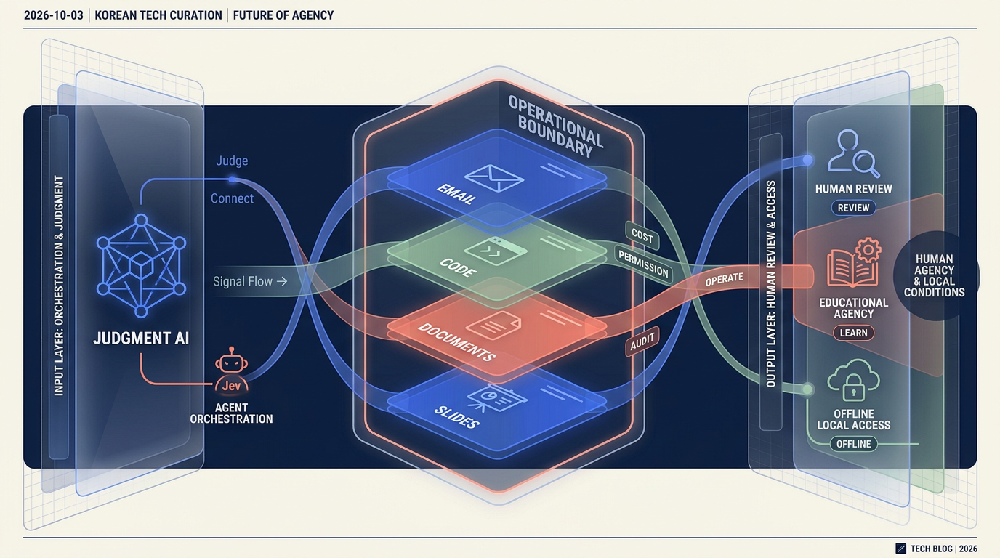

# 2026-10-03 · AI는 기능보다 경계 설계가 중요해진다 · 릴리스 39건

<section class="release-infographic">
  <figure class="release-infographic__figure">
    
    <figcaption>이번 39선은 AI 기능을 더하는 목록이 아니라, 판단·운영·작업면·사용 조건이 서로 다른 층위에서 연결되는 구조로 다시 읽었다.</figcaption>
  </figure>
  

    
Boundary Design · Release 39

    
이번 이미지는 중앙 허브나 순환 루프 대신, 왼쪽의 판단·연결 신호가 여러 층의 운영 경계를 거쳐 오른쪽의 사람·교육·오프라인 조건으로 정리되는 단면형 구조를 택했다. AI를 어디에 붙일지보다 어디에서 멈추고 누가 확인할지를 함께 보여주는 구성이다.

    <ul class="release-infographic__points">
      <li><strong>JUDGE &amp; CONNECT</strong> Jev의 분류·점수화와 MCP·의미 검색이 입력을 구조화한다.</li>
      <li><strong>OPERATE</strong> 에이전트의 역할·예산·권한·게이트웨이가 자동화의 경계를 만든다.</li>
      <li><strong>WORK SURFACES</strong> 메일·코드·문서·슬라이드·영상이 실제 결과물이 나오는 작업면이 된다.</li>
      <li><strong>HUMAN CONDITIONS</strong> 교육의 행위자성, 접근성, 사람의 승인, 오프라인 지식이 마지막 기준을 남긴다.</li>
    </ul>
  

</section>

## 먼저 결론

- 이번 39건의 핵심은 새로운 기능을 더 많이 붙이는 일이 아니라, **AI가 판단하고 실행하는 범위와 사람이 확인할 경계를 함께 설계하는 일**입니다.
- Jev 같은 판단형 AI는 분류·점수화·라우팅처럼 기준을 정할 수 있는 업무에 어울리고, LLM은 그 결과를 설명하거나 콘텐츠로 바꾸는 쪽에서 역할이 선명해집니다.
- 에이전트가 메일·코드·문서·슬라이드까지 직접 만지기 시작할수록 역할, 예산, 권한, 승인, 감사 기록이 모델 성능만큼 중요해집니다.
- 교육 자료와 Project NOMAD는 자동화의 반대편이 아니라, AI를 누구의 목적과 어떤 접근 조건 아래 사용할지 결정하는 바닥입니다.

## 이번 묶음을 읽는 방법

이번 자료는 도구 이름을 외우는 목록보다 **판단 → 운영 경계 → 작업면 → 사용 조건**의 순서로 읽는 편이 좋습니다. 먼저 반복 업무를 빠르게 분류할 수 있는지 살펴보고, 그 판단을 어떤 에이전트와 도구에 연결할지 정한 다음, 실제 파일과 결과물이 나오는 작업면으로 옮겨 보세요. 마지막에는 사람의 승인, 교육 목적, 접근성, 오프라인 실행 조건을 확인해야 합니다.

## 큰 흐름

최근 AI 자료에서 가장 눈에 띄는 변화는 답변 생성의 품질 경쟁이 **업무를 어디까지 맡길 수 있는가**라는 운영 문제로 이동했다는 점입니다. Jev 관련 자료는 생성 전에 판단을 분리할 수 있음을 보여주고, Paperclip·Buzz·herdr·Dryforge·Gajae Way는 에이전트가 실제로 움직일 때 필요한 역할·비용·권한 경계를 다룹니다. Univer·Open-slide·HWPX·Translight·EasyCut은 그 에이전트가 들어갈 작업면을 넓힙니다.

그 바깥에는 UNESCO 교육 자료와 Project NOMAD가 있습니다. 하나는 인간의 행위자성과 교육의 공공성을, 다른 하나는 인터넷 연결이 끊긴 상황에서도 지식을 사용할 수 있는 조건을 묻습니다. 결국 이번 39선은 “무엇을 자동화할까?”에서 멈추지 않고 “누가 목적을 정하고, 어디서 멈추며, 어떤 조건에서 계속 쓸 수 있을까?”로 질문을 밀어붙입니다.

## 주제별 학습 노트

### 에이전트 운영과 개발 자동화

에이전트가 늘어날수록 모델 자체보다 운영 계층이 또렷해집니다. 목표와 역할을 배정하고, 비용과 접근 권한을 관리하고, 터미널·원격 PC·게이트웨이를 연결하고, 필요할 때 사람의 승인을 받는 구조가 실제 도입의 전제가 됩니다. 이번 묶음에서는 “자율성”을 크게 말하는 자료보다 **자율성이 작동할 조건을 설계하는 자료**를 먼저 볼 만합니다.

### MCP·개발 도구와 지식 탐색

메일 계정, 코드베이스, 문서 저장소를 AI에 연결하는 일은 편리한 플러그인 하나를 추가하는 것보다 범위가 큽니다. 어떤 데이터를 읽을 수 있는지, 초안과 발송을 어떻게 구분할지, 의미 검색 결과를 원문과 어떻게 대조할지까지 함께 정해야 합니다. MCP·jevgrep·Needle은 연결과 탐색을 시작할 때 권한과 검토 지점을 생각하게 하는 사례입니다.

### 콘텐츠 제작·발표·번역

AI가 콘텐츠를 만드는 단계도 한 번의 생성에서 끝나지 않습니다. 디자인 언어를 정하고, 슬라이드와 영상을 편집하고, 원문과 번역을 대조하고, 결과물을 다시 검수하는 작업면이 필요합니다. 따라서 제작 도구를 볼 때는 “무엇을 만들어 주는가”와 함께 “어떤 원본과 수정 권한을 보존하는가”를 같이 확인하는 편이 안전합니다.

### Jev 판단형 AI와 응용

이번 큐레이션에서 Jev 관련 자료가 여러 건인 이유는 판단과 생성의 역할 분담이 현재 AI 적용의 중요한 실험 지점이기 때문입니다. 반복 분류·선택·점수화는 기준과 임계값을 명시할 수 있을 때 자동화하기 쉽고, 그 결과를 설명하거나 다음 행동으로 바꾸는 일은 LLM과 애플리케이션 규칙, 사람의 검토가 나눠 맡을 수 있습니다. 영상에서 말하는 속도·비용 배수는 업무·입력·비교 모델 조건에 따라 달라지므로, 숫자보다 **어떤 일을 어떤 경계로 잘라냈는가**를 먼저 봐야 합니다.

### 문서·교육과 학습 자료

문서와 교육 자료는 AI가 실제 생활의 형식과 목적을 만나는 자리입니다. HWPX 파일을 직접 다루는 앱, 문서·표·슬라이드를 에이전트에게 여는 Univer, 교육에서 AI의 인간 행위자성을 묻는 UNESCO 자료를 함께 읽으면, 자동화의 성패가 생성 품질만이 아니라 파일 호환성·수업 목적·검토 책임에 달려 있다는 사실이 보입니다.

### 로컬 AI·개인 지식·오프라인 접근

Project NOMAD는 AI를 클라우드 서비스로만 생각하지 않게 만드는 자료입니다. 인터넷이 없는 상황에서도 위키백과, 책, 강좌, 지도와 로컬 AI를 사용할 수 있게 하려는 발상은 재난 대응뿐 아니라 디지털 격차, 개인정보, 접근성의 문제와도 연결됩니다. 로컬 실행은 만능 해답이 아니라, 연결 조건까지 포함해 설계하는 하나의 선택지입니다.

## 이번 자료에서 바로 건질 질문

<ul class="note-list">
  <li>반복 분류·라우팅처럼 판단 기준을 명시할 수 있는 업무를 먼저 떼어낼 수 있는가?</li>
  <li>에이전트가 읽기·초안·실행·발송 중 어디까지 할 수 있는지 권한을 분리했는가?</li>
  <li>메일·코드·문서·슬라이드 작업면에서 원본과 수정 이력을 어떻게 보존할 것인가?</li>
  <li>낮은 확신, 예외 입력, 외부 행동 직전에는 사람의 확인을 어디에 둘 것인가?</li>
  <li>인터넷 연결, 기기 성능, 교육 목적, 개인정보 조건이 달라져도 사용할 수 있는가?</li>
</ul>

## 남겨둘 판단

AI 도구를 고르는 일이 곧 자동화 범위를 정하는 일은 아닙니다. 이번 39건이 보여주는 실무적인 순서는 조금 다릅니다. 먼저 판단 기준을 작게 만들고, 그 결과를 실행 가능한 작업면에 연결하고, 권한과 비용을 제한한 뒤, 사람의 검토와 사용 조건을 남겨야 합니다. **좋은 AI 시스템은 더 많이 대신하는 시스템이 아니라, 무엇을 대신하고 무엇을 끝까지 사람에게 돌려줄지 선명한 시스템**에 가깝습니다.

## 에이전트 운영과 개발 자동화

### 1. OpenAI DevDay 2026, 15가지 발표 한 번에 정리

발표 내용을 한데 놓고 보면 AI의 역할이 질문에 답하는 도구에서 지속적으로 일을 맡는 동료로 넓어지는 흐름이 보인다. 에이전트 실행, 판단, 도구 사용, 사람의 승인, 최종 산출물을 연결하는 구조를 살펴본다.

- 원본: [원문](https://www.youtube.com/watch?v=m8b3Vg6oa7g)
- 릴리스 공개 링크: [공개 요약](https://lilys.ai/digest/11576212/13691022?s=1&noteVersionId=10306638)

### 3. herdr-web-ui

에이전트 채팅만이 아니라 실시간 터미널과 원격 PC 조작까지 한 화면에서 다루는 관리 인터페이스다. 원격 실행 기능을 도입할 때 알림과 사용자 승인 흐름을 함께 살펴볼 사례다.

- 원본: [원문](https://github.com/devswha/herdr-web-ui)
- 릴리스 공개 링크: [공개 요약](https://lilys.ai/digest/11564961/13676473?s=1&noteVersionId=10291628)

### 5. 월 500달러 AI 등장! OpenAI DevDay에서 진짜 중요한 변화 | 챗GPT

이 영상은 DevDay 발표를 통해 AI 경쟁의 초점이 모델 성능뿐 아니라 지속적으로 실행되는 에이전트와 비용 효율로 넓어지는 흐름을 설명한다. 각 발표의 실제 적용 범위는 원문 발표와 함께 확인할 수 있다.

- 원본: [원문](https://www.youtube.com/watch?v=4gLfMMb4Jj0)
- 릴리스 공개 링크: [공개 요약](https://lilys.ai/digest/11549863/13656595?s=1&noteVersionId=10271107)

### 6. 공짜 Slack인 Buzz 도입 전후 비교: AI 에이전트 관리가 이렇게 쉬워졌다고?

에이전트가 늘어날 때 협업 도구, 서버 접근, 공통 지침을 어떻게 관리할지 보여주는 사용 사례다. 도입 효과와 함께 운영 환경 및 보안 조건을 비교해 볼 수 있다.

- 원본: [원문](https://www.youtube.com/watch?v=NjwkpwxheQI)
- 릴리스 공개 링크: [공개 요약](https://lilys.ai/digest/11548014/13654120?s=1&noteVersionId=10268577)

### 15. Dryforge: 프로세스보다 사용자 의도를 중심으로 에이전트의 자율성을 제한하여 문제를 해결한다.

에이전트가 정해진 절차만 따르거나 무제한으로 행동하는 양극단을 피하고, 사용자 의도와 권한 경계를 함께 설계하려는 프로젝트다. 설치법보다 자율성의 범위를 어떻게 정할지에 초점을 둔다.

- 원본: [원문](https://github.com/prekuter/dryforge)
- 릴리스 공개 링크: [공개 요약](https://lilys.ai/digest/11511784/13606616?s=1&noteVersionId=10219585)

### 16. 9월 27일 줌미팅 세미나(코너속의코너-Meta Muse, 영자님의 새로운 프로젝트)

AI가 백그라운드에서 복합 작업을 수행하는 시나리오와 실제 개발 경험을 연결한 토론이다. 편의성뿐 아니라 결제·외부 행동 전 사람의 확인이 필요한 지점을 생각하게 한다.

- 원본: [원문](https://www.youtube.com/watch?v=mbV2ITWCMGs)
- 릴리스 공개 링크: [공개 요약](https://lilys.ai/digest/11511400/13606177?s=1&noteVersionId=10219136)

### 20. GitHub - paperclipai/paperclip: The open-source app everyone uses to manage agents at work · GitHub

Paperclip은 여러 AI 에이전트에 목표·역할·예산을 배정하고 조직도와 작업 흐름을 한 대시보드에서 관리하는 오픈소스 오케스트레이션 앱이다. 에이전트 수가 늘어날 때 작업 추적과 거버넌스를 어떻게 다룰지 보여준다.

- 원본: [원문](https://github.com/paperclipai/paperclip)
- 릴리스 공개 링크: [공개 요약](https://lilys.ai/digest/11486121/13574528?s=1&noteVersionId=10186690)

### 23. GitHub - Yeachan-Heo/gajae-way: Gateway that hosts an operator-owned agent session behind durable jo

Gajae Way는 작업자의 에이전트 세션을 게이트웨이 뒤에 두고 외부 제어 표면과 연결하는 프로젝트다. 에이전트 접근을 소유자 통제와 경계 설정 아래 운영하는 구조에 초점을 둔다.

- 원본: [원문](https://github.com/Yeachan-Heo/gajae-way)
- 릴리스 공개 링크: [공개 요약](https://lilys.ai/digest/11483456/13571222?s=1&noteVersionId=10183302)

### 26. magpie

Magpie는 로컬 게이트웨이 하나로 DeepSeek·Kimi·GLM·Qwen·OpenRouter·Ollama 등 여러 모델 공급자를 Codex·Claude Code·Gemini CLI 같은 에이전트에 연결한다. OpenAI Responses와 Anthropic Messages 등 API 형식을 중계·변환해 기존 에이전트에서 모델 선택 폭을 넓히는 구조다.

- 원본: [원문](https://github.com/yetone/magpie)
- 릴리스 공개 링크: [공개 요약](https://lilys.ai/digest/11483259/13570995?s=1&noteVersionId=10183073)

### 30. GitHub - zai-org/ZCode: Z.ai's coding agent harness. Powerful, intelligent, extensible. · GitHub

ZCode는 Z.ai의 코딩 에이전트 실행 하네스 저장소다. 에이전트의 도구 연결과 실행 구조를 살펴보며 코딩 에이전트 제품이 모델 외에 어떤 런타임을 필요로 하는지 이해할 수 있다.

- 원본: [원문](https://github.com/zai-org/ZCode)
- 릴리스 공개 링크: [공개 요약](https://lilys.ai/digest/11478528/13564732?s=1&noteVersionId=10176636)

### 31. Designing delightful frontends with GPT-5.4 | OpenAI Developers

OpenAI 개발자 문서는 GPT-5.4로 매력적인 프런트엔드를 설계하는 접근을 다룬다. 요구사항을 시각적 구성과 상호작용으로 바꾸고, 결과를 반복 검토하는 프런트엔드 작업 흐름을 살펴본다.

- 원본: [원문](https://developers.openai.com/blog/designing-delightful-frontends-with-gpt-5-4)
- 릴리스 공개 링크: [공개 요약](https://lilys.ai/digest/11472479/13557519?s=1&noteVersionId=10168995)

### 32. oh-my-hermes/README.ko.md at main · rlaope/oh-my-hermes · GitHub

oh-my-hermes 한국어 README는 Hermes 위에서 작업 라우팅과 워크플로를 관리하는 운영 계층을 설명한다. 기존 런타임을 대체하기보다 역할 분담과 실행 경계를 보완하는 구성을 보여준다.

- 원본: [원문](https://github.com/rlaope/oh-my-hermes/blob/main/README.ko.md)
- 릴리스 공개 링크: [공개 요약](https://lilys.ai/digest/11472413/13557491?s=1&noteVersionId=10168964)

### 40. [Meta Muse] 질문 대신 실행하는 AI 메타 뮤즈: AI 에이전트가 우리의 일상을 바꿀 5가지 시나리오

Meta Muse를 주제로, 사용자가 질문을 직접 쓰기보다 AI가 주변 맥락을 파악해 작업을 수행하는 에이전트 시나리오를 소개한다. 일상 업무 자동화의 편의와 권한·감독 경계를 함께 생각하게 한다.

- 원본: [원문](https://www.youtube.com/watch?v=BtvX-_mVbCg)
- 릴리스 공개 링크: [공개 요약](https://lilys.ai/digest/11443476/13517586?s=1&noteVersionId=10127000)

## MCP·개발 도구와 지식 탐색

### 2. 네이버 메일 MCP

MCP 서버를 통해 네이버 메일의 검색·읽기·초안·발송을 AI 작업 흐름과 연결하는 프로젝트다. 연결 기능뿐 아니라 계정 설정과 도구별 권한 범위를 함께 확인할 수 있다.

- 원본: [원문](https://github.com/chanmuzi/naver-mail-mcp)
- 릴리스 공개 링크: [공개 요약](https://lilys.ai/digest/11565024/13676557?s=1&noteVersionId=10291713)

### 11. GitHub - dzhng/jevgrep: Find code by asking what it does. A CLI for coding agents that uses Jev to d

파일 이름을 몰라도 코드의 역할을 질문해 관련 구현을 찾는 검색 도구다. 큰 코드베이스를 처음 읽을 때 검색 질문과 원문 확인을 연결하는 방법을 살펴볼 수 있다.

- 원본: [원문](https://github.com/dzhng/jevgrep)
- 릴리스 공개 링크: [공개 요약](https://lilys.ai/digest/11523301/13621517?s=1&noteVersionId=10234909)

### 33. awesome-llm-apps/advanced_llm_apps/needle at main · Shubhamsaboo/awesome-llm-apps · GitHub

Needle은 키워드 일치보다 의미를 기준으로 GitHub 문서에서 관련 문장을 찾고 강조하는 검색 도구다. Chrome 확장이나 React 앱으로 원문 맥락을 열어 보며 검색 결과를 검토하고, Jev를 검색 기반으로 활용한다.

- 원본: [원문](https://github.com/Shubhamsaboo/awesome-llm-apps/tree/main/advanced_llm_apps/needle)
- 릴리스 공개 링크: [공개 요약](https://lilys.ai/digest/11471634/13556581?s=1&noteVersionId=10168040)

## 콘텐츠 제작·발표·번역

### 4. pbakaus/impeccable: The design language that makes your AI harness better at design.

디자인 언어와 피해야 할 패턴을 에이전트에게 명시해 결과의 품질과 일관성을 높이려는 도구다. 프런트엔드 생성 과정에서 명령어와 디자인 기준을 어떻게 재사용할지 참고할 수 있다.

- 원본: [원문](https://github.com/pbakaus/impeccable)
- 릴리스 공개 링크: [공개 요약](https://lilys.ai/digest/11552264/13659619?s=1&noteVersionId=10274211)

### 10. GitHub - open-slide/open-slide: A slide framework built for agents. · GitHub

슬라이드의 화면 구성과 내보내기 같은 기반 기능을 프레임워크가 맡아 에이전트가 내용에 집중하게 한다. 자연어 제작부터 브라우저 검토와 파일 출력까지 연결하는 사례다.

- 원본: [원문](https://github.com/open-slide/open-slide)
- 릴리스 공개 링크: [공개 요약](https://lilys.ai/digest/11523796/13622121?s=1&noteVersionId=10235561)

### 14. Translight: 번역앱, 크롬확장프로그램

번역 결과만 덮어쓰기보다 원문과 번역을 함께 보여줘 대조하며 읽게 돕는다. 학습 자료와 웹 문서를 번역할 때 원문 맥락을 보존하는 인터페이스를 살펴볼 수 있다.

- 원본: [원문](https://github.com/neverworkalone/translight)
- 릴리스 공개 링크: [공개 요약](https://lilys.ai/digest/11515762/13612062?s=1&noteVersionId=10225201)

### 25. GitHub - contenjoo/easycut: 쉬운 Mac 영상 편집기 — STT 대본 편집, 자막, 무음 컷, Claude AI 편집 · GitHub

EasyCut은 macOS용 영상 편집기로, 음성 인식 대본에서 문장을 편집해 영상을 자르고 자막을 만들며 무음 구간을 정리한다. Claude 기반 편집 기능을 기존 타임라인 작업에 결합한다.

- 원본: [원문](https://github.com/contenjoo/easycut)
- 릴리스 공개 링크: [공개 요약](https://lilys.ai/digest/11483405/13571153?s=1&noteVersionId=10183233)

### 28. 클로드 오퍼스 5.5가 직접 만든 영상, 이 정도까지 왔습니다 | 힉스필드 X 클로드 오퍼스 5.5

영상은 Claude Opus 5.5와 Higgsfield로 생성한 장면을 시연하며, 프롬프트와 영상 생성·후반 작업이 어디까지 이어졌는지 살펴본다. 결과물의 인상과 제작 과정을 구분해 보는 미디어 리터러시 자료다.

- 원본: [원문](https://www.youtube.com/watch?v=-oy8vOHt2PU)
- 릴리스 공개 링크: [공개 요약](https://lilys.ai/digest/11478579/13564787?s=1&noteVersionId=10176692)

### 29. Gemini 3.8 Flash TTS and Gemini 3.8 Flash-Lite TTS

Google의 Gemini 3.8 Flash 및 Flash-Lite 텍스트 음성 변환 발표 자료다. 음성 생성 기능과 모델 선택을 공식 설명에 따라 살펴보고, 실제 사용 전 언어·품질·접근 조건을 확인하도록 돕는다.

- 원본: [원문](https://blog.google/innovation-and-ai/models-and-research/gemini-models/gemini-3-8-text-to-speech/)
- 릴리스 공개 링크: [공개 요약](https://lilys.ai/digest/11478550/13564757?s=1&noteVersionId=10176661)

### 35. GitHub - gongnyang/bookforge: 주제 한 줄 → 상업도서급 한국어 전자책 PDF. Claude Code·Codex 겸용 에이전트 스킬 — 6 스타일 팩, 실측

Bookforge는 주제 한 줄에서 한국어 전자책 PDF까지 만드는 Claude Code·Codex 겸용 스킬이다. 조사, 원고 구성, 편집 단계를 반복 가능한 제작 절차로 묶는다.

- 원본: [원문](https://github.com/gongnyang/bookforge)
- 릴리스 공개 링크: [공개 요약](https://lilys.ai/digest/11452648/13529410?s=1&noteVersionId=10139210)

### 36. 시네마틱 HTML Presentation

Scrolline Deck은 스크롤 입력에 맞춰 장면 전환과 머무름을 연출하는 HTML 프레젠테이션 제작 스킬이다. Vite, GSAP ScrollTrigger, Lenis와 12개 장면 기법을 활용해 웹 발표를 구성한다.

- 원본: [원문](https://github.com/gongnyang/awesome-html-scrolline-deck)
- 릴리스 공개 링크: [공개 요약](https://lilys.ai/digest/11452546/13529262?s=1&noteVersionId=10139045)

## Jev 판단형 AI와 활용

### 7. AI는 '답하는 것'에서 '판단하는 것'으로 — Jev(결정 모델) 세미나 47분 완전판

세미나 제목은 생성형 AI의 답변과 Jev의 판단 기능을 대비한다. LilysAI 본문 요약이 비어 있어 구체적인 사례와 주장은 원본 영상에서 확인해야 한다.

- 원본: [원문](https://www.youtube.com/watch?v=MAmPKd7HhWQ)
- 릴리스 공개 링크: [공개 요약](https://lilys.ai/digest/11547960/13654055?s=1&noteVersionId=10268512)

### 8. (Jev 실습) 전국 상권 공공데이터 판단하기

판단형 모델이 공공데이터의 기준별 점수를 만들고 생성형 모델이 이를 설명하는 협업 흐름을 실습한다. 데이터에서 가설과 비교 기준을 정하는 과정을 따라가 볼 수 있다.

- 원본: [원문](https://www.youtube.com/watch?v=a2q8t1TguQM)
- 릴리스 공개 링크: [공개 요약](https://lilys.ai/digest/11529471/13629970?s=1&noteVersionId=10243645)

### 12. Jev로 실제로 할 수 있는 9가지 작업

반복되는 선택과 분류를 점수화해 후속 동작을 정하는 사례를 모았다. 적용 아이디어와 함께 고위험 판단에서의 한계도 점검한다.

- 원본: [원문](https://www.youtube.com/watch?v=pxaMzr7al3I)
- 릴리스 공개 링크: [공개 요약](https://lilys.ai/digest/11516507/13613006?s=1&noteVersionId=10226184)

### 13. Jev AI 모범 사례 (및 피해야 할 실수)

판단 품질은 모델만이 아니라 입력 상태와 질문 구조, 낮은 확신일 때의 코드 처리에 달려 있다. 명확한 선택지와 임계값을 설계하는 실무 기준을 배울 수 있다.

- 원본: [원문](https://www.youtube.com/watch?v=NhKJlU3UV10)
- 릴리스 공개 링크: [공개 요약](https://lilys.ai/digest/11516484/13612980?s=1&noteVersionId=10226158)

## 문서·교육과 학습 자료

### 9. GitHub - dream-num/univer: The Office Harness for AI Agents — Spreadsheets, Docs, Slides, Canvas, Re

Univer는 에이전트가 문서와 표, 슬라이드를 직접 다루는 제품을 만들 수 있게 오피스 기능을 제공한다. 대화형 AI를 실제 작업 공간에 연결하는 기반을 보여준다.

- 원본: [원문](https://github.com/dream-num/univer)
- 릴리스 공개 링크: [공개 요약](https://lilys.ai/digest/11526036/13625135?s=1&noteVersionId=10238663)

### 17. 한글 파일, 이제 AI 앱 안에서 바로 고칩니다

한글 문서 형식을 AI 작업에 연결해 파일 생성과 편집을 앱 안에서 이어가는 사례다. 문서 구조 검증과 편집기 모드를 함께 살펴보고, 참고 저장소는 원본 영상과 구분해 확인할 수 있다.

- 원본: [원문](https://www.youtube.com/watch?v=Wd17ZRnk0uI)
- 릴리스 공개 링크: [공개 요약](https://lilys.ai/digest/11508550/13602808?s=1&noteVersionId=10215670)

### 18. 미국 1위 찍은 메타 AI '뮤즈(Muse)' VPN 없이 한국에서 100% 뚫는 법 (튜토리얼)

Meta Muse를 원격 브라우저로 이용하는 방법과 기능을 설명하는 영상이다. 지역별 접근 조건은 바뀔 수 있으므로 현재 이용 가능 여부는 영상의 설명과 최신 서비스 상태를 따로 확인해야 한다.

- 원본: [원문](https://www.youtube.com/watch?v=rHCJ6uAiYM4)
- 릴리스 공개 링크: [공개 요약](https://lilys.ai/digest/11490441/13579380?s=1&noteVersionId=10191674)

### 19. (실습 자료 제공) Opus 5.5와 GPT 6 Sol의 콜라보 (천체 학습 앱 만들기)

서로 다른 모델의 강점을 나눠 웹 기반 학습 앱을 만드는 과정을 다룬다. 코드 생성, 이미지 보완, 배포를 하나의 학습용 제작 흐름으로 연결한다.

- 원본: [원문](https://www.youtube.com/watch?v=RxY7IfI_jL4)
- 릴리스 공개 링크: [공개 요약](https://lilys.ai/digest/11489417/13578158?s=1&noteVersionId=10190428)

### 22. 교실속알고리즘_한국어번역본.pdf

UNESCO의 2026년 교육·AI 논의집 비공식 한국어 번역본이다. 26편의 글이 인간의 행위자성, 청소년 발달, 교수·평가, 지식과 표현, 교육의 공공성 등을 질문하며, AI를 교육 목적에 맞게 다루는 정책·실천 과제를 제시한다.

- 원본: [원문](https://unesdoc.unesco.org/ark:/48223/pf0000399335)
- 릴리스 공개 링크: [공개 요약](https://lilys.ai/digest/11486033/13574425?s=1&noteVersionId=10186582)

## Jev 판단형 AI와 응용

### 21. GitHub - pjt3591oo/laya-server: typesafe ai > systemone > jev · GitHub

laya-server는 TypeSafe AI의 Jev를 서버 측에서 연결하는 Python 프로젝트다. 저장소 설명은 애플리케이션의 기존 시스템과 빠른 구조화 판단을 잇는 구현 맥락을 제공한다.

- 원본: [원문](https://github.com/pjt3591oo/laya-server)
- 릴리스 공개 링크: [공개 요약](https://lilys.ai/digest/11486109/13574513?s=1&noteVersionId=10186674)

### 27. Jev 진짜 200배 빠르고 400배 저렴한지 테스트 해봤습니다.

영상은 Jev의 속도·비용 주장을 고객 문의와 댓글 분류 실험으로 점검하고 LLM 단독 처리와 비교한다. 제시된 실측치는 6~8배 빠르고 14~76배 저렴한 구간이며, 범용 우월성보다 반복 분류·라우팅 업무에서의 조합 가능성을 보여준다.

- 원본: [원문](https://www.youtube.com/watch?v=GeM9URVnPV8)
- 릴리스 공개 링크: [공개 요약](https://lilys.ai/digest/11480183/13566836?s=1&noteVersionId=10178777)

### 34. Jev 실습 자료 드립니다 (Jev는 빠르게 판단하는 AI)

Jev 실습 자료는 원문(State)에 질문 기준(Noul·Choice·Score)을 적용해 분류 결과를 얻고, 앱 규칙으로 다음 행동을 정한 뒤 Gemini가 답변을 작성하는 흐름을 안내한다. 플레이그라운드 실습과 사람 검토 원칙도 함께 다룬다.

- 원본: [원문](https://www.youtube.com/watch?v=OjbYLmVajKg)
- 릴리스 공개 링크: [공개 요약](https://lilys.ai/digest/11469246/13554041?s=1&noteVersionId=10165376)

### 37. AI 에이전트에 '직관'을 달아주면 일어나는 일 (Typesafe Jev 파헤치기), jev 특강

영상은 Jev를 텍스트를 길게 생성하는 LLM과 대비해, 의미를 이해한 뒤 점수·확률로 판단 결과를 내는 방식으로 설명한다. 고객 문의 분류 같은 반복 판단에서 LLM과 역할을 나누는 구상을 소개한다.

- 원본: [원문](https://www.youtube.com/watch?v=_MgtIbZMPC4)
- 릴리스 공개 링크: [공개 요약](https://lilys.ai/digest/11451593/13527963?s=1&noteVersionId=10137671)

### 39. 200배 빠른데 400배 싸다, AI 업계 지각 변동, LLM 아닌 새로운 AI 등장 Jev… 단어 생성이 아니라 확률이 바꾸는 AI 생산성

영상은 Jev의 빠른 점수화와 생성형 모델의 답변 작성을 결합하는 생산성 흐름을 설명한다. 성능 표현은 영상의 실험 조건과 비교 대상을 함께 읽고, 반복 분류처럼 판단 기준이 명확한 업무에 한정해 해석해야 한다.

- 원본: [원문](https://www.youtube.com/watch?v=72rJKQ2a6Ak)
- 릴리스 공개 링크: [공개 요약](https://lilys.ai/digest/11443494/13517610?s=1&noteVersionId=10127025)

## 로컬 AI·개인 지식·오프라인 접근

### 38. [적정기술]Project NOMAD: 디지털 격차 해소 및 비상 상황 대비해 인터넷 연결 없이 위키피디아, 수천 권의 책과 강좌, 지도, 로컬 AI까지 모두 사용할 수 있는 서버

Project NOMAD는 인터넷이 없는 환경에서 위키백과, 책·강좌, 지도와 로컬 AI를 제공하려는 휴대형 오프라인 지식 서버다. 디지털 격차나 재난 상황에서 로컬 자원만으로 정보 접근을 유지하는 설계가 핵심이다.

- 원본: [원문](https://github.com/Crosstalk-Solutions/project-nomad)
- 릴리스 공개 링크: [공개 요약](https://lilys.ai/digest/11443536/13517659?s=1&noteVersionId=10127079)

## 복사용 링크 표
| 카테고리 | 주제 | 제목 | 원본 링크 | 릴리스 공개 링크 |
|---|---|---|---|---|
| 에이전트 운영과 개발 자동화 | 질문형 도구에서 에이전트 업무 운영 체제로 | OpenAI DevDay 2026, 15가지 발표 한 번에 정리 | [원문](https://www.youtube.com/watch?v=m8b3Vg6oa7g) | [공개 요약](https://lilys.ai/digest/11576212/13691022?s=1&noteVersionId=10306638) |
| MCP·개발 도구와 지식 탐색 | 메일 계정과 AI 도구 연결 | 네이버 메일 MCP | [원문](https://github.com/chanmuzi/naver-mail-mcp) | [공개 요약](https://lilys.ai/digest/11565024/13676557?s=1&noteVersionId=10291713) |
| 에이전트 운영과 개발 자동화 | 웹과 모바일에서 에이전트 작업 관리 | herdr-web-ui | [원문](https://github.com/devswha/herdr-web-ui) | [공개 요약](https://lilys.ai/digest/11564961/13676473?s=1&noteVersionId=10291628) |
| 콘텐츠 제작·발표·번역 | AI 프런트엔드 디자인 지침 | pbakaus/impeccable: The design language that makes your AI harness better at design. | [원문](https://github.com/pbakaus/impeccable) | [공개 요약](https://lilys.ai/digest/11552264/13659619?s=1&noteVersionId=10274211) |
| 에이전트 운영과 개발 자동화 | AI 에이전트와 모델 비용의 변화 | 월 500달러 AI 등장! OpenAI DevDay에서 진짜 중요한 변화 \| 챗GPT | [원문](https://www.youtube.com/watch?v=4gLfMMb4Jj0) | [공개 요약](https://lilys.ai/digest/11549863/13656595?s=1&noteVersionId=10271107) |
| 에이전트 운영과 개발 자동화 | 여러 서버와 에이전트의 팀 운영 | 공짜 Slack인 Buzz 도입 전후 비교: AI 에이전트 관리가 이렇게 쉬워졌다고? | [원문](https://www.youtube.com/watch?v=NjwkpwxheQI) | [공개 요약](https://lilys.ai/digest/11548014/13654120?s=1&noteVersionId=10268577) |
| Jev 판단형 AI와 활용 | Jev 결정 모델 세미나 | AI는 '답하는 것'에서 '판단하는 것'으로 — Jev(결정 모델) 세미나 47분 완전판 | [원문](https://www.youtube.com/watch?v=MAmPKd7HhWQ) | [공개 요약](https://lilys.ai/digest/11547960/13654055?s=1&noteVersionId=10268512) |
| Jev 판단형 AI와 활용 | 공공데이터를 활용한 상권 판단 실습 | (Jev 실습) 전국 상권 공공데이터 판단하기 | [원문](https://www.youtube.com/watch?v=a2q8t1TguQM) | [공개 요약](https://lilys.ai/digest/11529471/13629970?s=1&noteVersionId=10243645) |
| 문서·교육과 학습 자료 | 에이전트를 위한 오피스 도구 SDK | GitHub - dream-num/univer: The Office Harness for AI Agents — Spreadsheets, Docs, Slides, Canvas, Re | [원문](https://github.com/dream-num/univer) | [공개 요약](https://lilys.ai/digest/11526036/13625135?s=1&noteVersionId=10238663) |
| 콘텐츠 제작·발표·번역 | 에이전트가 만드는 프레젠테이션 | GitHub - open-slide/open-slide: A slide framework built for agents. · GitHub | [원문](https://github.com/open-slide/open-slide) | [공개 요약](https://lilys.ai/digest/11523796/13622121?s=1&noteVersionId=10235561) |
| MCP·개발 도구와 지식 탐색 | 질문으로 코드베이스 탐색 | GitHub - dzhng/jevgrep: Find code by asking what it does. A CLI for coding agents that uses Jev to d | [원문](https://github.com/dzhng/jevgrep) | [공개 요약](https://lilys.ai/digest/11523301/13621517?s=1&noteVersionId=10234909) |
| Jev 판단형 AI와 활용 | 분류와 라우팅을 중심으로 본 Jev 활용 | Jev로 실제로 할 수 있는 9가지 작업 | [원문](https://www.youtube.com/watch?v=pxaMzr7al3I) | [공개 요약](https://lilys.ai/digest/11516507/13613006?s=1&noteVersionId=10226184) |
| Jev 판단형 AI와 활용 | Jev 상태·질문·답변 설계 | Jev AI 모범 사례 (및 피해야 할 실수) | [원문](https://www.youtube.com/watch?v=NhKJlU3UV10) | [공개 요약](https://lilys.ai/digest/11516484/13612980?s=1&noteVersionId=10226158) |
| 콘텐츠 제작·발표·번역 | 원문을 보존하는 웹 번역 | Translight: 번역앱, 크롬확장프로그램 | [원문](https://github.com/neverworkalone/translight) | [공개 요약](https://lilys.ai/digest/11515762/13612062?s=1&noteVersionId=10225201) |
| 에이전트 운영과 개발 자동화 | 사용자 의도와 경계 있는 에이전트 자율성 | Dryforge: 프로세스보다 사용자 의도를 중심으로 에이전트의 자율성을 제한하여 문제를 해결한다. | [원문](https://github.com/prekuter/dryforge) | [공개 요약](https://lilys.ai/digest/11511784/13606616?s=1&noteVersionId=10219585) |
| 에이전트 운영과 개발 자동화 | 일상 자동화와 사람의 승인 경계 | 9월 27일 줌미팅 세미나(코너속의코너-Meta Muse, 영자님의 새로운 프로젝트) | [원문](https://www.youtube.com/watch?v=mbV2ITWCMGs) | [공개 요약](https://lilys.ai/digest/11511400/13606177?s=1&noteVersionId=10219136) |
| 문서·교육과 학습 자료 | AI 앱에서 한글 문서 편집 | 한글 파일, 이제 AI 앱 안에서 바로 고칩니다 | [원문](https://www.youtube.com/watch?v=Wd17ZRnk0uI) | [공개 요약](https://lilys.ai/digest/11508550/13602808?s=1&noteVersionId=10215670) |
| 문서·교육과 학습 자료 | Meta Muse 사용 흐름 소개 | 미국 1위 찍은 메타 AI '뮤즈(Muse)' VPN 없이 한국에서 100% 뚫는 법 (튜토리얼) | [원문](https://www.youtube.com/watch?v=rHCJ6uAiYM4) | [공개 요약](https://lilys.ai/digest/11490441/13579380?s=1&noteVersionId=10191674) |
| 문서·교육과 학습 자료 | 모델 협업으로 만드는 천체 학습 앱 | (실습 자료 제공) Opus 5.5와 GPT 6 Sol의 콜라보 (천체 학습 앱 만들기) | [원문](https://www.youtube.com/watch?v=RxY7IfI_jL4) | [공개 요약](https://lilys.ai/digest/11489417/13578158?s=1&noteVersionId=10190428) |
| 에이전트 운영과 개발 자동화 | 목표·예산·조직도를 갖춘 AI 에이전트 회사 운영 | GitHub - paperclipai/paperclip: The open-source app everyone uses to manage agents at work · GitHub | [원문](https://github.com/paperclipai/paperclip) | [공개 요약](https://lilys.ai/digest/11486121/13574528?s=1&noteVersionId=10186690) |
| Jev 판단형 AI와 응용 | Python 서버에서 Jev를 연결하는 예제 | GitHub - pjt3591oo/laya-server: typesafe ai > systemone > jev · GitHub | [원문](https://github.com/pjt3591oo/laya-server) | [공개 요약](https://lilys.ai/digest/11486109/13574513?s=1&noteVersionId=10186674) |
| 문서·교육과 학습 자료 | 교육 현장의 AI와 인간 행위자성 | 교실속알고리즘_한국어번역본.pdf | [원문](https://unesdoc.unesco.org/ark:/48223/pf0000399335) | [공개 요약](https://lilys.ai/digest/11486033/13574425?s=1&noteVersionId=10186582) |
| 에이전트 운영과 개발 자동화 | 작업자 소유 세션을 위한 에이전트 게이트웨이 | GitHub - Yeachan-Heo/gajae-way: Gateway that hosts an operator-owned agent session behind durable jo | [원문](https://github.com/Yeachan-Heo/gajae-way) | [공개 요약](https://lilys.ai/digest/11483456/13571222?s=1&noteVersionId=10183302) |
| 콘텐츠 제작·발표·번역 | 대본 기반 영상 편집과 AI 지원 | GitHub - contenjoo/easycut: 쉬운 Mac 영상 편집기 — STT 대본 편집, 자막, 무음 컷, Claude AI 편집 · GitHub | [원문](https://github.com/contenjoo/easycut) | [공개 요약](https://lilys.ai/digest/11483405/13571153?s=1&noteVersionId=10183233) |
| 에이전트 운영과 개발 자동화 | 여러 AI 모델을 코딩 에이전트에 연결하는 로컬 게이트웨이 | magpie | [원문](https://github.com/yetone/magpie) | [공개 요약](https://lilys.ai/digest/11483259/13570995?s=1&noteVersionId=10183073) |
| Jev 판단형 AI와 응용 | Jev 처리 성능 실험과 업무 범위 | Jev 진짜 200배 빠르고 400배 저렴한지 테스트 해봤습니다. | [원문](https://www.youtube.com/watch?v=GeM9URVnPV8) | [공개 요약](https://lilys.ai/digest/11480183/13566836?s=1&noteVersionId=10178777) |
| 콘텐츠 제작·발표·번역 | Claude Opus 영상 생성 사례 | 클로드 오퍼스 5.5가 직접 만든 영상, 이 정도까지 왔습니다 \| 힉스필드 X 클로드 오퍼스 5.5 | [원문](https://www.youtube.com/watch?v=-oy8vOHt2PU) | [공개 요약](https://lilys.ai/digest/11478579/13564787?s=1&noteVersionId=10176692) |
| 콘텐츠 제작·발표·번역 | Gemini 텍스트 음성 변환 | Gemini 3.8 Flash TTS and Gemini 3.8 Flash-Lite TTS | [원문](https://blog.google/innovation-and-ai/models-and-research/gemini-models/gemini-3-8-text-to-speech/) | [공개 요약](https://lilys.ai/digest/11478550/13564757?s=1&noteVersionId=10176661) |
| 에이전트 운영과 개발 자동화 | 코딩 에이전트 실행 하네스 | GitHub - zai-org/ZCode: Z.ai's coding agent harness. Powerful, intelligent, extensible. · GitHub | [원문](https://github.com/zai-org/ZCode) | [공개 요약](https://lilys.ai/digest/11478528/13564732?s=1&noteVersionId=10176636) |
| 에이전트 운영과 개발 자동화 | GPT-5.4 기반 프런트엔드 설계 | Designing delightful frontends with GPT-5.4 \| OpenAI Developers | [원문](https://developers.openai.com/blog/designing-delightful-frontends-with-gpt-5-4) | [공개 요약](https://lilys.ai/digest/11472479/13557519?s=1&noteVersionId=10168995) |
| 에이전트 운영과 개발 자동화 | Hermes 워크플로 운영 계층 | oh-my-hermes/README.ko.md at main · rlaope/oh-my-hermes · GitHub | [원문](https://github.com/rlaope/oh-my-hermes/blob/main/README.ko.md) | [공개 요약](https://lilys.ai/digest/11472413/13557491?s=1&noteVersionId=10168964) |
| MCP·개발 도구와 지식 탐색 | Needle 문서 검색 예제 | awesome-llm-apps/advanced_llm_apps/needle at main · Shubhamsaboo/awesome-llm-apps · GitHub | [원문](https://github.com/Shubhamsaboo/awesome-llm-apps/tree/main/advanced_llm_apps/needle) | [공개 요약](https://lilys.ai/digest/11471634/13556581?s=1&noteVersionId=10168040) |
| Jev 판단형 AI와 응용 | Jev·앱 규칙·Gemini 실습 | Jev 실습 자료 드립니다 (Jev는 빠르게 판단하는 AI) | [원문](https://www.youtube.com/watch?v=OjbYLmVajKg) | [공개 요약](https://lilys.ai/digest/11469246/13554041?s=1&noteVersionId=10165376) |
| 콘텐츠 제작·발표·번역 | 한국어 전자책 제작 자동화 | GitHub - gongnyang/bookforge: 주제 한 줄 → 상업도서급 한국어 전자책 PDF. Claude Code·Codex 겸용 에이전트 스킬 — 6 스타일 팩, 실측 | [원문](https://github.com/gongnyang/bookforge) | [공개 요약](https://lilys.ai/digest/11452648/13529410?s=1&noteVersionId=10139210) |
| 콘텐츠 제작·발표·번역 | 스크롤형 웹 프레젠테이션 | 시네마틱 HTML Presentation | [원문](https://github.com/gongnyang/awesome-html-scrolline-deck) | [공개 요약](https://lilys.ai/digest/11452546/13529262?s=1&noteVersionId=10139045) |
| Jev 판단형 AI와 응용 | 점수 기반 판단형 AI 설명 | AI 에이전트에 '직관'을 달아주면 일어나는 일 (Typesafe Jev 파헤치기), jev 특강 | [원문](https://www.youtube.com/watch?v=_MgtIbZMPC4) | [공개 요약](https://lilys.ai/digest/11451593/13527963?s=1&noteVersionId=10137671) |
| 로컬 AI·개인 지식·오프라인 접근 | 인터넷 없는 지식 서버 | [적정기술]Project NOMAD: 디지털 격차 해소 및 비상 상황 대비해 인터넷 연결 없이 위키피디아, 수천 권의 책과 강좌, 지도, 로컬 AI까지 모두 사용할 수 있는 서버 | [원문](https://github.com/Crosstalk-Solutions/project-nomad) | [공개 요약](https://lilys.ai/digest/11443536/13517659?s=1&noteVersionId=10127079) |
| Jev 판단형 AI와 응용 | Jev와 LLM의 역할 분담 | 200배 빠른데 400배 싸다, AI 업계 지각 변동, LLM 아닌 새로운 AI 등장 Jev… 단어 생성이 아니라 확률이 바꾸는 AI 생산성 | [원문](https://www.youtube.com/watch?v=72rJKQ2a6Ak) | [공개 요약](https://lilys.ai/digest/11443494/13517610?s=1&noteVersionId=10127025) |
| 에이전트 운영과 개발 자동화 | 맥락 인식형 에이전트 시나리오 | [Meta Muse] 질문 대신 실행하는 AI 메타 뮤즈: AI 에이전트가 우리의 일상을 바꿀 5가지 시나리오 | [원문](https://www.youtube.com/watch?v=BtvX-_mVbCg) | [공개 요약](https://lilys.ai/digest/11443476/13517586?s=1&noteVersionId=10127000) |

## 용어 정리

| 용어 | 쉬운 설명 | 일상 예시 |
|---|---|---|
| AI 에이전트 | 목표를 받고 도구를 사용해 여러 단계를 이어서 처리하는 AI입니다. | 여행 날짜를 받아 후보를 찾고 일정 초안까지 만드는 비서와 비슷합니다. |
| MCP | AI와 외부 도구·자료를 연결하는 공통 규격입니다. | 기기마다 다른 플러그 대신 같은 규격의 연결선을 쓰는 것과 같습니다. |
| 판단형 AI | 긴 글을 만들기보다 정해 둔 기준에 따라 분류·점수·선택을 내는 AI입니다. | 문의를 담당 부서별로 나누는 접수 담당자와 비슷합니다. |
| 하네스 | 에이전트가 도구와 절차를 사용하도록 둘러싼 실행 환경입니다. | 직원이 업무를 처리할 수 있게 계정·양식·작업 규칙을 제공하는 사무 환경입니다. |
| HWPX | 한글 문서의 XML 기반 파일 형식입니다. | 문서의 글과 표·서식을 구조적으로 읽고 편집할 수 있는 한글 파일입니다. |
| 로컬 AI | 인터넷 서비스 대신 내 기기나 가까운 서버에서 실행하는 AI입니다. | 인터넷이 끊겨도 집 안의 자료를 검색하는 오프라인 도서관과 비슷합니다. |
