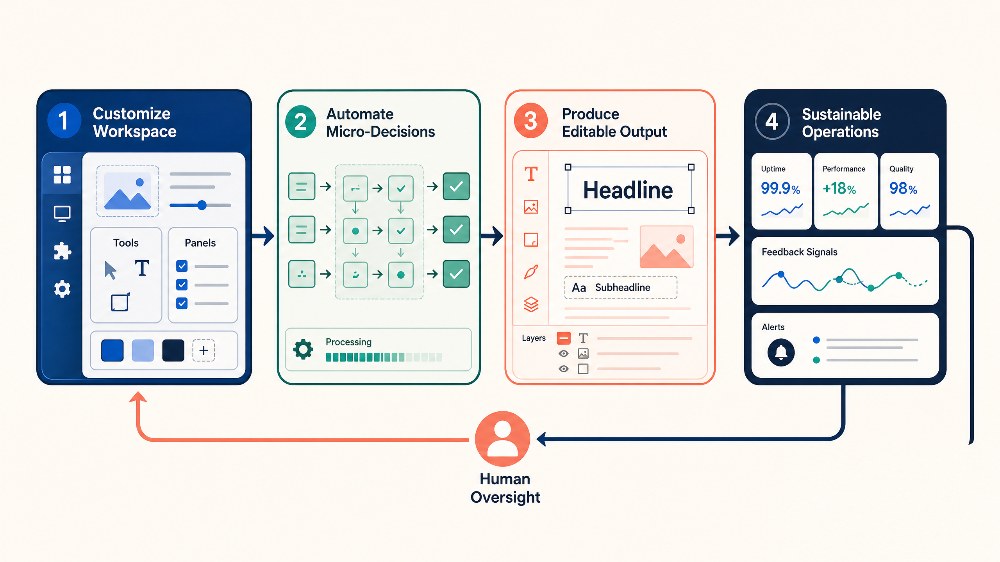

# 2026-10-10 · AI는 작업을 결과물과 운영으로 잇는다 · 릴리스 40건

<section class="release-infographic">
  <figure class="release-infographic__figure">
    
    <figcaption>이번 40선은 AI를 더 많이 붙이는 목록이 아니라, 작업을 결과물로 만들고 다시 운영 가능한 흐름으로 되돌리는 네 단계로 읽었다.</figcaption>
  </figure>
  

    
Work → Judgment → Output → Operations · Release 40

    
이번 이미지는 이전의 허브·루프·지도·단면형과 다른 파이프라인 구조를 택했다. 작업환경을 직접 꾸미는 에이전트가 작은 판단을 자동화하고, 수정 가능한 결과물을 만든 뒤, 지속 운영과 인간의 감독으로 다시 돌아오는 흐름이다.

    <ul class="release-infographic__points">
      <li><strong>WORKSPACE</strong> Mods, Baton, ide-mod, herdr와 Paperclip이 작업 상태·인계·비용·역할을 보이게 만든다.</li>
      <li><strong>JUDGMENT</strong> Jev와 로컬 모델 자료가 생성과 판단을 나누고, 기준·임계값·보류를 설계하게 한다.</li>
      <li><strong>OUTPUT</strong> 도식·영상·슬라이드·문서·앱은 답변이 아니라 수정하고 실행할 수 있는 결과물이 된다.</li>
      <li><strong>OPERATIONS</strong> 메일·메신저·서버·문서 편집과 교육 목적을 연결하되, 사람의 검토 지점을 남긴다.</li>
    </ul>
  

</section>

## 먼저 결론

- 이번 40건의 핵심은 더 센 모델을 고르는 일이 아니라, **작업을 네 단계로 나눠 어디까지 자동화하고 어디서 사람이 다시 판단할지 설계하는 일**입니다.
- 에이전트는 이제 답변창 안에 머물지 않고 작업환경, 터미널, 문서, 메신저, 서버와 연결됩니다. 그래서 상태·인계·권한·비용을 보이게 하는 운영 계층이 중요해집니다.
- Jev와 로컬 모델 자료는 생성과 판단을 분리합니다. 반복 분류는 기준·임계값·보류 경로를 명시할 때 자동화하기 쉬워집니다.
- 도식·영상·슬라이드·HWPX·앱 제작 자료는 대화의 답을 실제로 수정·실행·공유할 수 있는 결과물로 바꾸는 작업면을 보여줍니다.
- 마지막 기준은 교육과 인간의 행위자성입니다. AI가 더 많이 대신할수록 학습자가 직접 목적을 세우고 근거를 따지고 결과를 고칠 자리는 더 선명해야 합니다.

## 읽는 순서

처음 읽는다면 **25 → 31 → 1 → 11 → 35 → 37 → 40** 순서를 권합니다. 판단의 구조를 익히고 작업환경과 제작 사례를 본 뒤, 문서 작업과 교육의 목적을 다시 점검하는 경로입니다.

## 이번 큐레이션을 한 문장으로 읽기

이 자료 묶음에서 읽히는 큰 흐름은 **작업환경을 직접 꾸미는 에이전트 → 작은 판단 단위의 자동화 → 편집 가능한 결과물 제작 → 지속 운영과 인간의 감독**입니다. 이는 수집 자료를 연결한 편집적 해석입니다.

| 흐름 | 연결해서 읽을 자료 | 탐색할 질문 |
|---|---|---|
| 작업 상태를 보이게 하기 | 1·11·16·21 | 지금 무엇을 하고 있으며 언제 사람이 개입할까? |
| 판단과 설명을 나누기 | 25·30·31·14·15 | 어떤 입력과 기준으로 분류하고 언제 보류할까? |
| 답변을 결과물로 바꾸기 | 4·9·22·28·35·37 | 실제로 수정·실행·공유할 수 있는가? |
| 개인 실험을 운영으로 이어가기 | 3·10·24·33·38 | 인계·비용·책임·실패 기록을 어떻게 유지할까? |
| 교육의 목적을 먼저 정하기 | 40 | 학습자가 직접 사고하고 표현할 자리는 어디에 남길까? |

## 에이전트 운영 — 작업환경·협업·관찰·경계

Mods와 ide-mod는 작업 상태를 눈에 보이게 만들고, Baton과 herdr는 앱·기기 사이 인계를 돕습니다. Buzz와 Paperclip은 여러 에이전트의 운영 규모를 다루며, Dryforge는 그 과정에서 유지해야 할 사용자 의도를 묻습니다. 보안 분석 자료는 이 자율성의 영향을 방어 관점에서 살펴보는 연결점입니다.

**아이디어 씨앗:** 수업용 에이전트에 진행 상태, 사용량, 작업 인계 메모를 표시하고, 교사가 확인할 지점을 세 곳으로 정해 보세요.

### 1. Claude Code Mods: 작업장 자체를 바꾸기

이벤트와 훅으로 화면·명령어·실행 흐름을 바꾸는 Mods의 개념을 설명합니다. 일회성 스크립트와 상시 개입 기능의 차이를 이해하고, 실행 전 확인이나 상태 표시가 필요한 지점을 찾을 수 있습니다.

- 자료 날짜: 2026.10.09 · 주제: 작업환경 개조
- [원본](https://www.youtube.com/watch?v=N-djs9BCIyE) · [릴리스 공개 링크](https://lilys.ai/digest/11669849/13815254?s=1&noteVersionId=10434198)

### 3. Baton: Claude·Codex·Hermes 연결

서로 다른 에이전트 앱 사이에서 요청과 작업 맥락을 주고받는 플러그인 사례입니다. 도구를 여러 개 쓰는 상황에서 인계할 정보와 응답 책임을 어떻게 유지할지 살펴볼 수 있습니다.

- 자료 날짜: 2026.10.09 · 주제: 앱 사이 작업 인계
- [원본](https://www.youtube.com/watch?v=NXWZLWTJ7IQ) · [릴리스 공개 링크](https://lilys.ai/digest/11662039/13803701?s=1&noteVersionId=10422241)
- 함께 요약한 원본: [GitHub - netwaif/baton: 데스크톱 앱 안의 Claude Code를 코덱스 앱·헤르메스와 대화로 연결하는 플러그인(바통 터치)](https://github.com/netwaif/baton)

### 5. REA: 역공학 작업 지원

기존 프로그램의 구조와 실행 동작을 분석하는 역공학 지원 도구입니다. 분석 결과를 근거와 연결하는 방식, 정적 분석과 실행 관찰의 역할 차이를 배우는 자료입니다.

- 자료 날짜: 2026.10.09 · 주제: 프로그램 구조 분석
- [원본](https://github.com/morluto/rea) · [릴리스 공개 링크](https://lilys.ai/digest/11659406/13800177?s=1&noteVersionId=10418650)

### 6. ARTEX 한국어판: 자율 에이전트와 방어

여러 LLM 에이전트가 보안 점검 작업을 나누는 시스템의 한국어판입니다. 원문은 권한을 받은 환경에서의 연구와 방어·탐지 학습을 강조하며, 내부 추론과 사용자 출력의 언어를 구분하는 현지화 방식도 보여줍니다.

- 자료 날짜: 2026.10.07 · 주제: 보안 방어 학습
- [원본](https://github.com/jiwoochris/artex-ko) · [릴리스 공개 링크](https://lilys.ai/digest/11639357/13772827?s=1&noteVersionId=10390630)
- 라이브러리 제목 `New Note`를 본문에 따라 ARTEX 한국어판으로 표기했습니다.

### 11. ide-mod: 에이전트 보드와 문서 뷰어

Claude Code 안에서 에이전트 상태, 파일 트리, 요청 기록과 HWP·HWPX·PDF를 함께 보는 플러그인입니다. 강의 자막과 문체 검사도 제공하며, 문서 뷰어는 보기 전용이라는 범위를 구분해야 합니다.

- 자료 날짜: 2026.10.06 · 주제: 작업 상태와 문서 보기
- [원본](https://github.com/jkf87/ide-mod) · [릴리스 공개 링크](https://lilys.ai/digest/11629356/13822709?s=1&noteVersionId=10442095)
- 라이브러리 제목 `New Note`의 빈 요약을 기본 형식으로 생성했습니다. 새 요약의 note ID와 공개 주소를 다시 확인했습니다.

### 16. Claude Mods: 비용 미터기 만들기

사용량과 비용을 화면에 표시하는 Mods 제작 사례입니다. 장시간 작업에서 상태·기록·경고를 어디에 배치하면 사용자가 개입 시점을 판단하기 쉬운지 생각하게 합니다.

- 자료 날짜: 2026.10.06 · 주제: 사용량과 비용 관찰
- [원본](https://www.youtube.com/watch?v=dElhMRoArgQ) · [릴리스 공개 링크](https://lilys.ai/digest/11616658/13744006?s=1&noteVersionId=10361108)

### 21. herdr-web-ui: 휴대폰에서 에이전트 보기

기존 에이전트 세션의 대화와 터미널을 웹·모바일에서 확인하는 클라이언트입니다. 질문·승인 카드와 푸시 알림을 통해 작업이 사람의 응답을 기다리는 지점을 놓치지 않게 하는 구조가 특징입니다.

- 자료 날짜: 2026.10.01 · 주제: 모바일 작업 확인
- [원본](https://github.com/devswha/herdr-web-ui) · [릴리스 공개 링크](https://lilys.ai/digest/11564961/13676473?s=1&noteVersionId=10291628)

### 24. Buzz: 에이전트 관리 전후 비교

여러 서버와 에이전트를 한곳에서 다루는 운영 경험을 비교합니다. 관리 도구를 추가했을 때 얻는 가시성과 유지 비용을 함께 보며, 개인 작업에 필요한 최소 구조를 고민하게 합니다.

- 자료 날짜: 2026.09.30 · 주제: 가벼운 통합 관리
- [원본](https://www.youtube.com/watch?v=NjwkpwxheQI) · [릴리스 공개 링크](https://lilys.ai/digest/11548014/13654120?s=1&noteVersionId=10268577)

### 33. Dryforge: 사용자 의도를 중심에 두기

정해진 절차보다 사용자의 의도와 지켜야 할 범위를 먼저 기록하는 에이전트 작업 방식을 제안합니다. 작업을 이어 받아도 목적·결정·제약을 유지하게 하는 문서 구조를 살펴볼 수 있습니다.

- 자료 날짜: 2026.09.27 · 주제: 의도와 자율성 경계
- [원본](https://github.com/prekuter/dryforge) · [릴리스 공개 링크](https://lilys.ai/digest/11511784/13606616?s=1&noteVersionId=10219585)

### 38. Paperclip: 에이전트를 조직으로 운영

역할·작업·예산·승인과 기록을 중심으로 여러 에이전트를 관리하는 오픈소스 앱입니다. 규모가 커질 때 필요한 통제 장치를 살펴보고, 개인 작업에는 어느 부분까지 필요한지 Buzz 사례와 비교해 볼 수 있습니다.

- 자료 날짜: 2026.09.26 · 주제: 조직과 예산 관리
- [원본](https://github.com/paperclipai/paperclip) · [릴리스 공개 링크](https://lilys.ai/digest/11486121/13574528?s=1&noteVersionId=10186690)

## 판단 모델 — 판단·로컬 AI·데이터 활용

Jev 개념과 활용 사례에서 출발해 입력·평가 설계를 익히고, Laya와 서버 구성으로 실행 환경을 넓히는 흐름입니다. jevgrep은 판단을 검색에 적용하고, MiroFish는 여러 가상 행위자의 반응을 탐색합니다. 모두 출력이 의미하는 범위를 데이터와 과제 조건으로 제한해 읽어야 합니다.

**아이디어 씨앗:** 학생 문의를 긴급도에 따라 분류하되 이유·기준·검토 보류를 함께 표시하는 작은 실험을 설계해 보세요.

### 2. MiroFish: 에이전트로 시나리오 실험하기

여러 에이전트가 가상 세계에서 상호작용하도록 구성해 서비스나 정책의 반응을 탐색하는 프로젝트입니다. 결과를 실제 수요 예측의 확정값으로 삼기보다, 검증할 가설과 놓친 사용자 관점을 찾는 용도로 읽으면 좋습니다.

- 자료 날짜: 2026.10.09 · 주제: 가상 사용자 실험
- [원본](https://github.com/666ghj/MiroFish) · [릴리스 공개 링크](https://lilys.ai/digest/11662085/13803762?s=1&noteVersionId=10422302)

### 14. 내 PC의 판단 모델: 오픈 모델 비교

소형 오픈 모델을 로컬에서 실행해 문서 판단 과제로 비교한 실측 사례입니다. 특정 표본에서 나온 정확도를 다른 업무에 그대로 옮기지 않고, 자신의 데이터로 기준선을 만드는 방법을 배울 수 있습니다.

- 자료 날짜: 2026.10.06 · 주제: 로컬 모델 평가
- [원본](https://www.youtube.com/watch?v=_H_5Zz1hb0Q) · [릴리스 공개 링크](https://lilys.ai/digest/11616742/13744104?s=1&noteVersionId=10361207)

### 15. Laya: 오픈 모델로 판단 기능 구성

한국어 업무에 맞춘 모델 학습과 판단 모델의 활용 가능성을 소개합니다. 범용 대화 능력과 특정 분류 과제의 개선을 구분하고, 데이터와 평가 방식이 성능에 미치는 영향을 살펴보세요.

- 자료 날짜: 2026.10.06 · 주제: 한국어 분류 특화
- [원본](https://www.youtube.com/watch?v=ZktfWXfOwIY) · [릴리스 공개 링크](https://lilys.ai/digest/11616716/13744067?s=1&noteVersionId=10361169)

### 25. Jev 세미나: 답변에서 판단으로

질문에 대한 판단값을 반환하는 모델을 생성형 AI와 구분해 설명합니다. 코드의 규칙, 모델의 점수, 사람이 읽는 설명을 분리하면 분류와 우선순위 업무를 더 명확하게 설계할 수 있습니다.

- 자료 날짜: 2026.09.30 · 주제: 판단과 생성의 분리
- [원본](https://www.youtube.com/watch?v=MAmPKd7HhWQ) · [릴리스 공개 링크](https://lilys.ai/digest/11547960/13654055?s=1&noteVersionId=10268512)

### 26. Jev로 전국 상권 데이터 비교

상권 공공데이터를 판단 모델에 넣고 생성형 AI로 해석하는 실습입니다. 비교 기준과 입력 데이터를 먼저 정리하고, 점수를 후속 조사 대상을 좁히는 신호로 활용하는 흐름을 익힐 수 있습니다.

- 자료 날짜: 2026.09.29 · 주제: 공공데이터 실습
- [원본](https://www.youtube.com/watch?v=a2q8t1TguQM) · [릴리스 공개 링크](https://lilys.ai/digest/11529471/13629970?s=1&noteVersionId=10243645)

### 29. jevgrep: 하는 일로 코드 검색

함수 이름이나 문자열보다 코드가 하는 일을 질문해 관련 파일을 찾는 도구입니다. 검색 정확도와 비용 절감 주장은 저장소의 특정 평가 조건에 따른 결과로 보고, 자신의 저장소에서 찾기 과제를 비교해 볼 수 있습니다.

- 자료 날짜: 2026.09.28 · 주제: 의미로 코드 찾기
- [원본](https://github.com/dzhng/jevgrep) · [릴리스 공개 링크](https://lilys.ai/digest/11523301/13621517?s=1&noteVersionId=10234909)

### 30. Jev로 할 수 있는 아홉 가지 작업

메일 분류, 고객 문의, 잠재 고객과 콘텐츠 선별 등 판단 모델의 적용 사례를 설명합니다. 한 모델에 전체 업무를 맡기기보다 반복되는 판단 단위를 골라 연결하는 아이디어를 얻을 수 있습니다.

- 자료 날짜: 2026.09.28 · 주제: 업무 적용 사례
- [원본](https://www.youtube.com/watch?v=pxaMzr7al3I) · [릴리스 공개 링크](https://lilys.ai/digest/11516507/13613006?s=1&noteVersionId=10226184)

### 31. Jev 사용법: 질문·기준·보류 설계

상태 정보 준비, 명확한 질문과 임계값, 불확실할 때의 처리를 다룹니다. 점수가 낮거나 근거가 부족하면 사람이 검토하도록 보류 경로를 만드는 것이 실무 적용의 핵심입니다.

- 자료 날짜: 2026.09.28 · 주제: 입력과 실패 처리
- [원본](https://www.youtube.com/watch?v=NhKJlU3UV10) · [릴리스 공개 링크](https://lilys.ai/digest/11516484/13612980?s=1&noteVersionId=10226158)

### 39. laya-server: 판단 기능을 서버로 제공

판단 모델을 API로 호출하도록 구성한 서버 프로젝트입니다. 모델 실행을 서비스 인터페이스로 감싸는 방법과 입력·출력 형식을 살펴볼 수 있으며, 서버가 실행된 사실과 판단 품질은 따로 평가해야 합니다.

- 자료 날짜: 2026.09.26 · 주제: 판단 모델 API
- [원본](https://github.com/pjt3591oo/laya-server) · [릴리스 공개 링크](https://lilys.ai/digest/11486109/13574513?s=1&noteVersionId=10186674)

## 제작 도구 — 다이어그램·영상·앱·디자인

자연어로 만들 수 있는 결과물이 도식, 영상, 슬라이드, 게임과 iOS 앱으로 넓어집니다. Excalidraw와 Impeccable은 표현의 구조와 일관성을, 영상 프롬프트와 천체 앱은 여러 제작 역할의 분담을 보여줍니다. 생성 후 편집과 실제 실행·출력 확인이 공통 과제입니다.

**아이디어 씨앗:** 하나의 수업 개념을 도식 1장, 30초 영상, 퀴즈 앱으로 표현하고 학생이 이해하기 쉬운 결과를 비교해 보세요.

### 4. Excalidraw: 자연어로 도식 만들기

자연어 설명을 편집 가능한 Excalidraw 도식으로 바꾸는 스킬입니다. 상자와 화살표 생성에 더해 메시지 구조, 배치, 실제 렌더 결과를 점검하는 과정을 수업 설명도 제작에 연결할 수 있습니다.

- 자료 날짜: 2026.10.09 · 주제: 설명용 다이어그램
- [원본](https://github.com/coleam00/excalidraw-diagram-skill) · [릴리스 공개 링크](https://lilys.ai/digest/11659440/13800209?s=1&noteVersionId=10418682)

### 7. Blitz Mac: iOS 작업 흐름 연결

AI 에이전트가 시뮬레이터·기기·데이터와 개발 서비스를 다루도록 연결하는 Mac 도구입니다. 코드 작성 이후의 실행 확인과 개발 절차까지 자동화 범위를 넓히는 사례로 읽을 수 있습니다.

- 자료 날짜: 2026.10.07 · 주제: iOS 개발 지원
- [원본](https://github.com/blitzdotdev/blitz-mac) · [릴리스 공개 링크](https://lilys.ai/digest/11635525/13767961?s=1&noteVersionId=10385687)

### 8. Genex: AI 게임 개발 데스크톱 앱

게임과 3D 제작을 AI 작업 흐름에 연결하는 데스크톱 앱입니다. 대화로 시제품을 만드는 경험과 실제 실행·수정 가능한 제작 환경이 어떻게 만나는지 살펴보세요.

- 자료 날짜: 2026.10.07 · 주제: 게임 제작 환경
- [원본](https://github.com/genex-games/genex-desktop) · [릴리스 공개 링크](https://lilys.ai/digest/11632960/13764667?s=1&noteVersionId=10382326)

### 9. 바이브 코딩으로 영상 만들기

HTML·Canvas·SVG와 코드 기반 영상 도구를 이용해 장면과 애니메이션을 만드는 흐름을 소개합니다. 문구·색상·시간을 반복 수정할 수 있다는 점을 강의 도입 영상이나 개념 설명에 적용할 수 있습니다.

- 자료 날짜: 2026.10.06 · 주제: 코드 기반 영상
- [원본](https://www.youtube.com/watch?v=p8rphwT9g-A) · [릴리스 공개 링크](https://lilys.ai/digest/11630883/13761824?s=1&noteVersionId=10379396)

### 12. Opus 영상 제작 프롬프트 사례집

코드로 제작한 영상과 프롬프트를 모은 저장소입니다. 결과의 화려함보다 장면 구성, 움직임, 시각 스타일을 구체적으로 지시하는 방법을 분해해 자신의 설명 영상 설계에 활용할 수 있습니다.

- 자료 날짜: 2026.10.06 · 주제: 영상 프롬프트 모음
- [원본](https://github.com/yihui-dev/awesome-opus5-5-videos) · [릴리스 공개 링크](https://lilys.ai/digest/11628223/13758300?s=1&noteVersionId=10375757)

### 22. Impeccable: AI 디자인의 기준 만들기

AI가 화면을 만들 때 참고할 디자인 지침과 개선 명령을 제공하는 프로젝트입니다. 글꼴·간격·색과 흔한 디자인 실수를 명시해 일관된 화면을 만드는 방법을 배울 수 있습니다.

- 자료 날짜: 2026.09.30 · 주제: 디자인 언어
- [원본](https://github.com/pbakaus/impeccable) · [릴리스 공개 링크](https://lilys.ai/digest/11552264/13659619?s=1&noteVersionId=10274211)

### 28. Open Slide: 에이전트용 슬라이드 프레임워크

에이전트가 코드로 슬라이드를 만들고 미리보기·발표·내보내기를 수행하도록 설계한 프레임워크입니다. 슬라이드 생성과 실제 출력물 확인을 하나의 제작 흐름으로 묶는 관점을 배울 수 있습니다.

- 자료 날짜: 2026.09.28 · 주제: 슬라이드 제작 기반
- [원본](https://github.com/open-slide/open-slide) · [릴리스 공개 링크](https://lilys.ai/digest/11523796/13622121?s=1&noteVersionId=10235561)

### 37. 여러 모델로 천체 학습 앱 만들기

코드와 시각 자료 제작을 나눠 천체 학습 앱을 구성하는 실습 사례입니다. 3D 표현·퀴즈와 배포를 연결하면서 실제 천체 비율과 설명을 위한 시각적 조정을 구분하는 점에 주목하세요.

- 자료 날짜: 2026.09.26 · 주제: 교육용 앱 협업
- [원본](https://www.youtube.com/watch?v=RxY7IfI_jL4) · [릴리스 공개 링크](https://lilys.ai/digest/11489417/13578158?s=1&noteVersionId=10190428)

## 업무 자동화 — 메일·메신저·문서·번역

메일·메신저 연결이 업무 입력과 전달을 담당하고, Univer와 HWPX가 실제 문서 편집을 이어받습니다. Translight는 원문을 유지하며 읽기를 돕습니다. 조회, 초안, 수정, 발송을 나눠 결과를 확인하는 구조가 반복됩니다.

**아이디어 씨앗:** 자료 읽기 → 요약 초안 → 한글 문서 검토 → 배포의 흐름에서 사람이 확인해야 할 결과물을 단계마다 지정해 보세요.

### 17. Agent Messenger: 메신저 자동화 인터페이스

여러 메신저를 명령줄과 SDK로 다루는 프로젝트입니다. 알림·조회·전송을 각각의 작업으로 나누고, 사용자가 허용한 채널과 대상에 맞춰 연결하는 구조를 학습할 수 있습니다.

- 자료 날짜: 2026.10.05 · 주제: 메신저 연결
- [원본](https://github.com/agent-messenger/agent-messenger) · [릴리스 공개 링크](https://lilys.ai/digest/11604256/13728408?s=1&noteVersionId=10345171)

### 20. 네이버 메일 MCP: 검색·읽기·초안

AI 앱에서 네이버 메일을 검색하고 읽으며 초안 등의 작업을 다루도록 연결하는 서버입니다. 메일 내용 이해와 실제 전송을 구분해, 조회 중심 보조부터 업무를 설계하는 데 참고할 수 있습니다.

- 자료 날짜: 2026.10.01 · 주제: 메일 작업 연결
- [원본](https://github.com/chanmuzi/naver-mail-mcp) · [릴리스 공개 링크](https://lilys.ai/digest/11565024/13676557?s=1&noteVersionId=10291713)

### 27. Univer: 스프레드시트·문서·슬라이드

앱 안에 오피스 편집 기능을 넣고 에이전트가 작업하도록 연결하는 기반 도구입니다. 채팅 답변을 실제 셀·문서·슬라이드 변경으로 연결하려면 편집 인터페이스와 결과 확인이 필요함을 보여줍니다.

- 자료 날짜: 2026.09.28 · 주제: 문서 편집 기반
- [원본](https://github.com/dream-num/univer) · [릴리스 공개 링크](https://lilys.ai/digest/11526036/13625135?s=1&noteVersionId=10238663)

### 32. Translight: 웹페이지 이중 언어 읽기

브라우저의 번역 기능을 활용해 원문과 번역을 함께 보여주는 확장 프로그램입니다. 코드나 입력 영역을 보호하면서 읽기 흐름을 유지하는 방식이 기술 문서 학습에 유용한 설계 사례입니다.

- 자료 날짜: 2026.09.28 · 주제: 원문 유지 번역
- [원본](https://github.com/neverworkalone/translight) · [릴리스 공개 링크](https://lilys.ai/digest/11515762/13612062?s=1&noteVersionId=10225201)

### 35. HWPX: AI 앱에서 한글 문서 고치기

한글 문서를 생성·읽기·편집하고 결과를 확인하는 앱과 스킬 사례입니다. 교안이나 행정 문서에 적용할 때 내용 변경과 표·쪽 모양 검토를 함께 설계하는 관점을 제공합니다.

- 자료 날짜: 2026.09.27 · 주제: 한글 문서 작업
- [원본](https://www.youtube.com/watch?v=Wd17ZRnk0uI) · [릴리스 공개 링크](https://lilys.ai/digest/11508550/13602808?s=1&noteVersionId=10215670)
- 함께 요약한 원본: [hwpx-skill](https://github.com/imsebeom/hwpx)

## 플랫폼 동향 — 상시 비서·발표 해설·현장 경험

플랫폼 발표 해설과 Muse 사용기는 AI가 지속적으로 업무를 맡는 방향을 다룹니다. Hermes 서버 사례는 이를 구체적인 수집·판단·보고 흐름으로 보여주고, 세미나는 비용과 제작 경험을 보탭니다. 발표된 기능, 시연 사례, 실제 운영 결과는 서로 구분해 읽는 편이 좋습니다.

**아이디어 씨앗:** 하루 한 번 실행할 가치가 있는 반복 업무 하나를 골라 입력 자료, 비용, 실패 알림, 완료 증거를 적어 보세요.

### 10. Hermes × Jev × VPS: 보고 봇 구성

자료 수집, 판단, 보고를 서버에서 지속 실행하는 봇 제작 사례입니다. 주식이라는 사례 분야보다 서버 운영, 역할 분리, 보고 경로와 실행 기록을 연결하는 구조에 주목할 만합니다.

- 자료 날짜: 2026.10.06 · 주제: 상시 실행 사례
- [원본](https://www.youtube.com/watch?v=lRHyr8zVmHo) · [릴리스 공개 링크](https://lilys.ai/digest/11629408/13759805?s=1&noteVersionId=10377306)

### 13. Meta Muse: 개인 비서 사용 사례

메일·일정 등 일상 업무를 AI 비서에 연결한 사용 경험을 다룹니다. 제목의 금전적 효과는 영상 속 사례이며, 실제로 어떤 정보와 권한을 연결하고 어떤 결과를 확인했는지 중심으로 읽어야 합니다.

- 자료 날짜: 2026.10.06 · 주제: 생활 업무 비서
- [원본](https://www.youtube.com/watch?v=RPXhLWHIsm8) · [릴리스 공개 링크](https://lilys.ai/digest/11616779/13744151?s=1&noteVersionId=10361254)

### 18. 10월 3일 세미나: Dots와 도구 활용

Dots와 AI 개발 도구를 둘러싼 사용 경험, 비용과 제작 흐름을 공유하는 세미나입니다. 발표 기능 설명과 참여자의 실제 시도·운영 경험을 함께 비교해 볼 수 있는 자료입니다.

- 자료 날짜: 2026.10.04 · 주제: 현장 사용 경험
- [원본](https://www.youtube.com/watch?v=EBgq-WyoQ1w) · [릴리스 공개 링크](https://lilys.ai/digest/11592689/13712987?s=1&noteVersionId=10329238)

### 19. DevDay 2026: 발표 흐름 정리

영상이 소개하는 개발자 발표 내용을 상시 에이전트, 협업, API와 개발 환경 변화의 관점에서 정리합니다. 개별 기능의 현재 제공 여부와 조건은 별도 확인이 필요하며, 여기서는 발표 해설의 논점을 따라갑니다.

- 자료 날짜: 2026.10.02 · 주제: 발표 해설
- [원본](https://www.youtube.com/watch?v=m8b3Vg6oa7g) · [릴리스 공개 링크](https://lilys.ai/digest/11576212/13691022?s=1&noteVersionId=10306638)

### 23. DevDay 해설: AI 가격보다 운영 변화

영상은 비용·속도와 상시 실행·협업의 변화를 함께 논의합니다. 제목의 가격만 비교하기보다 어떤 작업을 얼마나 자주 실행하고 결과를 어떻게 검증할지로 도입 조건을 나눠 볼 수 있습니다.

- 자료 날짜: 2026.09.30 · 주제: 비용과 상시 실행
- [원본](https://www.youtube.com/watch?v=4gLfMMb4Jj0) · [릴리스 공개 링크](https://lilys.ai/digest/11549863/13656595?s=1&noteVersionId=10271107)

### 34. 9월 27일 세미나: Muse와 새 프로젝트

Meta Muse와 참여자의 새 프로젝트를 둘러싼 제작·활용 경험을 공유합니다. 아이디어, 시연, 실제 운영 결과를 구분하며 도구 선택과 교육 활용의 질문을 뽑아 보기에 좋습니다.

- 자료 날짜: 2026.09.27 · 주제: 커뮤니티 제작 경험
- [원본](https://www.youtube.com/watch?v=mbV2ITWCMGs) · [릴리스 공개 링크](https://lilys.ai/digest/11511400/13606177?s=1&noteVersionId=10219136)

### 36. Meta Muse: 지역별 접근 경험

지역에 따라 다른 서비스 접근 경험과 설정 과정을 소개하는 영상입니다. 영상의 성공 사례가 모든 계정과 시점에 적용되는 것은 아니므로, 서비스 제공 범위·계정 조건·실행 환경을 구분해 읽어야 합니다.

- 자료 날짜: 2026.09.26 · 주제: 서비스 접근 조건
- [원본](https://www.youtube.com/watch?v=rHCJ6uAiYM4) · [릴리스 공개 링크](https://lilys.ai/digest/11490441/13579380?s=1&noteVersionId=10191674)

## AI 교육 — 학습자의 행위자성과 평가

앞선 도구 자료가 자동화의 가능성을 보여준다면, 이 PDF는 교실에서 무엇을 학생과 교사가 직접 판단해야 하는지 묻습니다. 학습자의 관계·표현·평가와 교육의 공공성을 도구 선택의 기준으로 연결할 수 있습니다.

**아이디어 씨앗:** AI가 만든 결과물 제출 대신 학생이 기준을 세우고 결과를 반박·수정한 흔적을 평가하는 활동으로 바꿔 보세요.

### 40. 교실 속 알고리즘: 교육의 목적 다시 묻기

UNESCO 원서를 옮긴 비공식 한국어 번역 PDF로, AI가 학습자의 자율성·관계·사고·평가에 미치는 영향을 논의합니다. 도구 도입 전에 무엇을 학습자가 직접 판단하고 표현해야 하는지 수업의 기준을 세우게 합니다.

- 자료 날짜: 2026.09.26 · 주제: 행위자성과 평가
- 원본: 업로드 PDF(동일 한국어 파일의 외부 링크 없음) · [릴리스 공개 링크](https://lilys.ai/digest/11486033/13574425?s=1&noteVersionId=10186582)
- PDF 뷰어 확인: 153쪽, ISBN 978-92-3-100897-9. 3쪽 일러두기는 UNESCO의 공식 번역본이 아니라고 명시합니다.

## 복사용 링크 표

| 카테고리 | 주제 | 제목 | 원본 링크 | 릴리스 공개 링크 |
|---|---|---|---|---|
| 에이전트 운영 | 작업환경 개조 | 1. Claude Code Mods: 작업장 자체를 바꾸기 | [원본](https://www.youtube.com/watch?v=N-djs9BCIyE) | [공개 요약](https://lilys.ai/digest/11669849/13815254?s=1&noteVersionId=10434198) |
| 에이전트 운영 | 앱 사이 작업 인계 | 3. Baton: Claude·Codex·Hermes 연결 | [원본](https://www.youtube.com/watch?v=NXWZLWTJ7IQ) / [추가 원본](https://github.com/netwaif/baton) | [공개 요약](https://lilys.ai/digest/11662039/13803701?s=1&noteVersionId=10422241) |
| 에이전트 운영 | 프로그램 구조 분석 | 5. REA: 역공학 작업 지원 | [원본](https://github.com/morluto/rea) | [공개 요약](https://lilys.ai/digest/11659406/13800177?s=1&noteVersionId=10418650) |
| 에이전트 운영 | 보안 방어 학습 | 6. ARTEX 한국어판: 자율 에이전트와 방어 | [원본](https://github.com/jiwoochris/artex-ko) | [공개 요약](https://lilys.ai/digest/11639357/13772827?s=1&noteVersionId=10390630) |
| 에이전트 운영 | 작업 상태와 문서 보기 | 11. ide-mod: 에이전트 보드와 문서 뷰어 | [원본](https://github.com/jkf87/ide-mod) | [공개 요약](https://lilys.ai/digest/11629356/13822709?s=1&noteVersionId=10442095) |
| 에이전트 운영 | 사용량과 비용 관찰 | 16. Claude Mods: 비용 미터기 만들기 | [원본](https://www.youtube.com/watch?v=dElhMRoArgQ) | [공개 요약](https://lilys.ai/digest/11616658/13744006?s=1&noteVersionId=10361108) |
| 에이전트 운영 | 모바일 작업 확인 | 21. herdr-web-ui: 휴대폰에서 에이전트 보기 | [원본](https://github.com/devswha/herdr-web-ui) | [공개 요약](https://lilys.ai/digest/11564961/13676473?s=1&noteVersionId=10291628) |
| 에이전트 운영 | 가벼운 통합 관리 | 24. Buzz: 에이전트 관리 전후 비교 | [원본](https://www.youtube.com/watch?v=NjwkpwxheQI) | [공개 요약](https://lilys.ai/digest/11548014/13654120?s=1&noteVersionId=10268577) |
| 에이전트 운영 | 의도와 자율성 경계 | 33. Dryforge: 사용자 의도를 중심에 두기 | [원본](https://github.com/prekuter/dryforge) | [공개 요약](https://lilys.ai/digest/11511784/13606616?s=1&noteVersionId=10219585) |
| 에이전트 운영 | 조직과 예산 관리 | 38. Paperclip: 에이전트를 조직으로 운영 | [원본](https://github.com/paperclipai/paperclip) | [공개 요약](https://lilys.ai/digest/11486121/13574528?s=1&noteVersionId=10186690) |
| 판단 모델 | 가상 사용자 실험 | 2. MiroFish: 에이전트로 시나리오 실험하기 | [원본](https://github.com/666ghj/MiroFish) | [공개 요약](https://lilys.ai/digest/11662085/13803762?s=1&noteVersionId=10422302) |
| 판단 모델 | 로컬 모델 평가 | 14. 내 PC의 판단 모델: 오픈 모델 비교 | [원본](https://www.youtube.com/watch?v=_H_5Zz1hb0Q) | [공개 요약](https://lilys.ai/digest/11616742/13744104?s=1&noteVersionId=10361207) |
| 판단 모델 | 한국어 분류 특화 | 15. Laya: 오픈 모델로 판단 기능 구성 | [원본](https://www.youtube.com/watch?v=ZktfWXfOwIY) | [공개 요약](https://lilys.ai/digest/11616716/13744067?s=1&noteVersionId=10361169) |
| 판단 모델 | 판단과 생성의 분리 | 25. Jev 세미나: 답변에서 판단으로 | [원본](https://www.youtube.com/watch?v=MAmPKd7HhWQ) | [공개 요약](https://lilys.ai/digest/11547960/13654055?s=1&noteVersionId=10268512) |
| 판단 모델 | 공공데이터 실습 | 26. Jev로 전국 상권 데이터 비교 | [원본](https://www.youtube.com/watch?v=a2q8t1TguQM) | [공개 요약](https://lilys.ai/digest/11529471/13629970?s=1&noteVersionId=10243645) |
| 판단 모델 | 의미로 코드 찾기 | 29. jevgrep: 하는 일로 코드 검색 | [원본](https://github.com/dzhng/jevgrep) | [공개 요약](https://lilys.ai/digest/11523301/13621517?s=1&noteVersionId=10234909) |
| 판단 모델 | 업무 적용 사례 | 30. Jev로 할 수 있는 아홉 가지 작업 | [원본](https://www.youtube.com/watch?v=pxaMzr7al3I) | [공개 요약](https://lilys.ai/digest/11516507/13613006?s=1&noteVersionId=10226184) |
| 판단 모델 | 입력과 실패 처리 | 31. Jev 사용법: 질문·기준·보류 설계 | [원본](https://www.youtube.com/watch?v=NhKJlU3UV10) | [공개 요약](https://lilys.ai/digest/11516484/13612980?s=1&noteVersionId=10226158) |
| 판단 모델 | 판단 모델 API | 39. laya-server: 판단 기능을 서버로 제공 | [원본](https://github.com/pjt3591oo/laya-server) | [공개 요약](https://lilys.ai/digest/11486109/13574513?s=1&noteVersionId=10186674) |
| 제작 도구 | 설명용 다이어그램 | 4. Excalidraw: 자연어로 도식 만들기 | [원본](https://github.com/coleam00/excalidraw-diagram-skill) | [공개 요약](https://lilys.ai/digest/11659440/13800209?s=1&noteVersionId=10418682) |
| 제작 도구 | iOS 개발 지원 | 7. Blitz Mac: iOS 작업 흐름 연결 | [원본](https://github.com/blitzdotdev/blitz-mac) | [공개 요약](https://lilys.ai/digest/11635525/13767961?s=1&noteVersionId=10385687) |
| 제작 도구 | 게임 제작 환경 | 8. Genex: AI 게임 개발 데스크톱 앱 | [원본](https://github.com/genex-games/genex-desktop) | [공개 요약](https://lilys.ai/digest/11632960/13764667?s=1&noteVersionId=10382326) |
| 제작 도구 | 코드 기반 영상 | 9. 바이브 코딩으로 영상 만들기 | [원본](https://www.youtube.com/watch?v=p8rphwT9g-A) | [공개 요약](https://lilys.ai/digest/11630883/13761824?s=1&noteVersionId=10379396) |
| 제작 도구 | 영상 프롬프트 모음 | 12. Opus 영상 제작 프롬프트 사례집 | [원본](https://github.com/yihui-dev/awesome-opus5-5-videos) | [공개 요약](https://lilys.ai/digest/11628223/13758300?s=1&noteVersionId=10375757) |
| 제작 도구 | 디자인 언어 | 22. Impeccable: AI 디자인의 기준 만들기 | [원본](https://github.com/pbakaus/impeccable) | [공개 요약](https://lilys.ai/digest/11552264/13659619?s=1&noteVersionId=10274211) |
| 제작 도구 | 슬라이드 제작 기반 | 28. Open Slide: 에이전트용 슬라이드 프레임워크 | [원본](https://github.com/open-slide/open-slide) | [공개 요약](https://lilys.ai/digest/11523796/13622121?s=1&noteVersionId=10235561) |
| 제작 도구 | 교육용 앱 협업 | 37. 여러 모델로 천체 학습 앱 만들기 | [원본](https://www.youtube.com/watch?v=RxY7IfI_jL4) | [공개 요약](https://lilys.ai/digest/11489417/13578158?s=1&noteVersionId=10190428) |
| 업무 자동화 | 메신저 연결 | 17. Agent Messenger: 메신저 자동화 인터페이스 | [원본](https://github.com/agent-messenger/agent-messenger) | [공개 요약](https://lilys.ai/digest/11604256/13728408?s=1&noteVersionId=10345171) |
| 업무 자동화 | 메일 작업 연결 | 20. 네이버 메일 MCP: 검색·읽기·초안 | [원본](https://github.com/chanmuzi/naver-mail-mcp) | [공개 요약](https://lilys.ai/digest/11565024/13676557?s=1&noteVersionId=10291713) |
| 업무 자동화 | 문서 편집 기반 | 27. Univer: 스프레드시트·문서·슬라이드 | [원본](https://github.com/dream-num/univer) | [공개 요약](https://lilys.ai/digest/11526036/13625135?s=1&noteVersionId=10238663) |
| 업무 자동화 | 원문 유지 번역 | 32. Translight: 웹페이지 이중 언어 읽기 | [원본](https://github.com/neverworkalone/translight) | [공개 요약](https://lilys.ai/digest/11515762/13612062?s=1&noteVersionId=10225201) |
| 업무 자동화 | 한글 문서 작업 | 35. HWPX: AI 앱에서 한글 문서 고치기 | [원본](https://www.youtube.com/watch?v=Wd17ZRnk0uI) / [추가 원본](https://github.com/imsebeom/hwpx) | [공개 요약](https://lilys.ai/digest/11508550/13602808?s=1&noteVersionId=10215670) |
| 플랫폼 동향 | 상시 실행 사례 | 10. Hermes × Jev × VPS: 보고 봇 구성 | [원본](https://www.youtube.com/watch?v=lRHyr8zVmHo) | [공개 요약](https://lilys.ai/digest/11629408/13759805?s=1&noteVersionId=10377306) |
| 플랫폼 동향 | 생활 업무 비서 | 13. Meta Muse: 개인 비서 사용 사례 | [원본](https://www.youtube.com/watch?v=RPXhLWHIsm8) | [공개 요약](https://lilys.ai/digest/11616779/13744151?s=1&noteVersionId=10361254) |
| 플랫폼 동향 | 현장 사용 경험 | 18. 10월 3일 세미나: Dots와 도구 활용 | [원본](https://www.youtube.com/watch?v=EBgq-WyoQ1w) | [공개 요약](https://lilys.ai/digest/11592689/13712987?s=1&noteVersionId=10329238) |
| 플랫폼 동향 | 발표 해설 | 19. DevDay 2026: 발표 흐름 정리 | [원본](https://www.youtube.com/watch?v=m8b3Vg6oa7g) | [공개 요약](https://lilys.ai/digest/11576212/13691022?s=1&noteVersionId=10306638) |
| 플랫폼 동향 | 비용과 상시 실행 | 23. DevDay 해설: AI 가격보다 운영 변화 | [원본](https://www.youtube.com/watch?v=4gLfMMb4Jj0) | [공개 요약](https://lilys.ai/digest/11549863/13656595?s=1&noteVersionId=10271107) |
| 플랫폼 동향 | 커뮤니티 제작 경험 | 34. 9월 27일 세미나: Muse와 새 프로젝트 | [원본](https://www.youtube.com/watch?v=mbV2ITWCMGs) | [공개 요약](https://lilys.ai/digest/11511400/13606177?s=1&noteVersionId=10219136) |
| 플랫폼 동향 | 서비스 접근 조건 | 36. Meta Muse: 지역별 접근 경험 | [원본](https://www.youtube.com/watch?v=rHCJ6uAiYM4) | [공개 요약](https://lilys.ai/digest/11490441/13579380?s=1&noteVersionId=10191674) |
| AI 교육 | 행위자성과 평가 | 40. 교실 속 알고리즘: 교육의 목적 다시 묻기 | 업로드 PDF · 외부 링크 없음 | [공개 요약](https://lilys.ai/digest/11486033/13574425?s=1&noteVersionId=10186582) |

## 용어 정리

| 용어 | 쉬운 뜻 | 일상·수업 예시 |
|---|---|---|
| 에이전트 | 목표를 받아 도구를 쓰고 여러 단계를 수행하는 프로그램 | 자료를 찾고 교안 초안을 만든 뒤 결과를 보고하는 도우미 |
| 하네스(Harness) | 에이전트가 일하도록 도구·규칙·실행 환경을 연결한 틀 | 공구뿐 아니라 작업대와 작업 규칙까지 갖춘 작업실 |
| Mods·플러그인 | 기존 앱의 화면이나 동작을 확장하는 부가 기능 | 수업 진행 상태를 알려주는 앱 안의 작은 계기판 |
| 이벤트·훅 | 일이 일어나는 시점과 그때 끼어들어 실행하는 동작 | 문서 저장 직전에 맞춤법 검사를 실행하기 |
| MCP | AI 앱과 외부 도구가 연결되는 공통 인터페이스 | 같은 콘센트 규격으로 다른 기기를 연결하기 |
| SDK·API | 개발 도구 묶음과 프로그램이 요청을 주고받는 약속 | 문서 편집 기능을 앱에 넣고 정해진 형식으로 저장 요청하기 |
| 판단 모델 | 주어진 상태와 질문에 판단값을 반환하는 모델 | 문의가 긴급한지 점수로 분류하기 |
| 임계값·보류 | 행동을 정하는 기준값과 판단을 미루는 경로 | 애매한 문의는 자동 전달하지 않고 교사 검토함에 넣기 |
| 로컬 모델 | 자기 컴퓨터에서 실행하는 AI 모델 | 인터넷 서비스에 보내지 않고 내 PC에서 문서를 분류하기 |
| 파인튜닝 | 특정 데이터로 모델을 추가 학습시키기 | 학교 문의 예시를 보고 학교의 분류 기준에 적응시키기 |
| VPS | 계속 켜 둘 수 있는 임대 가상 서버 | 내 노트북을 닫아도 정해진 시간에 보고서를 만드는 컴퓨터 |
| PWA | 웹사이트를 앱처럼 설치해 쓰는 방식 | 휴대폰 홈 화면에서 에이전트 상태판을 열기 |
| HWPX | 한글 문서를 구조화해 저장하는 파일 형식 | 교안의 제목·표·본문을 수정하고 한글에서 확인하기 |
| 렌더링 | 코드나 문서 구조를 실제 보이는 화면으로 그리기 | 슬라이드 코드를 발표 화면으로 펼쳐 보기 |
| 핸드오프 | 다른 작업자에게 목적·상태·다음 일을 넘기기 | 교대 교사에게 진행 상황과 남은 일을 적어 전달하기 |
| 행위자성 | 스스로 목적을 정하고 판단하며 행동할 수 있는 힘 | 학생이 AI 답을 따르기 전에 기준을 세우고 근거를 따져 보기 |
