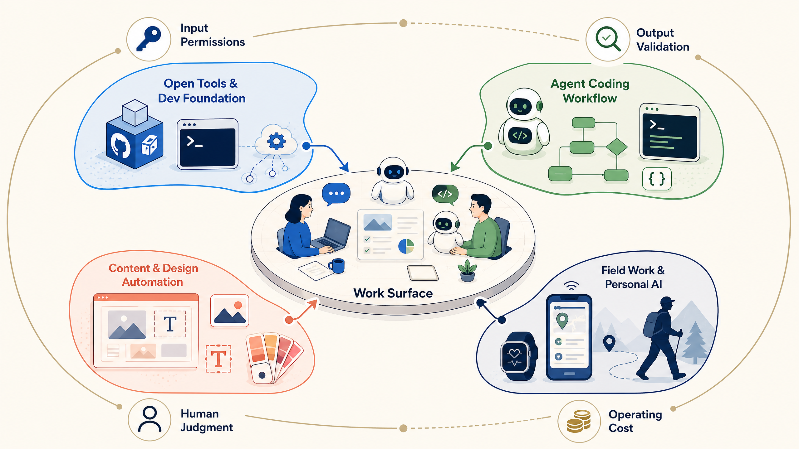

# 2026-10-24 · AI는 실제 작업면으로 내려온다 · 릴리스 40건

<section class="release-infographic">
  <figure class="release-infographic__figure">
    
    <figcaption>이번 40선은 AI 도구 목록이 아니라, 실제 작업면으로 연결되는 네 개의 영역과 그 바깥의 판단 조건을 함께 보여준다.</figcaption>
  </figure>
  

    
Open Tools · Agent Workflows · Making · Field AI · Release 40

    
이번 묶음에서 AI는 대화창 안에 머물지 않는다. 개발 도구를 움직이고, 영상·3D·문서를 만들고, 치과와 개인 업무에 들어간다. 연결이 넓어질수록 입력 권한, 결과 검증, 사람에게 되돌리는 기준, 운영 비용을 함께 설계해야 한다.

    <ul class="release-infographic__points">
      <li><strong>OPEN TOOLS</strong> 데이터·API·학습 경로와 기기 확장이 실험의 바닥을 넓힌다.</li>
      <li><strong>AGENT WORKFLOWS</strong> CLI·MCP·스킬·브라우저가 에이전트의 작업 범위를 넓힌다.</li>
      <li><strong>MAKING</strong> 영상·디자인·3D·모바일 QA가 대화를 실행 가능한 결과물로 바꾼다.</li>
      <li><strong>FIELD AI</strong> 문서·치과·오피스·개인 앱에서 개인정보와 유지보수가 현실의 기준이 된다.</li>
    </ul>
  

</section>

## 먼저 결론

- 이번 40건의 공통점은 AI가 대화형 도구에서 벗어나 **실제 소프트웨어와 업무 표면을 움직이는 단계**로 들어가고 있다는 점입니다.
- CLI, MCP, 스킬, 브라우저 자동화, 에이전트 오케스트레이션은 각각 따로 외우기보다 입력·처리·검증·인계가 이어지는 작업 흐름으로 읽는 편이 좋습니다.
- 영상·디자인·3D·문서·모바일 QA 사례는 생성 자체보다, 사람이 수정하고 실행하고 공유할 수 있는 결과물로 연결하는 방법을 보여줍니다.
- 치과·오피스·개인 브리핑처럼 일상 업무에 가까워질수록 개인정보, 계정 권한, 비용, 유지보수, 장애 시 수동 절차가 성능만큼 중요해집니다.
- 수업이나 프로젝트로 옮길 때는 “무엇을 자동화할까?”보다 <strong>무엇을 자동화하고 어디서 사람이 다시 판단할까?</strong>를 먼저 정해야 합니다.

이번 글은 2026년 10월 24일 LilysAI 최근 노트 목록에서 보이는 순서대로 모은 40개 자료를 다시 읽은 정리입니다. 각 항목의 공개 요약 링크를 함께 연결했으며, 성능·비용·효과에 관한 표현은 원문이 제시한 조건에서 나온 주장으로 보고 직접 확인해야 합니다.

## 이번 묶음을 한 문장으로 읽기

**AI는 답을 만드는 도구에서 실제 작업면을 조작하는 동료로 이동하고 있으며, 그만큼 권한·검증·책임을 함께 설계해야 한다.**

이 흐름은 네 갈래로 나뉩니다.

1. **오픈 도구와 개발 기반**은 데이터, API, 학습 경로, 기기 선택지를 넓힙니다.
2. **에이전트·코딩 워크플로우**는 CLI, MCP, 스킬, 브라우저를 통해 AI가 소프트웨어를 조작하는 범위를 넓힙니다.
3. **콘텐츠·디자인 자동화**는 대화 결과를 영상, 도식, 3D 장면, 앱 테스트처럼 실행 가능한 산출물로 바꿉니다.
4. **현장 업무와 개인용 AI**는 이 기술이 실제 문서, 치과, 오피스, 개인 앱에 들어갈 때 생기는 운영 조건을 보여줍니다.

## 오픈 도구와 개발 기반

### 1. Jupyter, Streamlit 대신 다음 세대를 위한 파이썬 Marimo

**주제:** 데이터 노트북

Marimo는 노트북을 일반 파이썬 파일로 관리하고 반응형 실행과 대시보드 공유를 결합한다. 데이터 분석 결과를 버전 관리하고 웹으로 전달하는 수업 실험에 맞는지 살펴볼 수 있다.

- 원본: [Jupyter, Streamlit 대신 다음 세대를 위한 파이썬 Marimo](https://www.youtube.com/watch?v=D4o8PWIc2gs)
- 릴리스 공개 링크: [LilysAI 공개 요약](https://lilys.ai/digest/11878016/15766775?s=1&noteVersionId=15135291)

### 11. public-apis/public-apis: A collective list of free APIs

**주제:** 무료 API 목록

Public APIs 저장소는 날씨·환율 등 외부 기능에 연결할 수 있는 API를 모아 소개한다. 작은 프로젝트에 실제 데이터를 연결하기 전 사용 조건과 키 보안, 서비스 지속성을 확인하는 출발점이다.

- 원본: [GitHub - public-apis/public-apis: A collective list of free APIs](https://github.com/public-apis/public-apis)
- 릴리스 공개 링크: [LilysAI 공개 요약](https://lilys.ai/digest/11849838/14063292?s=1&noteVersionId=10695723)

### 17. Engineering Handbook

**주제:** 엔지니어링 학습 경로

Engineering Handbook은 시스템 설계와 자료구조·알고리즘 학습 자료를 커리큘럼과 예제로 구성한다. 주제 목록뿐 아니라 학습 순서와 실습 자원이 초심자에게 충분한지 평가하는 데 쓸 수 있다.

- 원본: [The Engineering Handbook](https://github.com/handbook-academy/engineering-handbook)
- 릴리스 공개 링크: [LilysAI 공개 요약](https://lilys.ai/digest/11815962/14014310?s=1&noteVersionId=10641824)

### 19. DOS 게임 레밍즈를 Rust로 구현

**주제:** 고전 게임 재구현

Rust 프로젝트가 DOS 게임 Lemmings의 데이터와 동작을 재현하면서 엔진과 렌더링을 분리한다. 단계별 구현과 검증을 통해 레거시 소프트웨어를 학습 가능한 프로젝트로 바꾸는 방식을 볼 수 있다.

- 원본: [Rusty Lemmings](https://github.com/edwardkim/ohmylemmings)
- 릴리스 공개 링크: [LilysAI 공개 요약](https://lilys.ai/digest/11815134/14013276?s=1&noteVersionId=10640725)

### 25. DroidDesk: 안드로이드 폰을 리눅스 데스크탑으로 활용하는 도구

**주제:** 안드로이드에서 리눅스 데스크톱

DroidDesk는 Termux 기반으로 안드로이드 기기에서 리눅스 데스크톱 앱을 실행하는 방법을 제시한다. 휴대폰을 개발 기기로 확장할 때 성능, 주변기기와 앱 호환성의 실제 경계를 확인할 수 있다.

- 원본: [DroidDesk](https://github.com/orailnoor/DroidDesk)
- 릴리스 공개 링크: [LilysAI 공개 요약](https://lilys.ai/digest/11789207/13979814?s=1&noteVersionId=10605398)

**이 영역을 읽는 포인트:** 오픈 도구는 실험 비용을 낮추지만, 무료라는 말이 운영 비용이 없다는 뜻은 아닙니다. API 약관, 저장소의 유지 상태, 기기 성능, 데이터가 머무는 위치를 함께 봐야 합니다.

## 에이전트·코딩 워크플로우

### 2. 에이전트 워크플로우 최강 도구 Herdr 완벽 가이드 | Claude Code·Codex 동시에 쓰기

**주제:** 다중 에이전트 작업공간

Herdr는 여러 코딩 에이전트의 상태와 작업 분리를 한 화면에서 다루는 터미널 환경을 소개한다. 동시 작업과 리뷰가 필요한 프로젝트에서 작업공간의 역할을 비교해 볼 자료다.

- 원본: [YouTube video player](https://www.youtube.com/watch?v=-Fj8hMkNOvc)
- 릴리스 공개 링크: [LilysAI 공개 요약](https://lilys.ai/digest/11878015/15766771?s=1&noteVersionId=15135286)

### 4. [시즌 4] 그록봇, Dots, 뮤즈, 듀엣... 이런 거 왜 자꾸 나오죠?

**주제:** 에이전트의 단계별 진화

브라우저 질의응답에서 앱 조작, CLI, 반복 자동화, 에이전트 협업으로 이어지는 변화를 설명한다. 도구 접근 범위가 넓어질수록 권한과 검증을 함께 설계해야 한다는 관점으로 읽을 수 있다.

- 원본: [YouTube video player](https://www.youtube.com/watch?v=kNfKMI_pUfw)
- 릴리스 공개 링크: [LilysAI 공개 요약](https://lilys.ai/digest/11877983/15766706?s=1&noteVersionId=15135221)

### 6. 포니테일 넣었더니 코딩 시간 42% 줄었다? 실제 앱으로 비교했습니다 | Claude Code

**주제:** 코드 수정과 재사용

Ponytail 스킬을 기존 재고 장부 수정에 적용하고 시간·비용 변화를 비교한 사례다. 수치 성과는 해당 실험의 주장으로 읽고, 작은 수정·회귀 확인 방식이 재사용 가능한지 따져볼 수 있다.

- 원본: [YouTube video player](https://www.youtube.com/watch?v=fQZbSjmg9lg)
- 릴리스 공개 링크: [LilysAI 공개 요약](https://lilys.ai/digest/11861096/14077057?s=1&noteVersionId=10710002)

### 7. [시즌 4] Laya(라야)를 쓸 때 꼭 알아야 할 지식들

**주제:** 분류 모델의 확신도

Laya는 고객 문의를 분류하면서 신뢰도 점수와 자동 처리 임계값을 함께 다룬다. 실제 예시로 확률을 보정하고 낮은 확신도는 사람에게 넘기는 기준을 토론하기 좋다.

- 원본: [YouTube video player](https://www.youtube.com/watch?v=iS98oUg69Gw)
- 릴리스 공개 링크: [LilysAI 공개 요약](https://lilys.ai/digest/11861079/14077032?s=1&noteVersionId=10709974)

### 8. 헤르메스 에이전트 올인원 가이드북

**주제:** 역할형 AI 비서 팀

Hermes의 기억, 스킬, 봇, 메신저 연결과 칸반 운영을 통해 역할별 봇 협업을 구성한다. 반복 업무를 맡길 때 역할·입력 자료·검토 책임을 어떻게 나눌지 살펴볼 수 있다.

- 원본: [YouTube video player](https://www.youtube.com/watch?v=9cbXxICSJxc)
- 릴리스 공개 링크: [LilysAI 공개 요약](https://lilys.ai/digest/11861051/14076999?s=1&noteVersionId=10709940)

### 9. 인공지능으로 학원 교재 만들기: 환경설정

**주제:** 교재 제작 환경

터미널과 Claude Code·Codex를 연결해 학원 교재 제작 환경을 준비하는 과정을 소개한다. 구독 비용과 인쇄용 결과물의 한계를 포함해 교육 자료 제작의 현실적인 도입 조건을 검토할 수 있다.

- 원본: [YouTube video player](https://www.youtube.com/watch?v=5V5LGlGGGrs)
- 릴리스 공개 링크: [LilysAI 공개 요약](https://lilys.ai/digest/11856803/14072039?s=1&noteVersionId=10704721)

### 10. Opus 5.5, GPT-6.1-Sol과 책 만들기

**주제:** 문제집 제작과 에이전트 역할

고1 수학 교재 제작에서 주 에이전트와 이미지 생성 에이전트를 분담하고 반복 지시를 스킬로 관리한다. 결과 검토와 오작동 대응을 사람의 작업 절차에 포함하는 사례로 활용할 수 있다.

- 원본: [YouTube video player](https://www.youtube.com/watch?v=OK-afGaoDUw)
- 릴리스 공개 링크: [LilysAI 공개 요약](https://lilys.ai/digest/11856771/14071999?s=1&noteVersionId=10704681)

### 14. ego-lite: 에이전트 브라우저

**주제:** 에이전트 브라우저

ego-lite는 AI 에이전트가 브라우저 자동화 작업을 수행하도록 설계된 브라우저 프로젝트다. 로그인 세션을 다루는 편의성은 권한 경계와 데이터 노출 위험도 함께 검토해야 한다.

- 원본: [GitHub - citrolabs/ego-lite](https://github.com/citrolabs/ego-lite)
- 릴리스 공개 링크: [LilysAI 공개 요약](https://lilys.ai/digest/11822476/14025931?s=1&noteVersionId=10657196)

### 18. Unreal Engine Skills for Claude Code

**주제:** 언리얼 편집기 제어

Claude Code에서 언리얼 에디터의 액터·블루프린트·머티리얼 작업을 수행하도록 돕는 플러그인이다. 편집기 제어 자동화의 가능성과 스크립트 실행 권한 같은 안전 조건을 함께 확인해야 한다.

- 원본: [Unreal Engine Skills for Claude Code](https://github.com/EpicGames/unreal-engine-skills-for-claude-code-plugin)
- 릴리스 공개 링크: [LilysAI 공개 요약](https://lilys.ai/digest/11815193/14013354?s=1&noteVersionId=10640809)

### 20. 편집자P와 똑같은 실습 환경을 세팅하고 싶다면?

**주제:** 재현 가능한 실습 환경

편집자와 같은 AI 개발 실습 환경을 구성하는 설정 안내다. 도구 설치 목록을 복사하기보다 운영체제, 계정, 모델 접근을 포함해 당일 실행과 결과 확인까지 재현하는 기준을 얻을 수 있다.

- 원본: [YouTube video player](https://www.youtube.com/watch?v=PWTlxNAgHOQ)
- 릴리스 공개 링크: [LilysAI 공개 요약](https://lilys.ai/digest/11815087/14013219?s=1&noteVersionId=10640667)

### 22. OpenCode 윈도우즈 가이드

**주제:** Windows 개발 가이드

OpenCode Windows 안내는 설치부터 모델 선택, 연결 오류와 계정·요금 문제까지 FAQ 형태로 다룬다. AI 도구 수업 자료를 만들 때 현재 환경에서 설치와 응답을 직접 재검증하는 절차가 중요함을 보여준다.

- 원본: [설치부터 모델 선택까지, 막히는 순간 바로 찾기](https://opencode-windows-guide-techkwon.netlify.app/)
- 릴리스 공개 링크: [LilysAI 공개 요약](https://lilys.ai/digest/11809016/14005793?s=1&noteVersionId=10632984)

### 23. 10월 17일 줌미팅 세미나

**주제:** 펌웨어 개발과 작업 관리

하드웨어 펌웨어까지 AI로 구현하는 작업에서 컨텍스트 절약, 에이전트 오케스트레이션, 직접 만든 스킬을 다룬다. 실제 기기 테스트와 작업 이슈 관리가 생성 코드 검증에 어떻게 연결되는지 살펴볼 수 있다.

- 원본: [YouTube video player](https://www.youtube.com/watch?v=yZB9P82d1Tg)
- 릴리스 공개 링크: [LilysAI 공개 요약](https://lilys.ai/digest/11791580/13982961?s=1&noteVersionId=10608944)

### 24. 깃허브 사용법 기초

**주제:** Git 협업 기초

저장소, 커밋, 브랜치, 푸시를 파일 변경 기록의 흐름으로 설명한다. AI에게 변경을 맡겨도 diff 확인과 커밋 전 검토는 사람이 책임져야 한다는 기초를 익히는 자료다.

- 원본: [깃허브 사용법 기초](https://agentickorea.net/articles/github-basics-repository-commit)
- 릴리스 공개 링크: [LilysAI 공개 요약](https://lilys.ai/digest/11791014/13982213?s=1&noteVersionId=10608139)

### 28. CLI Anything

**주제:** 소프트웨어용 CLI 생성

CLI-Anything은 소프트웨어를 분석해 AI가 조작하기 쉬운 명령줄 인터페이스를 만드는 프로젝트다. 에이전트가 GUI에 의존하지 않고 반복 작업을 수행하려면 어떤 명령과 검증 출력을 제공해야 하는지 생각해 볼 수 있다.

- 원본: [CLI-Anything: Making ALL Software Agent-Native](https://github.com/HKUDS/CLI-Anything)
- 릴리스 공개 링크: [LilysAI 공개 요약](https://lilys.ai/digest/11782544/13971505?s=1&noteVersionId=10596757)

### 30. Muse 오케스트레이션

**주제:** 여러 AI의 역할 분담

Muse 오케스트레이션은 모델별 강점을 판단, 코드 작업, 실행 담당으로 나눠 협업시키는 구성을 소개한다. 도구를 늘리기보다 각 역할의 입력·출력과 교차 검증 지점을 명확히 하는 것이 핵심이다.

- 원본: [Muse 오케스트레이션](https://github.com/groundroot/muse-orchestration)
- 릴리스 공개 링크: [LilysAI 공개 요약](https://lilys.ai/digest/11780024/13967561?s=1&noteVersionId=10592713)

### 31. Tapflow

**주제:** 브라우저 기반 모바일 QA

Tapflow는 자체 인프라에서 iOS·Android 시뮬레이터를 브라우저로 스트리밍하는 QA 구성을 제안한다. 빌드 보안과 기기 접근을 조직 내부에서 통제하면서 설치 장벽을 낮추는 방법을 비교할 수 있다.

- 원본: [Tapflow](https://github.com/jo-duchan/tapflow)
- 릴리스 공개 링크: [LilysAI 공개 요약](https://lilys.ai/digest/11779983/13967509?s=1&noteVersionId=10592661)

### 35. Taste Skill

**주제:** 프런트엔드 디자인 스킬

Taste Skill은 AI가 생성하는 화면의 간격, 움직임, 시각적 완성도를 개선하도록 지시하는 스킬 모음이다. 디자인 기준을 재사용 가능한 지침으로 바꾸고 결과를 사람의 시각 검토로 확인하는 사례다.

- 원본: [Taste Skill](https://github.com/Leonxlnx/taste-skill)
- 릴리스 공개 링크: [LilysAI 공개 요약](https://lilys.ai/digest/11760163/13941486?s=1&noteVersionId=10565230)

### 37. Claude Code 용 Antigravity 플러그인

**주제:** 교차 모델 코딩

Antigravity 플러그인은 Claude Code와 Gemini CLI를 연결해 작업을 분담하고 결과를 교차 확인한다. 모델 라우팅을 통한 비용 절감과 외부 에이전트의 변경 검토를 함께 설계하는 자료다.

- 원본: [Antigravity for Claude Code](https://github.com/yuting0624/antigravity-for-claude-code)
- 릴리스 공개 링크: [LilysAI 공개 요약](https://lilys.ai/digest/11752260/13927164?s=1&noteVersionId=10550564)

### 39. Omarchy Linux를 통해 iPhone App 개발

**주제:** Linux에서 iOS 빌드

Omarchy 기반 도구로 Linux 환경에서 Flutter iOS 앱을 빌드하고 기기에 배포하는 프로젝트다. Xcode 없는 개발이라는 주장에 대해 실제 툴체인, 서명, 장치 연결 조건을 원문에서 확인하는 자료다.

- 원본: [Build and deploy iOS apps on Omarchy Linux](https://github.com/joshuaswarren/omarchy-apple-dev)
- 릴리스 공개 링크: [LilysAI 공개 요약](https://lilys.ai/digest/11746780/13917639?s=1&noteVersionId=10540808)

**이 영역을 읽는 포인트:** 에이전트가 소프트웨어를 직접 움직이기 시작하면 “잘 만들었는가”만으로는 부족합니다. 어떤 계정과 파일에 접근했는지, 실패했을 때 어디까지 되돌릴 수 있는지, 사람이 승인할 지점이 보이는지를 함께 기록해야 합니다.

## 콘텐츠·디자인 자동화

### 3. 코드만으로 이런 영상이 나온다고? 클로드 코드 오픈소스 스킬 8가지

**주제:** 코드 기반 영상 제작

Claude Code에서 영상 스타일과 움직임을 보조하는 오픈소스 스킬 8종을 비교한다. 스킬 선택이 결과물의 화풍과 작업 흐름을 어떻게 바꾸는지 비교 관찰할 수 있다.

- 원본: [YouTube video player](https://www.youtube.com/watch?v=IGdo9hR1_rE)
- 릴리스 공개 링크: [LilysAI 공개 요약](https://lilys.ai/digest/11878014/15766770?s=1&noteVersionId=15135285)

### 5. 그록봇 쇼츠 파이프라이닝 가이드

**주제:** 숏폼 제작 파이프라인

Grok Bot으로 원격·로컬 파일을 활용해 영상 제작, 편집, 업로드를 잇는 흐름을 다룬다. 자동화 단계를 설계할 때 게시 전 검수와 생성 콘텐츠 표시도 함께 점검할 수 있다.

- 원본: [YouTube video player](https://www.youtube.com/watch?v=x1Km5bpd8Is)
- 릴리스 공개 링크: [LilysAI 공개 요약](https://lilys.ai/digest/11861778/14078091?s=1&noteVersionId=10711074)

### 13. OpenShorts

**주제:** 영상 재가공 도구

OpenShorts는 긴 영상을 클립으로 자르고 UGC형 영상과 유튜브 게시를 보조하는 오픈소스 도구다. 제작 자동화의 범위와 사람이 확인해야 할 저작권·품질 단계를 구분해 볼 수 있다.

- 원본: [OpenShorts](https://github.com/mutonby/openshorts)
- 릴리스 공개 링크: [LilysAI 공개 요약](https://lilys.ai/digest/11835768/14042405?s=1&noteVersionId=10674226)

### 16. OpenDesign

**주제:** 로컬 AI 디자인 워크스페이스

OpenDesign은 다양한 코딩 에이전트를 연결하는 오픈소스 로컬 디자인 작업공간을 소개한다. 공급자 선택과 키 관리의 유연성을 디자인 결과물의 품질, 설치 부담과 함께 비교할 수 있다.

- 원본: [Open Design](https://open-design.ai/ko/)
- 릴리스 공개 링크: [LilysAI 공개 요약](https://lilys.ai/digest/11816009/14014370?s=1&noteVersionId=10641886)

### 21. Colorfigures skill

**주제:** 설명형 인터랙티브 그림

Colorfigures 스킬은 개념이나 구조를 보여주는 인터랙티브 도해 생성을 돕는다. 복잡한 원리를 설명할 때 장식보다 관계와 작동 과정을 얼마나 잘 드러내는지 평가할 수 있다.

- 원본: [Colorfigures](https://april-zhu.com/colorfigures)
- 릴리스 공개 링크: [LilysAI 공개 요약](https://lilys.ai/digest/11809120/14005928?s=1&noteVersionId=10633122)

### 26. 소프트웨어의 시대는 끝났다!? REA 쉬운 설명

**주제:** 역공학 에이전트

REA는 AI가 역공학 도구를 이용해 프로그램의 동작을 분석하도록 돕는 접근을 설명한다. 기능 분석과 재현 가능성을 높이는 대신 정확도, 권리와 오용 방지의 경계를 함께 토론할 수 있다.

- 원본: [YouTube video player](https://www.youtube.com/watch?v=Fd8XVsCZSjs)
- 릴리스 공개 링크: [LilysAI 공개 요약](https://lilys.ai/digest/11785844/13975668?s=1&noteVersionId=10601129)

### 27. AI 기반 Blender 3D 모델링 제어 플러그인

**주제:** Blender 3D 제어

MCP 기반 플러그인으로 Blender 모델과 장면을 AI가 조작하는 흐름을 다룬다. 자연어 지시를 3D 편집 동작으로 연결하는 구조와 안전 모드·네트워크 보안 조건을 함께 살펴볼 수 있다.

- 원본: [AI로 Blender 3D 모델링 제어하는 MCP 플러그인](https://gitlog.kr/i/dd3d3)
- 릴리스 공개 링크: [LilysAI 공개 요약](https://lilys.ai/digest/11785616/13975364?s=1&noteVersionId=10600823)

### 32. Organizing my life with Grok Bot

**주제:** AI 브리핑의 오프라인 활용

Grok Bot이 개인 정보를 묶어 아침 브리핑을 만들고 프린터로 전달하는 사례다. 화면 밖으로 정보를 옮겨 집중을 돕는 아이디어와 출력물의 개인정보·장애 대응을 함께 점검해 볼 수 있다.

- 원본: [YouTube video player](https://www.youtube.com/watch?v=zRNY93MtwFs)
- 릴리스 공개 링크: [LilysAI 공개 요약](https://lilys.ai/digest/11774850/13960891?s=1&noteVersionId=10585742)

### 33. 건축 디오라마 영상 실험실

**주제:** 건축 영상 제작 실험

AI 이미지와 코드 애니메이션을 조합해 건축 디오라마 영상을 만드는 방법과 비용을 비교한다. 결과 품질, 한글 표현, 제작비를 나눠 평가하며 영상 수업의 제작 파이프라인을 설계할 수 있다.

- 원본: [신비한 건축사전 같은 영상, 세 가지 방법으로 직접 만들어 봤습니다](https://funnellabs-diorama-lab.vercel.app/#skills)
- 릴리스 공개 링크: [LilysAI 공개 요약](https://lilys.ai/digest/11773688/13959420?s=1&noteVersionId=10584196)

### 34. Gemini 4 Argon 사용기

**주제:** 모델 비교와 적합성

Gemini 4 Argon을 시각 표현, 작업 시간, 토큰 효율로 평가한 사용기다. 단일 점수로 모델을 고르지 않고 창의성·속도·비용 등 과업별 기준을 정하는 연습에 적합하다.

- 원본: [YouTube video player](https://www.youtube.com/watch?v=gOChDHa0s3k)
- 릴리스 공개 링크: [LilysAI 공개 요약](https://lilys.ai/digest/11772985/13958566?s=1&noteVersionId=10583291)

**이 영역을 읽는 포인트:** 생성 도구가 많아질수록 결과물의 품질은 프롬프트 한 줄보다 반복 가능한 기준에 가까워집니다. 정확한 라벨, 저작권, 게시 전 확인, 수정 가능한 원본을 별도로 관리해야 합니다.

## 현장 업무와 개인용 AI

### 12. 동네 치과의 AI 전환기

**주제:** 치과 업무 전환 사례

동네 치과가 내부 인프라를 바탕으로 전화 응대, 보험 서류, 정보 검색과 보고 업무를 자동화한 사례다. 환자 정보 보호와 업무 비용, 비전공자 도입 과정을 함께 살펴볼 수 있다.

- 원본: [동네 치과의 AX전환기 1편](https://dentaldev26.tistory.com/m/2)
- 릴리스 공개 링크: [LilysAI 공개 요약](https://lilys.ai/digest/11846338/14058995?s=1&noteVersionId=10691297)

### 15. indiff — 문서를 설명하지 마세요. 그냥 열어 두세요.

**주제:** 문서·터미널 통합 공간

indiff는 macOS에서 문서, 터미널, AI 작업과 브라우징을 한 창에 모으는 앱을 제안한다. 여러 앱 사이를 오가는 시간을 줄이는 대신 작업 기록과 권한을 한곳에서 관리할 때의 조건을 생각해 볼 수 있다.

- 원본: [Open it. That’s enough.](https://choisukjune.github.io/indiff-app/)
- 릴리스 공개 링크: [LilysAI 공개 요약](https://lilys.ai/digest/11821736/14024960?s=1&noteVersionId=10656201)

### 29. Dental AX 치과 원내 AI 서비스

**주제:** 치과 원내 업무 서비스

DentalAX는 치과 업무를 돕는 웹 서비스를 AI 코딩으로 빠르게 만든 사례와 실행 자료를 제공한다. 짧은 제작 시간 자체보다 현장 요구, 개인정보, 유지보수와 사용성 검증이 충분한지 질문해 볼 수 있다.

- 원본: [DentalAX](https://github.com/GangJaeYu/DentalAX)
- 릴리스 공개 링크: [LilysAI 공개 요약](https://lilys.ai/digest/11782192/13970531?s=1&noteVersionId=10595760)

### 36. Jev에 대해 쉽게 설명

**주제:** 빠른 분류 전용 모델

Jev는 긴 문장 생성보다 분류 결정과 확신도 제공에 초점을 둔 모델로 소개된다. 단순하고 반복적인 분기 작업에서 대형 언어모델과 비용·속도·오류 처리 기준을 비교해 볼 수 있다.

- 원본: [10분 만에 Jev 이해하기](https://yozm.wishket.com/magazine/detail/3989/?data=rWJMMfLmOq4cCV%2FziGcLPyb3uYyX8rdFRTJiMIy1yoc%3D)
- 릴리스 공개 링크: [LilysAI 공개 요약](https://lilys.ai/digest/11752828/13928011?s=1&noteVersionId=10551432)

### 38. 이음오피스

**주제:** 문서 통합 오피스

이음오피스는 HWP부터 PDF까지 여러 문서를 한 창에서 열고 편집하며 로컬 작업과 AI 연결을 지원한다고 소개한다. 문서 호환성, 저장 형식, 개인정보 처리와 기존 오피스 의존도를 비교할 수 있다.

- 원본: [한글부터 PDF까지, 한 창에서](https://ieumoffice.com/)
- 릴리스 공개 링크: [LilysAI 공개 요약](https://lilys.ai/digest/11752149/13927034?s=1&noteVersionId=10550432)

### 40. Google Play의 개인 라이브러리와 vibe-coded 앱

**주제:** 개인 제작 앱의 배포 경로

Google Play 개인 라이브러리 기능은 AI로 만든 개인용 앱을 보관하고 여러 기기에서 다시 설치하는 경험을 다룬다. 앱 제작이 쉬워질수록 배포·업데이트·권한 관리가 개인 사용자에게 어떻게 전달되는지 살펴볼 수 있다.

- 원본: [Google Play adding ‘personal library’ to access your vibe-coded apps](https://9to5google.com/2026/10/13/google-play-vibe-coded/)
- 릴리스 공개 링크: [LilysAI 공개 요약](https://lilys.ai/digest/11733946/13900929?s=1&noteVersionId=10523431)

**이 영역을 읽는 포인트:** 현장 도입의 첫 질문은 “AI가 할 수 있는가?”가 아니라 “어떤 데이터가 들어가며, 누가 결과를 확인하고, 문제가 생기면 수동으로 어떻게 이어갈 것인가?”입니다.

## 수업과 프로젝트로 옮길 때

이번 40건을 학생 활동이나 실무 프로젝트로 바꾼다면 다음 네 단계가 현실적입니다.

1. **작업면 고르기:** 문서, 코드, 영상, 데이터, 브라우저 중 하나만 정합니다.
2. **역할 나누기:** 생성·분류·검색·실행 중 AI에게 맡길 일을 한 가지로 제한합니다.
3. **검증선 만들기:** 입력 권한, 결과 확인, 실패 시 보류, 되돌리기 지점을 표로 적습니다.
4. **운영비 기록하기:** 사용 시간, 모델 비용, 설치·유지보수 비용, 사람이 다시 처리한 시간을 함께 기록합니다.

## 복사용 링크 표

| 카테고리 | 주제 | 제목 | 원본 링크 | 릴리스 공개 링크 |
|---|---|---|---|---|
| 오픈 도구와 개발 기반 | 데이터 노트북 | Jupyter, Streamlit 대신 다음 세대를 위한 파이썬 Marimo | [원본](https://www.youtube.com/watch?v=D4o8PWIc2gs) | [공개 요약](https://lilys.ai/digest/11878016/15766775?s=1&noteVersionId=15135291) |
| 에이전트·코딩 워크플로우 | 다중 에이전트 작업공간 | Herdr 완벽 가이드 | [원본](https://www.youtube.com/watch?v=-Fj8hMkNOvc) | [공개 요약](https://lilys.ai/digest/11878015/15766771?s=1&noteVersionId=15135286) |
| 콘텐츠·디자인 자동화 | 코드 기반 영상 제작 | 클로드 코드 오픈소스 스킬 8가지 | [원본](https://www.youtube.com/watch?v=IGdo9hR1_rE) | [공개 요약](https://lilys.ai/digest/11878014/15766770?s=1&noteVersionId=15135285) |
| 에이전트·코딩 워크플로우 | 에이전트의 단계별 진화 | 그록봇, Dots, 뮤즈, 듀엣 | [원본](https://www.youtube.com/watch?v=kNfKMI_pUfw) | [공개 요약](https://lilys.ai/digest/11877983/15766706?s=1&noteVersionId=15135221) |
| 콘텐츠·디자인 자동화 | 숏폼 제작 파이프라인 | 그록봇 쇼츠 파이프라이닝 | [원본](https://www.youtube.com/watch?v=x1Km5bpd8Is) | [공개 요약](https://lilys.ai/digest/11861778/14078091?s=1&noteVersionId=10711074) |
| 에이전트·코딩 워크플로우 | 코드 수정과 재사용 | 포니테일과 Claude Code | [원본](https://www.youtube.com/watch?v=fQZbSjmg9lg) | [공개 요약](https://lilys.ai/digest/11861096/14077057?s=1&noteVersionId=10710002) |
| 에이전트·코딩 워크플로우 | 분류 모델의 확신도 | Laya를 쓸 때 알아야 할 지식 | [원본](https://www.youtube.com/watch?v=iS98oUg69Gw) | [공개 요약](https://lilys.ai/digest/11861079/14077032?s=1&noteVersionId=10709974) |
| 에이전트·코딩 워크플로우 | 역할형 AI 비서 팀 | 헤르메스 에이전트 가이드북 | [원본](https://www.youtube.com/watch?v=9cbXxICSJxc) | [공개 요약](https://lilys.ai/digest/11861051/14076999?s=1&noteVersionId=10709940) |
| 에이전트·코딩 워크플로우 | 교재 제작 환경 | 인공지능으로 학원 교재 만들기 | [원본](https://www.youtube.com/watch?v=5V5LGlGGGrs) | [공개 요약](https://lilys.ai/digest/11856803/14072039?s=1&noteVersionId=10704721) |
| 에이전트·코딩 워크플로우 | 문제집 제작과 에이전트 역할 | Opus·GPT와 책 만들기 | [원본](https://www.youtube.com/watch?v=OK-afGaoDUw) | [공개 요약](https://lilys.ai/digest/11856771/14071999?s=1&noteVersionId=10704681) |
| 오픈 도구와 개발 기반 | 무료 API 목록 | public-apis | [원본](https://github.com/public-apis/public-apis) | [공개 요약](https://lilys.ai/digest/11849838/14063292?s=1&noteVersionId=10695723) |
| 현장 업무와 개인용 AI | 치과 업무 전환 사례 | 동네 치과의 AI 전환기 | [원본](https://dentaldev26.tistory.com/m/2) | [공개 요약](https://lilys.ai/digest/11846338/14058995?s=1&noteVersionId=10691297) |
| 콘텐츠·디자인 자동화 | 영상 재가공 도구 | OpenShorts | [원본](https://github.com/mutonby/openshorts) | [공개 요약](https://lilys.ai/digest/11835768/14042405?s=1&noteVersionId=10674226) |
| 에이전트·코딩 워크플로우 | 에이전트 브라우저 | ego-lite | [원본](https://github.com/citrolabs/ego-lite) | [공개 요약](https://lilys.ai/digest/11822476/14025931?s=1&noteVersionId=10657196) |
| 현장 업무와 개인용 AI | 문서·터미널 통합 공간 | indiff | [원본](https://choisukjune.github.io/indiff-app/) | [공개 요약](https://lilys.ai/digest/11821736/14024960?s=1&noteVersionId=10656201) |
| 콘텐츠·디자인 자동화 | 로컬 AI 디자인 워크스페이스 | OpenDesign | [원본](https://open-design.ai/ko/) | [공개 요약](https://lilys.ai/digest/11816009/14014370?s=1&noteVersionId=10641886) |
| 오픈 도구와 개발 기반 | 엔지니어링 학습 경로 | Engineering Handbook | [원본](https://github.com/handbook-academy/engineering-handbook) | [공개 요약](https://lilys.ai/digest/11815962/14014310?s=1&noteVersionId=10641824) |
| 에이전트·코딩 워크플로우 | 언리얼 편집기 제어 | Unreal Engine Skills | [원본](https://github.com/EpicGames/unreal-engine-skills-for-claude-code-plugin) | [공개 요약](https://lilys.ai/digest/11815193/14013354?s=1&noteVersionId=10640809) |
| 오픈 도구와 개발 기반 | 고전 게임 재구현 | Rusty Lemmings | [원본](https://github.com/edwardkim/ohmylemmings) | [공개 요약](https://lilys.ai/digest/11815134/14013276?s=1&noteVersionId=10640725) |
| 에이전트·코딩 워크플로우 | 재현 가능한 실습 환경 | 편집자P 실습 환경 | [원본](https://www.youtube.com/watch?v=PWTlxNAgHOQ) | [공개 요약](https://lilys.ai/digest/11815087/14013219?s=1&noteVersionId=10640667) |
| 콘텐츠·디자인 자동화 | 설명형 인터랙티브 그림 | Colorfigures | [원본](https://april-zhu.com/colorfigures) | [공개 요약](https://lilys.ai/digest/11809120/14005928?s=1&noteVersionId=10633122) |
| 에이전트·코딩 워크플로우 | Windows 개발 가이드 | OpenCode 윈도우즈 가이드 | [원본](https://opencode-windows-guide-techkwon.netlify.app/) | [공개 요약](https://lilys.ai/digest/11809016/14005793?s=1&noteVersionId=10632984) |
| 에이전트·코딩 워크플로우 | 펌웨어 개발과 작업 관리 | 10월 17일 줌미팅 | [원본](https://www.youtube.com/watch?v=yZB9P82d1Tg) | [공개 요약](https://lilys.ai/digest/11791580/13982961?s=1&noteVersionId=10608944) |
| 에이전트·코딩 워크플로우 | Git 협업 기초 | 깃허브 사용법 기초 | [원본](https://agentickorea.net/articles/github-basics-repository-commit) | [공개 요약](https://lilys.ai/digest/11791014/13982213?s=1&noteVersionId=10608139) |
| 오픈 도구와 개발 기반 | 안드로이드에서 리눅스 데스크톱 | DroidDesk | [원본](https://github.com/orailnoor/DroidDesk) | [공개 요약](https://lilys.ai/digest/11789207/13979814?s=1&noteVersionId=10605398) |
| 콘텐츠·디자인 자동화 | 역공학 에이전트 | REA 쉬운 설명 | [원본](https://www.youtube.com/watch?v=Fd8XVsCZSjs) | [공개 요약](https://lilys.ai/digest/11785844/13975668?s=1&noteVersionId=10601129) |
| 콘텐츠·디자인 자동화 | Blender 3D 제어 | Blender MCP 플러그인 | [원본](https://gitlog.kr/i/dd3d3) | [공개 요약](https://lilys.ai/digest/11785616/13975364?s=1&noteVersionId=10600823) |
| 에이전트·코딩 워크플로우 | 소프트웨어용 CLI 생성 | CLI-Anything | [원본](https://github.com/HKUDS/CLI-Anything) | [공개 요약](https://lilys.ai/digest/11782544/13971505?s=1&noteVersionId=10596757) |
| 현장 업무와 개인용 AI | 치과 원내 업무 서비스 | DentalAX | [원본](https://github.com/GangJaeYu/DentalAX) | [공개 요약](https://lilys.ai/digest/11782192/13970531?s=1&noteVersionId=10595760) |
| 에이전트·코딩 워크플로우 | 여러 AI의 역할 분담 | Muse 오케스트레이션 | [원본](https://github.com/groundroot/muse-orchestration) | [공개 요약](https://lilys.ai/digest/11780024/13967561?s=1&noteVersionId=10592713) |
| 에이전트·코딩 워크플로우 | 브라우저 기반 모바일 QA | Tapflow | [원본](https://github.com/jo-duchan/tapflow) | [공개 요약](https://lilys.ai/digest/11779983/13967509?s=1&noteVersionId=10592661) |
| 콘텐츠·디자인 자동화 | AI 브리핑의 오프라인 활용 | Organizing my life with Grok Bot | [원본](https://www.youtube.com/watch?v=zRNY93MtwFs) | [공개 요약](https://lilys.ai/digest/11774850/13960891?s=1&noteVersionId=10585742) |
| 콘텐츠·디자인 자동화 | 건축 영상 제작 실험 | 건축 디오라마 영상 실험실 | [원본](https://funnellabs-diorama-lab.vercel.app/#skills) | [공개 요약](https://lilys.ai/digest/11773688/13959420?s=1&noteVersionId=10584196) |
| 콘텐츠·디자인 자동화 | 모델 비교와 적합성 | Gemini 4 Argon | [원본](https://www.youtube.com/watch?v=gOChDHa0s3k) | [공개 요약](https://lilys.ai/digest/11772985/13958566?s=1&noteVersionId=10583291) |
| 에이전트·코딩 워크플로우 | 프런트엔드 디자인 스킬 | Taste Skill | [원본](https://github.com/Leonxlnx/taste-skill) | [공개 요약](https://lilys.ai/digest/11760163/13941486?s=1&noteVersionId=10565230) |
| 현장 업무와 개인용 AI | 빠른 분류 전용 모델 | Jev | [원본](https://yozm.wishket.com/magazine/detail/3989/?data=rWJMMfLmOq4cCV%2FziGcLPyb3uYyX8rdFRTJiMIy1yoc%3D) | [공개 요약](https://lilys.ai/digest/11752828/13928011?s=1&noteVersionId=10551432) |
| 에이전트·코딩 워크플로우 | 교차 모델 코딩 | Antigravity 플러그인 | [원본](https://github.com/yuting0624/antigravity-for-claude-code) | [공개 요약](https://lilys.ai/digest/11752260/13927164?s=1&noteVersionId=10550564) |
| 현장 업무와 개인용 AI | 문서 통합 오피스 | 이음오피스 | [원본](https://ieumoffice.com/) | [공개 요약](https://lilys.ai/digest/11752149/13927034?s=1&noteVersionId=10550432) |
| 에이전트·코딩 워크플로우 | Linux에서 iOS 빌드 | Omarchy Linux | [원본](https://github.com/joshuaswarren/omarchy-apple-dev) | [공개 요약](https://lilys.ai/digest/11746780/13917639?s=1&noteVersionId=10540808) |
| 현장 업무와 개인용 AI | 개인 제작 앱의 배포 경로 | Google Play 개인 라이브러리 | [원본](https://9to5google.com/2026/10/13/google-play-vibe-coded/) | [공개 요약](https://lilys.ai/digest/11733946/13900929?s=1&noteVersionId=10523431) |

## 용어 정리

| 용어 | 쉬운 설명 | 생활 속 예 |
|---|---|---|
| 에이전트 | 목표를 받아 도구를 사용하고 여러 단계를 수행하는 AI 프로그램 | 예약 확인부터 일정표 작성까지 이어서 처리하는 비서 |
| 오케스트레이션 | 여러 AI나 도구의 역할·순서를 정해 함께 일하게 하는 방식 | 자료 조사, 초안 작성, 사실 확인을 담당자별로 나누는 팀 작업 |
| CLI | 글자 명령으로 컴퓨터 프로그램을 실행하는 인터페이스 | 메뉴를 누르는 대신 “파일을 정리해 줘”에 해당하는 명령을 입력 |
| MCP | AI와 외부 앱·도구가 정해진 방식으로 연결되는 규약 | 비서에게 캘린더나 파일함을 안전한 연결선으로 붙이는 것 |
| 스킬 | AI가 반복 작업을 일정한 절차와 기준에 따라 하도록 주는 지침·도구 | 매번 새로 설명하지 않고 보고서 작성 양식을 저장해 두기 |
| 워크트리 | 같은 코드 저장소에서 서로 영향을 덜 주도록 나눈 작업 폴더 | 같은 문서의 원본을 보존하며 별도 사본에서 실험하기 |
| API | 프로그램끼리 기능이나 데이터를 주고받는 약속 | 앱이 날씨 서비스에 오늘의 기온을 요청하는 것 |
| 신뢰도 보정 | AI의 확신도와 실제 정답률이 비슷해지도록 조정하는 일 | “90% 확실”이라고 한 문제들 중 실제로 약 9할을 맞히는지 확인 |
| 임계값 | 자동 처리할지 사람에게 넘길지 나누는 기준 점수 | 90점 이상 자동 통과, 그보다 낮으면 교사가 다시 확인 |
| 역공학 | 완성된 프로그램을 살펴 작동 원리와 구성 요소를 알아내는 과정 | 전자기기를 열어 부품 연결을 살펴보며 동작을 이해하기 |
| 시뮬레이터 | 실제 기기처럼 동작하도록 컴퓨터 안에서 만든 시험 환경 | 새 앱을 실제 휴대폰에 설치하기 전에 가상 휴대폰에서 실행 |
| 로컬 실행 | 자료와 프로그램을 내 기기나 조직 내부 환경에서 처리하는 방식 | 문서가 외부 서버로 나가지 않도록 학교 컴퓨터에서 편집 |
| 펌웨어 | 기기 안에서 하드웨어를 직접 움직이는 작은 프로그램 | 세탁기 버튼과 모터 동작을 이어 주는 내장 소프트웨어 |
| 브랜치·커밋·푸시 | 브랜치는 작업 갈래, 커밋은 변경 기록, 푸시는 기록을 원격 저장소에 올리는 일 | 과제 사본에서 수정하고 변경 기록을 남긴 뒤 팀 저장소에 공유 |

## 다음에 바로 쓸 체크리스트

<ul class="note-list">
  <li>AI가 접근할 파일·계정·브라우저 세션의 범위를 먼저 정했는가?</li>
  <li>생성 결과를 사람이 확인할 기준과 낮은 확신도 보류 경로가 있는가?</li>
  <li>외부 링크·오픈소스·생성 콘텐츠의 라이선스와 게시 조건을 확인했는가?</li>
  <li>모델 사용량, 설치·유지보수 비용, 사람이 다시 처리한 시간을 기록했는가?</li>
  <li>에이전트가 실패하거나 멈췄을 때 수동 작업으로 이어갈 절차가 남아 있는가?</li>
</ul>

## 남겨둘 판단

이번 40건을 한꺼번에 따라갈 필요는 없습니다. 먼저 자신의 작업에서 가장 자주 반복되는 한 장면을 고르고, 그 장면에 필요한 도구 하나와 검증 기준 하나를 붙이는 편이 낫습니다. AI가 실제 작업면으로 내려올수록 좋은 시스템은 더 많은 일을 대신하는 시스템이 아니라, **무엇을 맡겼고 무엇을 사람이 다시 확인해야 하는지 선명하게 보여주는 시스템**입니다.
