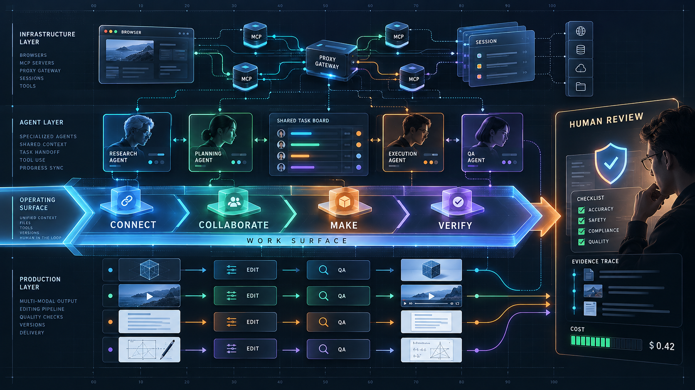

# 2026-10-30 · AI는 연결·협업·제작으로 확장된다 · 릴리스 40건

<section class="release-infographic">
  <figure class="release-infographic__figure">
    
    <figcaption>이번 40선은 모델 하나의 성능보다 연결된 작업 표면, 에이전트 협업, 결과물 제작, 사람의 검증이 함께 설계되어야 한다는 흐름을 보여준다.</figcaption>
  </figure>
  

    
Connect · Collaborate · Make · Verify · Human Review

    
AI의 다음 단계는 대화창을 더 크게 만드는 일이 아니다. 브라우저·MCP·프록시·세션을 연결하고, 여러 에이전트가 작업을 나누고, 3D·영상·교재를 결과물로 만든 뒤, 사람의 검토와 근거 확인을 통과시키는 운영 표면을 만드는 일에 가깝다.

    <ul class="release-infographic__points">
      <li><strong>CONNECT</strong> 브라우저·MCP·프록시·세션이 AI의 작업 범위를 넓힌다.</li>
      <li><strong>COLLABORATE</strong> 조사·기획·실행·QA 역할을 나눌수록 상태와 인계가 중요해진다.</li>
      <li><strong>MAKE</strong> 3D·영상·문서·교재는 생성보다 편집·검수·배포 흐름으로 읽어야 한다.</li>
      <li><strong>VERIFY</strong> 정확성·안전·근거·비용을 사람이 마지막에 확인해야 한다.</li>
    </ul>
  

</section>

AI 도구를 수업·콘텐츠 제작·업무 개선에 써 보려는 교사와 개발자를 위한 자료다. Readray(구 LilysAI)의 최근순 40개를 주제별로 다시 묶었다. 도구의 가격·성능 수치는 원본 제작자의 설명이므로 적용 전에 현재 조건을 확인하자.

## 먼저 결론

1. **연결**: 모델 하나의 능력보다 MCP, 프록시, 브라우저와 운영 환경을 어떻게 연결하는지가 중요해지고 있다.
2. **협업**: 여러 에이전트가 동시에 움직일수록 세션 상태·권한·사람의 검토가 필요하다.
3. **제작**: 3D·영상·교재는 생성, 편집, 검수, 배포를 나눈 작업 흐름으로 발전하고 있다.
4. **현장 적용**: 성능 수치와 사용 사례는 실험 조건을 함께 읽고, 자신의 자료와 개인정보 경계에서 다시 검증해야 한다.

**시도해 볼 질문**: 내가 반복하는 업무 한 가지를 고른다면, 어떤 단계만 AI에 맡기고 무엇을 사람이 승인할까? 제작 결과를 다시 열어 수정하고 출처를 확인할 수 있는가?

## 이 글을 읽는 방법

이 글은 Readray(구 LilysAI)의 최근순 40개 노트를 주제별로 다시 묶은 학습 큐레이션이다. 각 항목에는 공개 요약과 원본 링크를 함께 두었다. 가격·성능·사용 조건은 바뀔 수 있으므로 실제 적용 전에는 현재 페이지와 자신의 자료·개인정보 경계를 다시 확인하자.

## 에이전트 협업·운영 (17개)

대화형 AI가 실제 파일·브라우저·운영 체계로 이동하는 흐름이다. 여러 에이전트를 동시에 쓰는 도구가 늘면서 세션 상태, 권한, 사람의 승인 지점을 설계해야 한다.

### 6. Hermes의 협업 업무 자동화

메일 선별부터 협상 기록, 계약 검토, 인보이스 처리까지 에이전트에 맡기는 실제 사례다. 어떤 결정은 사람이 승인해야 하는지 업무 경계를 설계하는 데 참고할 만하다.

- 원본: [바로가기](https://www.youtube.com/watch?v=M-LGMC-mV2A)
- 공개 요약: [Readray에서 읽기](https://readray.ai/digest/11948749/15852952?noteVersionId=15228066)

### 8. ego lite 에이전트 브라우저 가이드

에이전트가 페이지 구조를 읽고 별도 작업 공간에서 브라우저 업무를 처리하는 흐름을 설명한다. 유료 광고 영상이므로 기능·제약은 실제 사용 환경에서 확인해야 한다.

- 원본: [바로가기](https://www.youtube.com/watch?v=7uOxn_077Ok)
- 공개 요약: [Readray에서 읽기](https://readray.ai/digest/11948738/15852941?noteVersionId=15228054)

### 9. hivemux로 Claude Code 세션 보기

여러 Claude Code 세션의 실행·대기 상태를 tmux 사이드바에 모아 보여준다. 동시에 여러 작업을 맡길 때 어떤 세션이 사람의 응답을 기다리는지 파악하는 데 유용하다.

- 원본: [바로가기](https://hivemux.dev/)
- 공개 요약: [Readray에서 읽기](https://readray.ai/digest/11935208/15837150?noteVersionId=15210924)

### 10. ohmydeparture의 Codex 전광판

Codex 세션을 출발 안내판처럼 시각화하는 프로젝트다. 세션 상태를 멀리서 확인하는 인터페이스가 협업 현장에 어떤 도움을 주는지 살펴볼 수 있다.

- 원본: [바로가기](https://github.com/edwardkim/ohmydeparture)
- 공개 요약: [Readray에서 읽기](https://readray.ai/digest/11934156/15835865?noteVersionId=15209533)

### 11. Chrome과 ego lite 사용 경험 비교

일반 브라우저 자동화에서 겪은 로그인·화면 제어 문제를 사례로 제시하고 별도 에이전트 공간을 소개한다. 도구를 고를 때 로그인 유지, 사용자 개입, 작업 격리를 비교해 볼 만하다.

- 원본: [바로가기](https://www.youtube.com/watch?v=zQKLH66TKEo)
- 공개 요약: [Readray에서 읽기](https://readray.ai/digest/11925921/15826174?noteVersionId=15198797)

### 12. Tailscale과 SSH로 집 PC 접속

집의 AI 작업 컴퓨터를 밖에서 사용하기 위한 사설 네트워크와 원격 명령 접속을 설명한다. 원격 접속 전에 장비 절전, 접근 권한, 연결 상태를 점검하는 절차가 핵심이다.

- 원본: [바로가기](https://www.youtube.com/watch?v=bI3bdAhlV38)
- 공개 요약: [Readray에서 읽기](https://readray.ai/digest/11925901/15826152?noteVersionId=15198775)

### 13. 세 AI 에이전트의 실제 업무 비교

영상 제작과 항공권 검색을 같은 과제로 주어 에이전트별 강점을 비교한 영상이다. 한 번의 실험 결과를 일반 성능 순위로 받아들이기보다 자신의 과제로 다시 시험해 볼 수 있다.

- 원본: [바로가기](https://www.youtube.com/watch?v=eby27mRZTbY)
- 공개 요약: [Readray에서 읽기](https://readray.ai/digest/11925773/15826007?noteVersionId=15198619)

### 16. Claude로 개인 업무 에이전트 만들기

폴더와 업무 지시서를 중심으로 자료 조사·기획 같은 연속 작업을 맡기는 입문 사례다. 결과를 받는 단계뿐 아니라 파일 접근 범위와 사람의 검토 지점을 정하는 일이 중요하다.

- 원본: [바로가기](https://www.youtube.com/watch?v=urlbNkusl1Q)
- 공개 요약: [Readray에서 읽기](https://readray.ai/digest/11915840/15814488?noteVersionId=15186076)

### 17. OpenBot의 로컬 AI 팀 공간

여러 AI 도구를 로컬 작업 공간에 배치해 파일과 메시지로 협업하게 하는 프로젝트다. 에이전트 간 협업이 늘어날수록 파일 권한과 역할 분리가 왜 필요한지 보여준다.

- 원본: [바로가기](https://github.com/nightly-labs/openbot)
- 공개 요약: [Readray에서 읽기](https://readray.ai/digest/11910461/15807909?noteVersionId=15178784)

### 19. Windows-MCP

AI 에이전트가 Windows의 화면·키보드·파일 작업에 접근하도록 하는 MCP 서버다. 자동화 범위가 넓은 만큼 권한 설정과 실행 기록을 먼저 살펴봐야 한다.

- 원본: [바로가기](https://github.com/CursorTouch/Windows-MCP)
- 공개 요약: [Readray에서 읽기](https://readray.ai/digest/11908708/15805791?noteVersionId=15176416)

### 20. macOS 음성 비서 사사리사

음성 명령으로 Mac 작업을 실행하고 복잡한 코딩은 다른 AI 도구에 위임하는 오픈소스 프로젝트다. 음성 입력에서 실제 시스템 동작까지의 연결을 관찰할 수 있다.

- 원본: [바로가기](https://github.com/mvcompany8500-web/sasarisa)
- 공개 요약: [Readray에서 읽기](https://readray.ai/digest/11902166/15797388?noteVersionId=15167100)

### 22. Harness Router

서로 다른 에이전트 실행 환경을 하나의 API로 다루려는 오픈소스 프로젝트다. 모델 선택과 실제 도구 실행 계층을 분리하는 설계가 어떤 문제를 줄이는지 볼 수 있다.

- 원본: [바로가기](https://github.com/HarnessRouter/harnessrouter)
- 공개 요약: [Readray에서 읽기](https://readray.ai/digest/11889759/15781723?noteVersionId=15150650)

### 23. 이음오피스·Grok Bot·Muse·피클봇 세미나

문서 작성, 검색·협업, 소셜 연동, 통화 대행처럼 서로 다른 에이전트의 쓰임을 소개한다. 실제 업무를 먼저 정하고 그에 맞는 도구를 고르는 비교 틀로 읽으면 좋다.

- 원본: [바로가기](https://www.youtube.com/watch?v=h0JK2ouqAOw)
- 공개 요약: [Readray에서 읽기](https://readray.ai/digest/11889569/15781434?noteVersionId=15150355)

### 27. OpenCodex의 모델 프록시

Codex와 Claude Code에서 여러 모델 제공자를 연결하는 로컬 프록시다. 작업 환경과 모델 선택을 분리할 때 호환성과 설정 책임이 어떻게 달라지는지 볼 수 있다.

- 원본: [바로가기](https://github.com/lidge-jun/opencodex)
- 공개 요약: [Readray에서 읽기](https://readray.ai/digest/11886407/15777490?noteVersionId=15146279)

### 29. Herdr의 다중 에이전트 작업 공간

Claude Code와 Codex 세션을 한 화면에서 관리하는 터미널 중심 작업 흐름을 설명한다. 병렬 작업에 앞서 작업 범위, 워크트리, 검토 담당을 분리하는 이유를 이해할 수 있다.

- 원본: [바로가기](https://www.youtube.com/watch?v=-Fj8hMkNOvc)
- 공개 요약: [Readray에서 읽기](https://readray.ai/digest/11878015/15766771?noteVersionId=15135286)

### 31. Grok Bot·Dots·Muse·Duet의 등장

AI 도구가 대화창에서 외부 앱 조작과 반복 작업, 에이전트 간 협업으로 확장되는 흐름을 설명한다. 도구 이름보다 실행 권한과 연결 방식의 변화를 읽는 데 유용하다.

- 원본: [바로가기](https://www.youtube.com/watch?v=kNfKMI_pUfw)
- 공개 요약: [Readray에서 읽기](https://readray.ai/digest/11877983/15766706?noteVersionId=15135221)

### 35. Hermes 에이전트 가이드

여러 모델과 도구를 역할별 봇으로 연결해 개인 AI 팀을 만드는 입문 영상이다. 설치 절차보다 각 봇의 권한, 메시지 전달, 결과 확인 방법을 중심으로 읽으면 좋다.

- 원본: [바로가기](https://www.youtube.com/watch?v=9cbXxICSJxc)
- 공개 요약: [Readray에서 읽기](https://readray.ai/digest/11861051/14076999?noteVersionId=10709940)

## 창작·디자인 자동화 (11개)

3D, 영상, 발표 자료, UI 제작이 생성 한 번으로 끝나지 않고 여러 도구를 잇는 과정으로 바뀐다. 결과물의 내용·연출·게시 전 검수가 사람의 중요한 역할로 남는다.

### 1. MCP for Blender

자연어 지시를 Blender의 모델링·애니메이션 작업으로 연결하는 오픈소스 플러그인이다. AI가 생성한 실행 코드를 검토하고 안전 모드를 설정하는 과정까지 실습 주제로 삼을 수 있다.

- 원본: [바로가기](https://github.com/ahujasid/mcp-for-blender)
- 공개 요약: [Readray에서 읽기](https://readray.ai/digest/11951026/15855565?noteVersionId=15230863)

### 2. Blender Skills 94종

Blender 작업을 94개 전문 스킬로 나누어 AI 에이전트가 실행하게 한다. 1번 자료의 연결 도구와 함께 보면, 도구 연결과 작업 지침이 어떻게 결합되는지 이해하기 쉽다.

- 원본: [바로가기](https://github.com/arjun988/blender-skills)
- 공개 요약: [Readray에서 읽기](https://readray.ai/digest/11951006/15855545?noteVersionId=15230843)

### 3. Google Flow와 Aside로 영상 이어 붙이기

Flow에서 이야기와 장면을 만들고 브라우저 에이전트로 결과물을 합치는 제작 흐름을 보여준다. 생성 도구가 하지 못하는 마지막 편집 단계를 별도 에이전트에 맡기는 사례다.

- 원본: [바로가기](https://www.youtube.com/watch?v=ugrFhWEAlAk)
- 공개 요약: [Readray에서 읽기](https://readray.ai/digest/11948773/15852984?noteVersionId=15228106)

### 4. AI 숏폼 드라마 제작 실험

AI 영상 도구로 짧은 드라마를 직접 제작하며 콘티, 인물 일관성, 컷 타이밍을 점검한다. 비용 절감 수치는 영상 제작자의 사례로 읽고 자신의 제작 조건에서 다시 계산해야 한다.

- 원본: [바로가기](https://www.youtube.com/watch?v=ummewW1Vqwg)
- 공개 요약: [Readray에서 읽기](https://readray.ai/digest/11948762/15852969?noteVersionId=15228091)

### 5. Gamma로 PPT 만들고 내보내기

초보자가 Gamma로 발표 자료를 만들고 편집·내보내기까지 진행하는 방법을 다룬다. 무료 사용 조건과 크레딧은 바뀔 수 있으므로 실습 직전에 화면에서 확인하는 편이 좋다.

- 원본: [바로가기](https://www.youtube.com/watch?v=PSzU8t_vu40)
- 공개 요약: [Readray에서 읽기](https://readray.ai/digest/11948753/15852957?noteVersionId=15228071)

### 7. 바이브코딩 모션 용어 24가지

막연한 의성어 대신 효과 이름, 속도, 시작 조건을 적어 UI 움직임을 요청하는 방법을 소개한다. 한 화면의 움직임을 줄여 사용성을 해치지 않는 연출도 함께 생각하게 한다.

- 원본: [바로가기](https://www.youtube.com/watch?v=r7iS0Gw3Jq4)
- 공개 요약: [Readray에서 읽기](https://readray.ai/digest/11948746/15852948?noteVersionId=15228062)

### 18. anatomy-motion의 3D 해부학 영상

코드 기반 3D 렌더링으로 해부학 설명 영상을 만드는 Claude Code 스킬이다. 의료·교육 시각화에서 재현 가능한 장면 제어와 내용 정확도를 함께 검토하는 출발점이 된다.

- 원본: [바로가기](https://github.com/passeth/anatomy-motion)
- 공개 요약: [Readray에서 읽기](https://readray.ai/digest/11908857/15805942?noteVersionId=15176586)

### 21. 바이브코딩 UI 용어 24가지

히어로 섹션, 반응형 배치, 모달, 스켈레톤 로딩 등 화면 설계의 기본 어휘를 모았다. AI에 화면 수정을 요청할 때 부품 이름을 정확히 말하는 연습 자료로 쓸 수 있다.

- 원본: [바로가기](https://www.youtube.com/watch?v=mlhKEy-2bgI)
- 공개 요약: [Readray에서 읽기](https://readray.ai/digest/11892733/15785501?noteVersionId=15154501)

### 30. 코드 기반 영상 스킬 8가지

여러 오픈소스 영상 스킬의 화면 스타일과 제작 방식을 비교한다. 원하는 화풍과 수정 가능성을 먼저 정한 뒤 스킬을 고르는 아이디어를 준다.

- 원본: [바로가기](https://www.youtube.com/watch?v=IGdo9hR1_rE)
- 공개 요약: [Readray에서 읽기](https://readray.ai/digest/11878014/15766770?noteVersionId=15135285)

### 32. Grok Bot 쇼츠 제작 파이프라인

영상 생성부터 편집·업로드까지 이어지는 자동화 흐름을 보여준다. 실제 배포에 적용한다면 저작권, 최종 검수, 게시 권한을 각 단계에서 확인해야 한다.

- 원본: [바로가기](https://www.youtube.com/watch?v=x1Km5bpd8Is)
- 공개 요약: [Readray에서 읽기](https://readray.ai/digest/11861778/14078091?noteVersionId=10711074)

### 40. OpenShorts

긴 영상에서 세로형 짧은 영상을 만드는 오픈소스 도구를 소개한다. 자동 편집 결과를 게시하기 전 맥락 손실과 자막 정확도를 검토하는 실습 주제로 적합하다.

- 원본: [바로가기](https://github.com/mutonby/openshorts)
- 공개 요약: [Readray에서 읽기](https://readray.ai/digest/11835768/14042405?noteVersionId=10674226)

## 교육·문서 제작 (5개)

HWPX, 교재, 파이썬 노트북처럼 수정·재사용이 필요한 산출물이 중심이다. 초안 생성 속도와 별개로 학습 내용의 정확성, 원본 서식, 출판·배포 품질을 확인해야 한다.

### 14. pwh의 HWPX 편집

AI가 HWPX 문서의 초안·선택 영역·표 서식을 다루는 로컬 도구를 소개한다. 교사용 문서를 만들 때 원본 구조와 서식이 얼마나 보존되는지 확인하는 실습에 적합하다.

- 원본: [바로가기](https://github.com/wansucong-stoom/stoom-pwh)
- 공개 요약: [Readray에서 읽기](https://readray.ai/digest/11924815/15824956?noteVersionId=15197499)

### 15. 대한민국 AI 행동계획 업로드 PDF

업로드된 200쪽 PDF는 국가 AI 인프라와 산업·공공 전환 과제를 다룬다. 외부 원본 주소가 자료 화면에 없으므로 정책 문구를 인용할 때는 파일의 발행처와 원문을 별도로 확인해야 한다.

- 원본: 업로드 PDF (외부 링크 없음)
- 공개 요약: [Readray에서 읽기](https://readray.ai/digest/11917485/15816332?noteVersionId=15188056)

### 28. Marimo 반응형 노트북

실행 순서가 꼬이기 쉬운 노트북 문제를 반응형 계산과 파이썬 파일 형식으로 다루는 Marimo 소개 영상이다. 수업 자료의 재현성과 버전 관리를 비교하는 데 좋다.

- 원본: [바로가기](https://www.youtube.com/watch?v=D4o8PWIc2gs)
- 공개 요약: [Readray에서 읽기](https://readray.ai/digest/11878016/15766775?noteVersionId=15135291)

### 36. AI 교재 제작 환경 설정

터미널과 여러 에이전트를 묶어 학원 교재 제작 환경을 준비하는 과정을 다룬다. 비용과 인쇄 품질 한계가 함께 제시되어, 초안 제작과 실제 출판 준비를 구분하는 데 도움이 된다.

- 원본: [바로가기](https://www.youtube.com/watch?v=5V5LGlGGGrs)
- 공개 요약: [Readray에서 읽기](https://readray.ai/digest/11856803/14072039?noteVersionId=10704721)

### 37. AI와 고1 수학 교재 만들기

집필과 이미지 생성 역할을 나누고 반복 지침을 파일·스킬로 저장하는 교재 제작 사례다. 문제의 수학적 정확성과 교사용 검토는 별도 단계로 두어야 한다.

- 원본: [바로가기](https://www.youtube.com/watch?v=OK-afGaoDUw)
- 공개 요약: [Readray에서 읽기](https://readray.ai/digest/11856771/14071999?noteVersionId=10704681)

## 추론·모델·데이터 (4개)

추론 구조, 경량 음성 모델, 분류 확률, 공개 API 목록을 다룬다. 모델의 성능 주장과 실제 사용 조건을 분리해 검증하는 읽기 연습에 적합하다.

### 25. Structural Chain-of-Thought 논문 PDF

자유로운 추론 문장 대신 실행 가능한 계산 그래프를 만들게 하는 연구를 다룬다. 업로드된 19쪽 PDF의 외부 원본 링크는 화면에 없으며, 학습자는 제안 방식과 실험 결과를 분리해 읽는 것이 좋다.

- 원본: 업로드 PDF (외부 링크 없음)
- 공개 요약: [Readray에서 읽기](https://readray.ai/digest/11887643/15778770?noteVersionId=15147619)

### 26. KittenTTS

CPU에서도 실행할 수 있는 경량 음성 합성 모델을 소개한다. 모델 크기·속도·음성 품질이 어떻게 맞바뀌는지 비교할 때 활용할 수 있다.

- 원본: [바로가기](https://github.com/KittenML/KittenTTS)
- 공개 요약: [Readray에서 읽기](https://readray.ai/digest/11886499/15777596?noteVersionId=15146388)

### 34. Laya의 확률 보정

문의 분류 모델이 내놓는 신뢰도 점수를 실제 정답률과 맞추는 보정 개념을 설명한다. 자동 처리와 사람 검토를 나누는 기준값을 어떻게 정할지 생각하게 한다.

- 원본: [바로가기](https://www.youtube.com/watch?v=iS98oUg69Gw)
- 공개 요약: [Readray에서 읽기](https://readray.ai/digest/11861079/14077032?noteVersionId=10709974)

### 38. Public APIs 목록

여러 분야의 공개 API를 찾을 수 있는 커뮤니티 저장소다. 수업 프로젝트에 적용할 때는 목록의 존재만 믿지 말고 현재 사용 조건과 응답 예시를 확인해야 한다.

- 원본: [바로가기](https://github.com/public-apis/public-apis)
- 공개 요약: [Readray에서 읽기](https://readray.ai/digest/11849838/14063238?noteVersionId=10695669)

## 현장 전환·아이디어 (3개)

사업 아이디어 탐색과 치과 업무 전환, 코딩 작업 개선의 사례가 모였다. 주장된 성과를 그대로 옮기기보다 자신의 현장 문제, 비용, 개인정보 경계를 정해 작은 실험으로 확인할 수 있다.

### 24. Idealab.ai의 사업 아이디어 탐색

관심사와 자원에 맞는 사업 아이디어를 탐색하도록 돕는 서비스를 소개한다. 제시된 아이디어의 수보다 고객 문제와 검증 방법을 얼마나 구체화할 수 있는지가 학습 포인트다.

- 원본: [바로가기](https://idealab.ai/)
- 공개 요약: [Readray에서 읽기](https://readray.ai/digest/11888307/15779603?noteVersionId=15148488)

### 33. 포니테일 코딩 스킬 실험

기존 코드를 재사용하도록 AI에 지시한 뒤 제작 시간과 비용을 비교한 사례다. 영상의 42% 단축 수치는 그 실험 조건의 결과이므로 다른 프로젝트에 일반화하지 말아야 한다.

- 원본: [바로가기](https://www.youtube.com/watch?v=fQZbSjmg9lg)
- 공개 요약: [Readray에서 읽기](https://readray.ai/digest/11861096/14077057?noteVersionId=10710002)

### 39. 동네 치과의 AI 전환기 3편

치과 원장이 전화·차트·행정 업무에 AI를 적용한 과정과 시행착오를 세 편의 글로 공유한다. 환자 정보 보호를 위해 내부망에서 처리한다는 설계 원칙과 실제 운영 효과를 구분해 읽을 만하다.

- 원본: [바로가기](https://dentaldev26.tistory.com/m/2)
- 추가 원본: [동네 치과 AX전환기 2편. 이것이 치과AX다 (희망편, 파멸편)](https://dentaldev26.tistory.com/m/3)
- 추가 원본: [동네치과의 AX 전환기 3편. 결국 와이프한테 걸림. 당근에 금색 상자 올라오기 전에 다 풀고 감](https://dentaldev26.tistory.com/m/4)
- 공개 요약: [Readray에서 읽기](https://readray.ai/digest/11846338/14058995?noteVersionId=10691297)

## 복사용 링크 표

| 카테고리 | 주제 | 제목 | 원본 링크 | 릴리스 공개 링크 |
|---|---|---|---|---|
| 에이전트 협업·운영 | 업무 자동화 | Hermes의 협업 업무 자동화 | https://www.youtube.com/watch?v=M-LGMC-mV2A | https://readray.ai/digest/11948749/15852952?noteVersionId=15228066 |
| 에이전트 협업·운영 | 브라우저 에이전트 | ego lite 에이전트 브라우저 가이드 | https://www.youtube.com/watch?v=7uOxn_077Ok | https://readray.ai/digest/11948738/15852941?noteVersionId=15228054 |
| 에이전트 협업·운영 | 세션 관리 | hivemux로 Claude Code 세션 보기 | https://hivemux.dev/ | https://readray.ai/digest/11935208/15837150?noteVersionId=15210924 |
| 에이전트 협업·운영 | 세션 관리 | ohmydeparture의 Codex 전광판 | https://github.com/edwardkim/ohmydeparture | https://readray.ai/digest/11934156/15835865?noteVersionId=15209533 |
| 에이전트 협업·운영 | 브라우저 에이전트 | Chrome과 ego lite 사용 경험 비교 | https://www.youtube.com/watch?v=zQKLH66TKEo | https://readray.ai/digest/11925921/15826174?noteVersionId=15198797 |
| 에이전트 협업·운영 | 원격 작업 | Tailscale과 SSH로 집 PC 접속 | https://www.youtube.com/watch?v=bI3bdAhlV38 | https://readray.ai/digest/11925901/15826152?noteVersionId=15198775 |
| 에이전트 협업·운영 | 도구 비교 | 세 AI 에이전트의 실제 업무 비교 | https://www.youtube.com/watch?v=eby27mRZTbY | https://readray.ai/digest/11925773/15826007?noteVersionId=15198619 |
| 에이전트 협업·운영 | 업무 위임 | Claude로 개인 업무 에이전트 만들기 | https://www.youtube.com/watch?v=urlbNkusl1Q | https://readray.ai/digest/11915840/15814488?noteVersionId=15186076 |
| 에이전트 협업·운영 | 로컬 협업 | OpenBot의 로컬 AI 팀 공간 | https://github.com/nightly-labs/openbot | https://readray.ai/digest/11910461/15807909?noteVersionId=15178784 |
| 에이전트 협업·운영 | 컴퓨터 제어 | Windows-MCP | https://github.com/CursorTouch/Windows-MCP | https://readray.ai/digest/11908708/15805791?noteVersionId=15176416 |
| 에이전트 협업·운영 | 음성 인터페이스 | macOS 음성 비서 사사리사 | https://github.com/mvcompany8500-web/sasarisa | https://readray.ai/digest/11902166/15797388?noteVersionId=15167100 |
| 에이전트 협업·운영 | 에이전트 연결 | Harness Router | https://github.com/HarnessRouter/harnessrouter | https://readray.ai/digest/11889759/15781723?noteVersionId=15150650 |
| 에이전트 협업·운영 | 현장 도구 비교 | 이음오피스·Grok Bot·Muse·피클봇 세미나 | https://www.youtube.com/watch?v=h0JK2ouqAOw | https://readray.ai/digest/11889569/15781434?noteVersionId=15150355 |
| 에이전트 협업·운영 | 모델 연결 | OpenCodex의 모델 프록시 | https://github.com/lidge-jun/opencodex | https://readray.ai/digest/11886407/15777490?noteVersionId=15146279 |
| 에이전트 협업·운영 | 세션 관리 | Herdr의 다중 에이전트 작업 공간 | https://www.youtube.com/watch?v=-Fj8hMkNOvc | https://readray.ai/digest/11878015/15766771?noteVersionId=15135286 |
| 에이전트 협업·운영 | 에이전트 흐름 | Grok Bot·Dots·Muse·Duet의 등장 | https://www.youtube.com/watch?v=kNfKMI_pUfw | https://readray.ai/digest/11877983/15766706?noteVersionId=15135221 |
| 에이전트 협업·운영 | 개인 AI 팀 | Hermes 에이전트 가이드 | https://www.youtube.com/watch?v=9cbXxICSJxc | https://readray.ai/digest/11861051/14076999?noteVersionId=10709940 |
| 창작·디자인 자동화 | 3D 제작 | MCP for Blender | https://github.com/ahujasid/mcp-for-blender | https://readray.ai/digest/11951026/15855565?noteVersionId=15230863 |
| 창작·디자인 자동화 | 3D 제작 | Blender Skills 94종 | https://github.com/arjun988/blender-skills | https://readray.ai/digest/11951006/15855545?noteVersionId=15230843 |
| 창작·디자인 자동화 | 영상 제작 | Google Flow와 Aside로 영상 이어 붙이기 | https://www.youtube.com/watch?v=ugrFhWEAlAk | https://readray.ai/digest/11948773/15852984?noteVersionId=15228106 |
| 창작·디자인 자동화 | 영상 제작 | AI 숏폼 드라마 제작 실험 | https://www.youtube.com/watch?v=ummewW1Vqwg | https://readray.ai/digest/11948762/15852969?noteVersionId=15228091 |
| 창작·디자인 자동화 | 발표 자료 | Gamma로 PPT 만들고 내보내기 | https://www.youtube.com/watch?v=PSzU8t_vu40 | https://readray.ai/digest/11948753/15852957?noteVersionId=15228071 |
| 창작·디자인 자동화 | UI 모션 | 바이브코딩 모션 용어 24가지 | https://www.youtube.com/watch?v=r7iS0Gw3Jq4 | https://readray.ai/digest/11948746/15852948?noteVersionId=15228062 |
| 창작·디자인 자동화 | 교육 영상 | anatomy-motion의 3D 해부학 영상 | https://github.com/passeth/anatomy-motion | https://readray.ai/digest/11908857/15805942?noteVersionId=15176586 |
| 창작·디자인 자동화 | UI 설계 | 바이브코딩 UI 용어 24가지 | https://www.youtube.com/watch?v=mlhKEy-2bgI | https://readray.ai/digest/11892733/15785501?noteVersionId=15154501 |
| 창작·디자인 자동화 | 영상 제작 | 코드 기반 영상 스킬 8가지 | https://www.youtube.com/watch?v=IGdo9hR1_rE | https://readray.ai/digest/11878014/15766770?noteVersionId=15135285 |
| 창작·디자인 자동화 | 영상 배포 | Grok Bot 쇼츠 제작 파이프라인 | https://www.youtube.com/watch?v=x1Km5bpd8Is | https://readray.ai/digest/11861778/14078091?noteVersionId=10711074 |
| 창작·디자인 자동화 | 숏폼 제작 | OpenShorts | https://github.com/mutonby/openshorts | https://readray.ai/digest/11835768/14042405?noteVersionId=10674226 |
| 교육·문서 제작 | 한글 문서 | pwh의 HWPX 편집 | https://github.com/wansucong-stoom/stoom-pwh | https://readray.ai/digest/11924815/15824956?noteVersionId=15197499 |
| 교육·문서 제작 | AI 정책 | 대한민국 AI 행동계획 업로드 PDF | 업로드 PDF (외부 링크 없음) | https://readray.ai/digest/11917485/15816332?noteVersionId=15188056 |
| 교육·문서 제작 | 파이썬 학습 | Marimo 반응형 노트북 | https://www.youtube.com/watch?v=D4o8PWIc2gs | https://readray.ai/digest/11878016/15766775?noteVersionId=15135291 |
| 교육·문서 제작 | 교재 제작 | AI 교재 제작 환경 설정 | https://www.youtube.com/watch?v=5V5LGlGGGrs | https://readray.ai/digest/11856803/14072039?noteVersionId=10704721 |
| 교육·문서 제작 | 교재 제작 | AI와 고1 수학 교재 만들기 | https://www.youtube.com/watch?v=OK-afGaoDUw | https://readray.ai/digest/11856771/14071999?noteVersionId=10704681 |
| 추론·모델·데이터 | AI 연구 | Structural Chain-of-Thought 논문 PDF | 업로드 PDF (외부 링크 없음) | https://readray.ai/digest/11887643/15778770?noteVersionId=15147619 |
| 추론·모델·데이터 | 음성 모델 | KittenTTS | https://github.com/KittenML/KittenTTS | https://readray.ai/digest/11886499/15777596?noteVersionId=15146388 |
| 추론·모델·데이터 | 분류 모델 | Laya의 확률 보정 | https://www.youtube.com/watch?v=iS98oUg69Gw | https://readray.ai/digest/11861079/14077032?noteVersionId=10709974 |
| 추론·모델·데이터 | API 자료 | Public APIs 목록 | https://github.com/public-apis/public-apis | https://readray.ai/digest/11849838/14063238?noteVersionId=10695669 |
| 현장 전환·아이디어 | 아이디어 탐색 | Idealab.ai의 사업 아이디어 탐색 | https://idealab.ai/ | https://readray.ai/digest/11888307/15779603?noteVersionId=15148488 |
| 현장 전환·아이디어 | 개발 방식 | 포니테일 코딩 스킬 실험 | https://www.youtube.com/watch?v=fQZbSjmg9lg | https://readray.ai/digest/11861096/14077057?noteVersionId=10710002 |
| 현장 전환·아이디어 | 의료 현장 AX | 동네 치과의 AI 전환기 3편 | https://dentaldev26.tistory.com/m/2 | https://readray.ai/digest/11846338/14058995?noteVersionId=10691297 |

## 용어 정리

| 용어 | 쉬운 뜻 | 생활 속 예 |
|---|---|---|
| 에이전트 | 목표를 받아 여러 단계를 이어 수행하는 AI 도구 | 자료를 찾고 표를 만든 뒤 검토 요청까지 이어서 수행 |
| MCP | AI가 외부 도구의 기능을 정해진 방식으로 호출하게 하는 연결 규약 | AI가 Blender의 모델 생성 명령을 호출 |
| 스킬 | 반복 작업의 지침과 절차를 묶은 파일·기능 | 같은 형식의 교재 표를 매번 만들기 |
| 하네스 | 에이전트에 도구·권한·실행 절차를 붙여 주는 운영 틀 | AI가 명령을 실행하고 결과를 다시 읽는 환경 |
| tmux | 터미널 작업 창을 여러 개 유지·전환하는 도구 | 긴 작업을 켜 둔 채 다른 작업 창으로 이동 |
| SSH | 다른 컴퓨터에 안전하게 명령을 보내는 접속 방식 | 집 PC에 접속해 작업 상태 확인 |
| Tailscale | 내 기기끼리 사설 연결망을 만드는 도구 | 학교 밖에서 집 PC에 연결 |
| AX | 업무 흐름을 AI 활용에 맞춰 바꾸는 것 | 전화 응대 기록을 정리하고 사람이 최종 확인 |
| CoT | 문제 해결의 중간 추론 과정을 표현하는 방식 | 답만 쓰지 않고 계산 단계를 남기기 |
| TTS | 텍스트를 음성으로 바꾸는 기술 | 교재 문장을 읽어 주는 음성 만들기 |
| 확률 보정 | 모델의 신뢰도 점수가 실제 정답률과 맞도록 조정하는 것 | 80%라고 한 답 10개 중 약 8개가 맞는지 확인 |
| API | 다른 서비스의 기능·자료를 프로그램에서 쓰는 통로 | 날씨 정보를 받아 수업 대시보드에 표시 |
| HWPX | 한글 문서의 XML 기반 파일 형식 | AI로 만든 표를 한글에서 다시 열어 수정 |
| Marimo | 실행 관계를 자동 반영하는 파이썬 노트북 도구 | 입력 값을 바꾸면 연결된 그래프가 다시 계산 |
