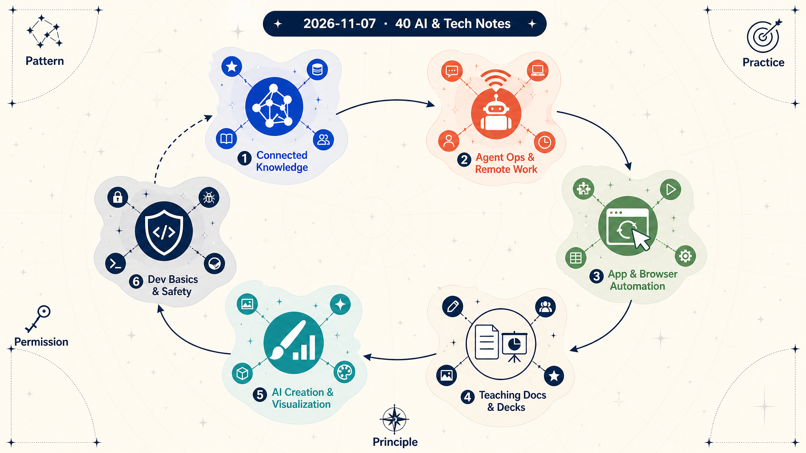

# 2026-11-07 · AI 학습은 별자리처럼 연결된다 · 릴리스 40건

<section class="release-infographic">
  <figure class="release-infographic__figure">
    
    <figcaption>이번 40선은 도구 목록이 아니라, 배운 패턴이 실제 작업과 안전한 운영 원칙으로 이어지는 학습 별자리다.</figcaption>
  </figure>
  

    
Pattern · Practice · Principle · Permission · Release 40

    
이번 노트들은 AI를 하나의 만능 도구로 설명하지 않는다. 지식과 자료를 연결하고, 에이전트가 작업을 나누고, 앱·문서·창작 도구를 움직이고, 마지막에는 개발 기초와 사람의 판단으로 경계를 세우는 흐름을 함께 보여준다.

    <ul class="release-infographic__points">
      <li><strong>연결된 지식</strong> MCP, 온톨로지, 학습 스킬과 지식 그래프가 자료의 관계를 만든다.</li>
      <li><strong>운영되는 에이전트</strong> 역할·세션·원격 연결이 대화형 AI를 실제 작업 흐름으로 확장한다.</li>
      <li><strong>움직이는 작업면</strong> 앱, 브라우저, 문서, 3D와 영상이 AI가 만지는 결과물로 바뀐다.</li>
      <li><strong>사람의 경계</strong> 정확성·권한·비용·책임은 자동화 바깥이 아니라 자동화 안에 설계한다.</li>
    </ul>
  

</section>

2026년 11월 7일에 확인한 Readray 최신 노트 40개를 교사와 학습자가 다시 탐색하기 쉽게 묶었다. 각 항목은 원본과 공개 요약 링크를 함께 남겼고, 36번은 업로드 PDF라 외부 원본 링크가 없다. 원본의 기능·성능·가격·정책은 자료가 만들어진 시점의 주장이나 시연이므로 실제 사용 전에 다시 확인하자.

## 먼저 결론

1. **AI 학습은 도구 이름보다 연결 관계를 읽는 일에 가깝다.** 지식 연결, 에이전트 운영, 자동화, 창작, 개발 안전이 서로 떨어진 주제가 아니다.
2. **작업을 맡길수록 운영 구조가 학습 내용이 된다.** 역할·세션·원격 접근·파일 권한·검토 지점을 함께 설계해야 한다.
3. **생성 결과는 끝이 아니라 편집 가능한 중간 산출물이다.** 문서·발표·영상·3D 결과는 사실 확인과 품질 검수를 거쳐야 쓸 수 있다.
4. **가장 오래 남는 기초는 권한과 검증이다.** 자동화 범위가 넓어질수록 서비스 정책, 개인정보, 보안, 비용, 중단 방법을 먼저 확인해야 한다.

**이번 묶음을 읽는 질문**: 내가 배우려는 도구는 어떤 자료와 작업면을 연결하는가? 무엇을 자동 처리하고 어디에서 사람에게 되돌리는가? 결과를 다시 열어 수정하고 근거를 확인할 수 있는가?

## 이 글을 읽는 방법

아래 본문은 40개 노트를 여섯 개 흐름으로 묶은 학습 큐레이션이다. 각 항목의 짧은 설명은 공개 요약을 바탕으로 학습 관점에서 다시 썼으며, 마지막에는 복사해 쓸 수 있는 링크 표를 남겼다. 제목 앞 번호는 원래 학습 패키지의 항목 번호다.

## AI와 지식·학습 (4개)

자료를 모으는 것에서 그치지 않고, 자료 사이의 관계와 복습 흐름을 설계하는 영역이다.

### 1. 데이터와 지식 연결

데이터베이스와 개인 지식 베이스를 MCP로 연결한다. 스키마 파악, SQL 검증, 출처 기록을 통해 AI 조회의 근거 관리 방식을 살펴볼 수 있다.

- 원본: [auto-ontology-mcp](https://github.com/gogoymh/auto-ontology-mcp)
- 공개 요약: [Readray](https://readray.ai/digest/12046259/15964344?noteVersionId=15348086)

### 13. /teach 학습 스킬

학습 목표와 자료를 기록하고 인출 연습과 간격 반복을 결합한다. 수업이나 개인 연수에서 학습 기록과 복습 일정을 잇는 방법을 생각해 보자.

- 원본: [The /teach Skill](https://www.aihero.dev/skills-teach)
- 공개 요약: [Readray](https://readray.ai/digest/12011106/15924473?noteVersionId=15305356)

### 20. 지식 그래프와 에이전트

Grok Bot과 지식 그래프를 결합해 자료의 연결과 빈틈을 찾는 활용 사례다. 에이전트의 역할과 정보 흐름을 질문 설계로 바꾸어 볼 수 있다.

- 원본: [Knowledge Graph Brain](https://www.youtube.com/watch?v=nhVRR4rWgK4)
- 공개 요약: [Readray](https://readray.ai/digest/11974783/15882918?noteVersionId=15260267)

### 36. 인공지능 행동계획

2026~2028년 대한민국 인공지능 행동계획의 업로드 PDF 요약이다. 인프라, 산업·공공 전환, 인재와 제도 과제를 읽되 정책 목표와 실제 집행 현황은 구분해 확인하자.

- 원본: 업로드된 PDF (외부 URL 없음)
- 공개 요약: [Readray](https://readray.ai/digest/11917485/15816332?noteVersionId=15188056)

## 에이전트 운영과 원격 작업 (11개)

에이전트가 대화창을 넘어 여러 세션, 터미널, 원격 컴퓨터와 연결되는 흐름이다. 역할 분리, 상태 확인, 접근 권한과 중단 방법이 핵심이다.

### 7. 원격 에이전트 팀

OpenRig, Herdr, Tailscale, RustDesk를 역할 분담과 원격 작업의 한 묶음으로 살펴본다.

- 원본: [OpenRig · Herdr · RustDesk](https://www.youtube.com/watch?v=a_L1-cqXWKI)
- 공개 요약: [Readray](https://readray.ai/digest/12045643/15963674?noteVersionId=15347378)

### 8. 하네스·루프·그래프

지시문을 실행 환경, 반복 검증, 여러 단계의 흐름으로 확장한다. 작은 과제의 규칙·확인 기준·검토 지점을 그려 보자.

- 원본: [하네스·루프·그래프 엔지니어링](https://www.youtube.com/watch?v=uKbw2Lfn3wI)
- 공개 요약: [Readray](https://readray.ai/digest/12045628/15963656?noteVersionId=15347359)

### 17. AI 도구 세미나

컴퓨터 제어, 앱 개발, 게임·3D 콘텐츠 사례를 통해 무엇을 위임하고 사람이 어디서 판단하는지 살펴본다.

- 원본: [10월 31일 줌미팅 세미나](https://www.youtube.com/watch?v=Q_FnKIrV8MM)
- 공개 요약: [Readray](https://readray.ai/digest/11977177/15885675?noteVersionId=15263365)

### 18. 에이전트 오피스

실행 중인 에이전트 세션과 상태를 픽셀 아트 오피스로 시각화한다. 화면이 실제 작업 상태를 정확히 보여주는지 확인해 보자.

- 원본: [에이전트 오피스 마을](https://www.youtube.com/watch?v=Bpg9N3ZK-78)
- 공개 요약: [Readray](https://readray.ai/digest/11977128/15885627?noteVersionId=15263193)

### 19. Herdr 세션 관리

여러 에이전트 세션을 한 화면에서 관리한다. 백그라운드 실행과 원격 연결의 구조, 상태 확인 방식을 비교할 수 있다.

- 원본: [Herdr 앱](https://www.youtube.com/watch?v=HyzCDB0195U)
- 공개 요약: [Readray](https://readray.ai/digest/11977102/15885600?noteVersionId=15263163)

### 27. Hermes 업무 자동화

협업 메일, 계약 검토와 업무 기록을 다루는 사례다. 대외 메시지와 계약·결제 판단에는 사람의 검토를 둬야 한다.

- 원본: [Hermes 자동화 사례](https://www.youtube.com/watch?v=M-LGMC-mV2A)
- 공개 요약: [Readray](https://readray.ai/digest/11948749/15852952?noteVersionId=15228066)

### 30. hivemux 세션 관리

tmux 안에서 여러 Claude Code 세션 상태를 사이드바로 보여준다. 대기 중인 작업을 찾고 전환하는 흐름을 살펴보자.

- 원본: [hivemux](https://hivemux.dev/)
- 공개 요약: [Readray](https://readray.ai/digest/11935208/15837150?noteVersionId=15210924)

### 31. Codex 전광판

Codex 세션 활동을 공항 전광판처럼 시각화한다. 작업 이력과 상태를 멀리서 확인하는 인터페이스의 효용을 검토해 보자.

- 원본: [ohmydeparture](https://github.com/edwardkim/ohmydeparture)
- 공개 요약: [Readray](https://readray.ai/digest/11934156/15835865?noteVersionId=15209533)

### 33. Tailscale과 SSH

Tailscale 사설망과 SSH 원격 명령을 연결한다. 절전, 원격 로그인, 허용 기기와 접근 권한을 함께 점검해야 한다.

- 원본: [Tailscale + SSH](https://www.youtube.com/watch?v=bI3bdAhlV38)
- 공개 요약: [Readray](https://readray.ai/digest/11925901/15826152?noteVersionId=15198775)

### 37. 에이전트 입문

Claude 데스크톱과 작업 폴더로 업무형 에이전트를 만드는 입문 사례다. 작은 과제와 사람의 결과 확인부터 시작해 보자.

- 원본: [AI 에이전트 만들기](https://www.youtube.com/watch?v=urlbNkusl1Q)
- 공개 요약: [Readray](https://readray.ai/digest/11915840/15814488?noteVersionId=15186076)

### 38. OpenBot 협업 공간

여러 AI 동료가 로컬 작업 공간에서 파일과 작업을 공유한다. 파일 수정과 명령 실행 권한의 허용 범위를 먼저 살펴보자.

- 원본: [openbot](https://github.com/nightly-labs/openbot)
- 공개 요약: [Readray](https://readray.ai/digest/11910461/15807909?noteVersionId=15178784)

## 앱·브라우저 자동화 (7개)

접근성 트리, 모바일 기기, 에이전트 브라우저와 Windows MCP가 AI의 작업면을 화면 안쪽으로 넓힌다. 자동화 가능성과 실제 접근 허가는 다르다.

### 9. 카카오톡 자동화

접근성 트리로 앱 반복 작업을 제어한 사례다. 서비스 정책과 계정 위험을 함께 살펴보자.

- 원본: [카카오톡 자동화](https://www.youtube.com/watch?v=h1TV_GRnp-A)
- 공개 요약: [Readray](https://readray.ai/digest/12045584/15963611?noteVersionId=15347339)

### 15. 모바일 기기 자동화

MCP로 실제 iPhone과 Android 화면을 보고 탭·입력·스와이프하도록 연결한다. 기기 지원 범위, 비용과 접근 권한을 확인하자.

- 원본: [phone-harness/mcp](https://github.com/phone-harness/mcp)
- 공개 요약: [Readray](https://readray.ai/digest/12009344/15922369?noteVersionId=15303118)

### 21. 데스크톱 UI 자동화

접근성 트리로 UI 요소를 식별하고 데스크톱을 조작한다. 화면을 새로 읽어 대상이 바뀌었는지 확인하는 절차가 중요하다.

- 원본: [agent-desktop](https://github.com/vercel-labs/agent-desktop)
- 공개 요약: [Readray](https://readray.ai/digest/11974384/15882467?noteVersionId=15259790)

### 29. ego lite 광고 영상

유료 광고가 포함된 영상으로 에이전트 탭과 협업 방식을 소개한다. 광고 맥락을 고려해 사용 조건과 권한을 비교하자.

- 원본: [ego lite 광고 영상](https://www.youtube.com/watch?v=7uOxn_077Ok)
- 공개 요약: [Readray](https://readray.ai/digest/11948738/15852941?noteVersionId=15228054)

### 32. ego lite 활용

에이전트 브라우저와 기존 자동화를 비교한다. 작업 분리와 로그인 활용의 편의성과 접근 권한을 함께 살펴보자.

- 원본: [ego lite 사용기](https://www.youtube.com/watch?v=zQKLH66TKEo)
- 공개 요약: [Readray](https://readray.ai/digest/11925921/15826174?noteVersionId=15198797)

### 34. AI 에이전트 비교

영상 제작과 항공권 탐색을 같은 과제로 비교한 사례다. 결과는 조건과 시점에 좌우되므로 자신의 과제로 다시 시험하자.

- 원본: [세 AI 에이전트 비교](https://www.youtube.com/watch?v=eby27mRZTbY)
- 공개 요약: [Readray](https://readray.ai/digest/11925773/15826007?noteVersionId=15198619)

### 40. Windows 자동화

Windows 앱·UI·파일을 다루는 MCP 서버다. 자동화 범위, 파일·시스템 접근 권한과 중단 방법을 검토하자.

- 원본: [Windows-MCP](https://github.com/CursorTouch/Windows-MCP)
- 공개 요약: [Readray](https://readray.ai/digest/11908708/15805791?noteVersionId=15176416)

## 교사 문서와 발표 자료 (5개)

문서 편집과 발표 제작은 정확성뿐 아니라 파일 보존, 형식 유지, 사실 검토가 품질 기준이 된다.

### 10. 교사용 공문 초안

기존 한글 공문을 바탕으로 새 초안을 만들고 날짜와 변경 사항을 확인한다. 양식과 사실관계를 교사가 검토하는 절차가 핵심이다.

- 원본: [teacher_doc](https://github.com/raphysicst-create/teacher_doc)
- 공개 요약: [Readray](https://readray.ai/digest/12042589/15960243?noteVersionId=15343626)

### 12. 쌤글 문서 편집

브라우저에서 한글·워드·PDF를 편집하고 변환한다. AI와 연결할 때 파일 처리 방식과 지원 기능을 직접 확인하자.

- 원본: [쌤글](https://ssamtool.com/tool/geul/)
- 공개 요약: [Readray](https://readray.ai/digest/12015875/15929908?noteVersionId=15311148)

### 14. HWP Cloud

브라우저에서 HWP·HWPX를 열고 수정한다. 문단·표 편집과 복잡한 양식의 보존 여부를 시험해 볼 수 있다.

- 원본: [HWP Cloud](https://hwp-cloud.vercel.app/)
- 공개 요약: [Readray](https://readray.ai/digest/12011097/15924465?noteVersionId=15305348)

### 26. Gamma 발표 자료

Gamma로 발표 자료를 만들고 편집·내보내기한다. 무료 조건과 기능은 실제 이용 시 확인하고 AI 내용의 정확성을 검토하자.

- 원본: [Gamma PPT AI](https://www.youtube.com/watch?v=PSzU8t_vu40)
- 공개 요약: [Readray](https://readray.ai/digest/11948753/15852957?noteVersionId=15228071)

### 35. HWPX 문서 편집

Codex 데스크톱에서 한글 문서 초안과 선택 영역을 편집한다. 표·서식·문서 구조가 유지되는지 확인하는 흐름을 생각해 보자.

- 원본: [stoom-pwh](https://github.com/wansucong-stoom/stoom-pwh)
- 공개 요약: [Readray](https://readray.ai/digest/11924815/15824956?noteVersionId=15197499)

## AI 창작과 시각화 (10개)

이미지·영상·3D는 생성 한 번으로 끝나지 않고 에셋 생성, 편집, 배치, 렌더링, 정확성 검토가 이어지는 제작 과정이다.

### 2. 에이전트 아바타

SVG 경로와 눈 위치를 JSON으로 정의해 대화형 에이전트 아바타를 표시한다. 규격·렌더러·편집기를 분리하는 방법을 살펴보자.

- 원본: [open-bot-avatar](https://github.com/DominikScholz/open-bot-avatar)
- 공개 요약: [Readray](https://readray.ai/digest/12046255/15964340?noteVersionId=15348081)

### 3. AI 이미지와 GIF

GIF 제작, 참조 이미지, 부분 수정 기능을 시연한다. 프레임 수와 해상도, 최종 색과 움직임을 직접 확인하자.

- 원본: [GPT 이미지 2.6](https://www.youtube.com/watch?v=VtPhdzLEKP4)
- 공개 요약: [Readray](https://readray.ai/digest/12045697/15963752?noteVersionId=15347459)

### 11. 창작 에이전트 스킬

이미지·영상·오디오·3D 제작 스킬 모음이다. 클라우드 생성과 Blender 같은 로컬 제작 도구의 차이를 살펴보자.

- 원본: [scenario-labs/skills](https://github.com/scenario-labs/skills)
- 공개 요약: [Readray](https://readray.ai/digest/12019106/15933657?noteVersionId=15315179)

### 16. Blender 장면 생성

짧은 설명에서 소품, 배치, 조명, 카메라, 렌더링까지 연결한다. 제작 단계와 비용을 나누어 자동화의 한계를 따져 보자.

- 원본: [anyscene](https://github.com/apekshik/anyscene)
- 공개 요약: [Readray](https://readray.ai/digest/11979901/15888764?noteVersionId=15266661)

### 22. MCP for Blender

언어모델과 Blender를 MCP로 연결한다. 자동 생성 코드의 실행 범위, 안전 설정과 결과 검토가 중요하다.

- 원본: [mcp-for-blender](https://github.com/ahujasid/mcp-for-blender)
- 공개 요약: [Readray](https://readray.ai/digest/11951026/15855565?noteVersionId=15230863)

### 23. Blender 전문 스킬

Blender 작업을 역할별 스킬로 나누어 제작 흐름을 수행한다. 지시·제작·검수 단계를 어떻게 나눌지 비교해 보자.

- 원본: [blender-skills](https://github.com/arjun988/blender-skills)
- 공개 요약: [Readray](https://readray.ai/digest/11951006/15855545?noteVersionId=15230843)

### 24. 영상 생성과 편집

Google Flow에서 장면을 만들고 Aside로 클립을 이어 붙인다. 생성과 편집을 나누어 계획하고 연결과 소리를 점검하자.

- 원본: [Flow + Aside](https://www.youtube.com/watch?v=ugrFhWEAlAk)
- 공개 요약: [Readray](https://readray.ai/digest/11948773/15852984?noteVersionId=15228106)

### 25. AI 숏폼 드라마

AI 영상 생성으로 짧은 드라마를 제작한다. 콘티, 인물 일관성, 컷 연결과 비용을 함께 검토하자.

- 원본: [AI 숏폼드라마](https://www.youtube.com/watch?v=ummewW1Vqwg)
- 공개 요약: [Readray](https://readray.ai/digest/11948762/15852969?noteVersionId=15228091)

### 28. 모션 디자인 용어

페이드, 이징, 스프링 등 화면 움직임의 어휘를 익힌다. 효과 이름에 지속 시간과 시작 조건을 더해 요청해 보자.

- 원본: [모션 디자인 용어 24가지](https://www.youtube.com/watch?v=r7iS0Gw3Jq4)
- 공개 요약: [Readray](https://readray.ai/digest/11948746/15852948?noteVersionId=15228062)

### 39. 3D 해부학 영상

코드 기반 3D 해부학 설명 영상을 만든다. 교육용 시각화의 가능성과 함께 해부학적 정확성의 전문가 검토를 기억하자.

- 원본: [anatomy-motion](https://github.com/passeth/anatomy-motion)
- 공개 요약: [Readray](https://readray.ai/digest/11908857/15805942?noteVersionId=15176586)

## 개발 기초와 안전 (3개)

AI가 코드를 만들거나 시스템을 분석할수록 구조, 권한, 보안, 성능을 사람이 판별할 수 있어야 한다.

### 4. 풀스택 개발 기초

웹 구조, 데이터베이스, 보안과 배포를 이해해야 AI가 만든 코드도 운영할 수 있다는 강의다. 자신의 지식 공백과 비교해 보자.

- 원본: [풀스택 개발 기초](https://www.youtube.com/watch?v=R7Xuw4jgB-s)
- 공개 요약: [Readray](https://readray.ai/digest/12045685/15963732?noteVersionId=15347439)

### 5. 리버스 엔지니어링

완성된 프로그램의 구조와 동작 원리를 추론한다. 보안 분석과 유지보수 사례를 보되 대상의 사용 권한과 범위를 먼저 확인하자.

- 원본: [리버스 엔지니어링](https://www.youtube.com/watch?v=Jipn-_GNQAQ)
- 공개 요약: [Readray](https://readray.ai/digest/12045670/15963716?noteVersionId=15347423)

### 6. Rust 전환 판단

Rust의 메모리 안전성과 성능, AI 코드 전환 사례를 비교한다. 전환은 측정으로 정하고 테스트와 성능 재측정을 병행하자.

- 원본: [Rust 전환 판단](https://www.youtube.com/watch?v=RvWRPwbs5H0)
- 공개 요약: [Readray](https://readray.ai/digest/12045653/15963692?noteVersionId=15347398)

## 복사용 링크 표

아래 표는 40개 항목의 카테고리, 주제, 원본, 공개 요약 링크를 한곳에 모은 목록이다. 36번은 원본 파일이 업로드 PDF이므로 외부 원본 URL 대신 그 사실을 표시했다.

| 카테고리 | 주제 | 원본 링크 | 공개 요약 링크 |
|---|---|---|---|
| AI와 지식·학습 | 1. 데이터와 지식 연결 | [원본](https://github.com/gogoymh/auto-ontology-mcp) | [공개 요약](https://readray.ai/digest/12046259/15964344?noteVersionId=15348086) |
| AI 창작과 시각화 | 2. 에이전트 아바타 | [원본](https://github.com/DominikScholz/open-bot-avatar) | [공개 요약](https://readray.ai/digest/12046255/15964340?noteVersionId=15348081) |
| AI 창작과 시각화 | 3. AI 이미지와 GIF | [원본](https://www.youtube.com/watch?v=VtPhdzLEKP4) | [공개 요약](https://readray.ai/digest/12045697/15963752?noteVersionId=15347459) |
| 개발 기초와 안전 | 4. 풀스택 개발 기초 | [원본](https://www.youtube.com/watch?v=R7Xuw4jgB-s) | [공개 요약](https://readray.ai/digest/12045685/15963732?noteVersionId=15347439) |
| 개발 기초와 안전 | 5. 리버스 엔지니어링 | [원본](https://www.youtube.com/watch?v=Jipn-_GNQAQ) | [공개 요약](https://readray.ai/digest/12045670/15963716?noteVersionId=15347423) |
| 개발 기초와 안전 | 6. Rust 전환 판단 | [원본](https://www.youtube.com/watch?v=RvWRPwbs5H0) | [공개 요약](https://readray.ai/digest/12045653/15963692?noteVersionId=15347398) |
| 에이전트 운영과 원격 작업 | 7. 원격 에이전트 팀 | [원본](https://www.youtube.com/watch?v=a_L1-cqXWKI) | [공개 요약](https://readray.ai/digest/12045643/15963674?noteVersionId=15347378) |
| 에이전트 운영과 원격 작업 | 8. 하네스·루프·그래프 | [원본](https://www.youtube.com/watch?v=uKbw2Lfn3wI) | [공개 요약](https://readray.ai/digest/12045628/15963656?noteVersionId=15347359) |
| 앱·브라우저 자동화 | 9. 카카오톡 자동화 | [원본](https://www.youtube.com/watch?v=h1TV_GRnp-A) | [공개 요약](https://readray.ai/digest/12045584/15963611?noteVersionId=15347339) |
| 교사 문서와 발표 자료 | 10. 교사용 공문 초안 | [원본](https://github.com/raphysicst-create/teacher_doc) | [공개 요약](https://readray.ai/digest/12042589/15960243?noteVersionId=15343626) |
| AI 창작과 시각화 | 11. 창작 에이전트 스킬 | [원본](https://github.com/scenario-labs/skills) | [공개 요약](https://readray.ai/digest/12019106/15933657?noteVersionId=15315179) |
| 교사 문서와 발표 자료 | 12. 쌤글 문서 편집 | [원본](https://ssamtool.com/tool/geul/) | [공개 요약](https://readray.ai/digest/12015875/15929908?noteVersionId=15311148) |
| AI와 지식·학습 | 13. /teach 학습 스킬 | [원본](https://www.aihero.dev/skills-teach) | [공개 요약](https://readray.ai/digest/12011106/15924473?noteVersionId=15305356) |
| 교사 문서와 발표 자료 | 14. HWP Cloud | [원본](https://hwp-cloud.vercel.app/) | [공개 요약](https://readray.ai/digest/12011097/15924465?noteVersionId=15305348) |
| 앱·브라우저 자동화 | 15. 모바일 기기 자동화 | [원본](https://github.com/phone-harness/mcp) | [공개 요약](https://readray.ai/digest/12009344/15922369?noteVersionId=15303118) |
| AI 창작과 시각화 | 16. Blender 장면 생성 | [원본](https://github.com/apekshik/anyscene) | [공개 요약](https://readray.ai/digest/11979901/15888764?noteVersionId=15266661) |
| 에이전트 운영과 원격 작업 | 17. AI 도구 세미나 | [원본](https://www.youtube.com/watch?v=Q_FnKIrV8MM) | [공개 요약](https://readray.ai/digest/11977177/15885675?noteVersionId=15263365) |
| 에이전트 운영과 원격 작업 | 18. 에이전트 오피스 | [원본](https://www.youtube.com/watch?v=Bpg9N3ZK-78) | [공개 요약](https://readray.ai/digest/11977128/15885627?noteVersionId=15263193) |
| 에이전트 운영과 원격 작업 | 19. Herdr 세션 관리 | [원본](https://www.youtube.com/watch?v=HyzCDB0195U) | [공개 요약](https://readray.ai/digest/11977102/15885600?noteVersionId=15263163) |
| AI와 지식·학습 | 20. 지식 그래프와 에이전트 | [원본](https://www.youtube.com/watch?v=nhVRR4rWgK4) | [공개 요약](https://readray.ai/digest/11974783/15882918?noteVersionId=15260267) |
| 앱·브라우저 자동화 | 21. 데스크톱 UI 자동화 | [원본](https://github.com/vercel-labs/agent-desktop) | [공개 요약](https://readray.ai/digest/11974384/15882467?noteVersionId=15259790) |
| AI 창작과 시각화 | 22. MCP for Blender | [원본](https://github.com/ahujasid/mcp-for-blender) | [공개 요약](https://readray.ai/digest/11951026/15855565?noteVersionId=15230863) |
| AI 창작과 시각화 | 23. Blender 전문 스킬 | [원본](https://github.com/arjun988/blender-skills) | [공개 요약](https://readray.ai/digest/11951006/15855545?noteVersionId=15230843) |
| AI 창작과 시각화 | 24. 영상 생성과 편집 | [원본](https://www.youtube.com/watch?v=ugrFhWEAlAk) | [공개 요약](https://readray.ai/digest/11948773/15852984?noteVersionId=15228106) |
| AI 창작과 시각화 | 25. AI 숏폼 드라마 | [원본](https://www.youtube.com/watch?v=ummewW1Vqwg) | [공개 요약](https://readray.ai/digest/11948762/15852969?noteVersionId=15228091) |
| 교사 문서와 발표 자료 | 26. Gamma 발표 자료 | [원본](https://www.youtube.com/watch?v=PSzU8t_vu40) | [공개 요약](https://readray.ai/digest/11948753/15852957?noteVersionId=15228071) |
| 에이전트 운영과 원격 작업 | 27. Hermes 업무 자동화 | [원본](https://www.youtube.com/watch?v=M-LGMC-mV2A) | [공개 요약](https://readray.ai/digest/11948749/15852952?noteVersionId=15228066) |
| AI 창작과 시각화 | 28. 모션 디자인 용어 | [원본](https://www.youtube.com/watch?v=r7iS0Gw3Jq4) | [공개 요약](https://readray.ai/digest/11948746/15852948?noteVersionId=15228062) |
| 앱·브라우저 자동화 | 29. ego lite 광고 영상 | [원본](https://www.youtube.com/watch?v=7uOxn_077Ok) | [공개 요약](https://readray.ai/digest/11948738/15852941?noteVersionId=15228054) |
| 에이전트 운영과 원격 작업 | 30. hivemux 세션 관리 | [원본](https://hivemux.dev/) | [공개 요약](https://readray.ai/digest/11935208/15837150?noteVersionId=15210924) |
| 에이전트 운영과 원격 작업 | 31. Codex 전광판 | [원본](https://github.com/edwardkim/ohmydeparture) | [공개 요약](https://readray.ai/digest/11934156/15835865?noteVersionId=15209533) |
| 앱·브라우저 자동화 | 32. ego lite 활용 | [원본](https://www.youtube.com/watch?v=zQKLH66TKEo) | [공개 요약](https://readray.ai/digest/11925921/15826174?noteVersionId=15198797) |
| 에이전트 운영과 원격 작업 | 33. Tailscale과 SSH | [원본](https://www.youtube.com/watch?v=bI3bdAhlV38) | [공개 요약](https://readray.ai/digest/11925901/15826152?noteVersionId=15198775) |
| 앱·브라우저 자동화 | 34. AI 에이전트 비교 | [원본](https://www.youtube.com/watch?v=eby27mRZTbY) | [공개 요약](https://readray.ai/digest/11925773/15826007?noteVersionId=15198619) |
| 교사 문서와 발표 자료 | 35. HWPX 문서 편집 | [원본](https://github.com/wansucong-stoom/stoom-pwh) | [공개 요약](https://readray.ai/digest/11924815/15824956?noteVersionId=15197499) |
| AI와 지식·학습 | 36. 인공지능 행동계획 | 업로드 PDF (외부 원본 없음) | [공개 요약](https://readray.ai/digest/11917485/15816332?noteVersionId=15188056) |
| 에이전트 운영과 원격 작업 | 37. 에이전트 입문 | [원본](https://www.youtube.com/watch?v=urlbNkusl1Q) | [공개 요약](https://readray.ai/digest/11915840/15814488?noteVersionId=15186076) |
| 에이전트 운영과 원격 작업 | 38. OpenBot 협업 공간 | [원본](https://github.com/nightly-labs/openbot) | [공개 요약](https://readray.ai/digest/11910461/15807909?noteVersionId=15178784) |
| AI 창작과 시각화 | 39. 3D 해부학 영상 | [원본](https://github.com/passeth/anatomy-motion) | [공개 요약](https://readray.ai/digest/11908857/15805942?noteVersionId=15176586) |
| 앱·브라우저 자동화 | 40. Windows 자동화 | [원본](https://github.com/CursorTouch/Windows-MCP) | [공개 요약](https://readray.ai/digest/11908708/15805791?noteVersionId=15176416) |

## 용어 정리

| 용어 | 쉬운 설명과 예 |
|---|---|
| AI 에이전트 | 목표에 맞춰 도구를 사용하며 여러 단계를 수행하는 프로그램. 예: 문서를 찾고 초안을 작성한다. |
| MCP | AI가 외부 도구와 자료를 연결할 때 사용하는 방식. 예: 문서 검색 도구를 호출한다. |
| 온톨로지·지식 그래프 | 개념과 그 관계를 연결한 구조. 예: 교과와 수업, 자료 사이의 관계를 그린다. |
| 접근성 트리 | 화면의 버튼과 입력란 같은 요소를 구조화한 정보. 예: 자동화가 ‘저장’ 버튼을 찾는다. |
| 하네스 | AI 작업에 적용할 환경과 규칙. 예: 수정 뒤 테스트를 실행하도록 설정한다. |
| 루프·그래프 | 결과를 확인하고 고치는 반복과, 여러 작업을 연결한 흐름. |
| 풀스택 | 화면부터 서버와 데이터 저장까지 서비스의 여러 부분을 함께 살펴보는 관점. |
| 리버스 엔지니어링 | 완성된 제품의 구조와 동작을 분석해 원리를 알아내는 일. |
| SSH·Tailscale | 원격 컴퓨터에 명령을 보내는 방식과 기기를 사설망으로 연결하는 도구. |
| tmux | 터미널 하나에서 여러 작업을 나누어 관리하는 도구. |
| HWPX | 한글 문서의 개방형 파일 형식. 예: 표와 본문을 포함한 학교 문서. |
| 이징 | 움직임의 시작과 끝 속도를 조절하는 방식. 예: 버튼이 처음엔 빠르고 끝에서 천천히 멈춘다. |

## 다음에 바로 쓸 체크리스트

<ul class="note-list">
  <li>자료를 연결하기 전에 원본의 공개 범위, 최신성, 이용 조건을 확인한다.</li>
  <li>에이전트에 맡길 작업마다 입력 파일, 허용 도구, 사람의 승인 지점을 한 줄로 적는다.</li>
  <li>문서·코드·이미지·영상 결과는 사실·형식·권한을 확인한 뒤 공유한다.</li>
  <li>원격 접속과 UI 자동화에는 허용 기기, 계정 범위, 로그, 중단 방법을 함께 둔다.</li>
  <li>도입 전 비용과 성능을 원본의 주장으로 확정하지 말고 작은 과제로 다시 측정한다.</li>
</ul>

## 남겨둘 판단

이번 40개는 “어떤 AI가 제일 좋은가”를 고르는 목록이 아니다. 지식이 연결되고, 에이전트가 역할을 나누고, 앱과 문서와 창작 도구가 작업면이 되고, 개발 기초와 안전 원칙이 그 흐름을 지지하는 과정을 한 번에 읽는 지도에 가깝다. 다음 학습에서는 도구를 더 모으기보다 한 가지 실제 과제를 골라 **연결 → 실행 → 결과물 편집 → 사람의 검토**를 끝까지 통과시켜 보는 편이 낫다.
