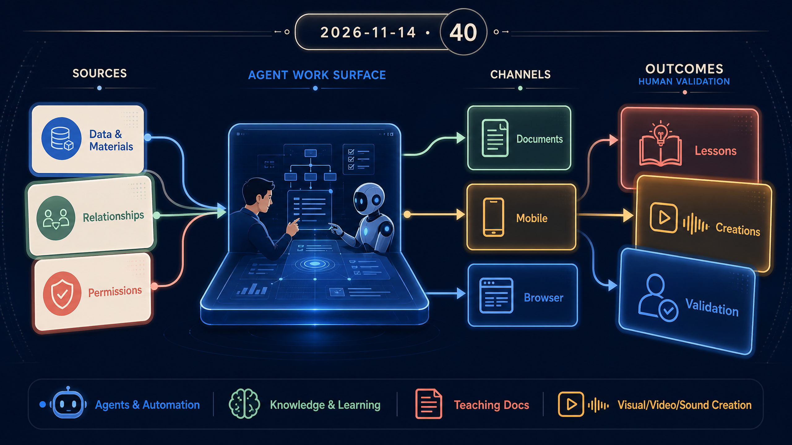

# 2026-11-14 · 자료가 작업면으로 흐르는 AI 학습 지도 · 릴리스 40건

<section class="release-map-hero">
  <figure class="release-map-hero__figure">
    
    <figcaption>자료를 모으는 일은 출발점이다. 이번 40선은 자료가 작업면을 만나 결과물이 되고, 다시 사람의 검증으로 돌아오는 경로를 보여준다.</figcaption>
  </figure>
  <aside class="release-map-hero__rail">
    
FIELD GUIDE · 40 NOTES · 2026.11.14

    <h2>자료 → 작업면 → 검증</h2>
    <ol>
      <li><strong>관계</strong>검색·온톨로지·학습 기록</li>
      <li><strong>실행</strong>에이전트·앱·모바일·원격</li>
      <li><strong>제작</strong>문서·영상·오디오·3D</li>
      <li><strong>판단</strong>권한·정확성·사용 조건</li>
    </ol>
  </aside>
  

    
<strong>이번 큐레이션의 질문</strong> AI에게 무엇을 맡길 수 있는가보다, 어떤 자료와 작업면을 연결하고 어디에서 사람에게 되돌릴 것인가를 먼저 묻는다.

  

</section>

2026년 11월 14일에 수집한 최근 자료 가운데 원본과 공개 요약을 확인한 40개를 교육과 창작에 AI 도구를 활용하는 교사와 학습자의 관점에서 다시 묶었다. 각 항목에는 원본 링크와 공개 요약 링크를 함께 남겼다. 원본의 기능·성능·가격·정책은 자료가 만들어진 시점의 주장이나 시연이므로 실제 사용 전에 다시 확인하자.

## 먼저 결론

1. **에이전트의 다음 확장은 화면과 모바일이라는 작업면이다.** 접근성 트리와 기기 연결은 자동화를 구체적으로 만들지만, 허용 범위와 중단 방법이 함께 있어야 한다.
2. **검색은 관계를 다루는 쪽으로 이동한다.** GraphRAG, 온톨로지, 학습 스킬은 자료를 찾는 데서 그치지 않고 개념과 복습 흐름을 연결한다.
3. **문서와 창작은 같은 제작 파이프라인 안으로 들어온다.** 공문, 영상, 오디오, 3D 결과를 만들 수 있어도 사람이 사실·형식·사용 조건을 점검해야 한다.
4. **자동화의 완성 조건은 실행이 아니라 검증이다.** 특히 30번처럼 제목이 바뀌는 자료는 영상 ID와 원본을 대조하는 습관이 필요하다.

## 네 갈래로 읽는 이번 40선

아래 항목은 첨부된 학습 패키지의 원래 번호를 유지하면서, 같은 질문을 공유하는 네 영역으로 다시 배열했다. 제목과 설명은 패키지에 적힌 내용을 보존했고, 링크도 원본 그대로 옮겼다.

## 에이전트와 자동화 (18개)

AI가 명령을 기다리는 도구에서 화면·모바일·세션·원격 작업을 수행하는 운영면으로 넓어지는 흐름이다. 편리함보다 먼저 권한, 중단, 결과 확인을 설계해야 한다.

### 1. gemini-skills/skills/gemini-api-cli/SKILL.md at main · google-gemini/gemini-skills · GitHub

Gemini API를 명령줄에서 다루는 스킬 문서다. 미디어 생성과 파일 분석을 자동화할 때 입력·출력과 인증 방식을 함께 살펴볼 수 있다.

- 원본: [원본 링크](https://github.com/google-gemini/gemini-skills/blob/main/skills/gemini-api-cli/SKILL.md)
- 공개 요약: [Readray 공개 요약](https://readray.ai/digest/12133102/16061451?noteVersionId=15451689)

### 3. Aside로 맥북에서 카톡·당근 자동화 끝냈습니다

Aside를 이용해 메시지 요약과 매물 검색을 자동화하는 시연이다. 서비스의 이용 조건과 개인정보 접근 범위를 확인하며 활용해 보자.

- 원본: [원본 링크](https://www.youtube.com/watch?v=LyJBoEKGlxU)
- 공개 요약: [Readray 공개 요약](https://readray.ai/digest/12132787/16061088?noteVersionId=15451294)

### 4. 해외에서 난리난 phone-harness 직접 사용해봤습니다

Phone Harness로 스마트폰의 터치·입력 등을 자동화하는 실험이다. 화면 인식의 한계와 기기 접근 권한을 함께 살펴본다.

- 원본: [원본 링크](https://www.youtube.com/watch?v=-7akHqSkpzE)
- 공개 요약: [Readray 공개 요약](https://readray.ai/digest/12113789/16040570?noteVersionId=15429521)

### 5. GitHub - storytold/craft-anything: Craft Anything: understand how any software works, and craft your

기존 소프트웨어의 동작을 분석하고 새 프로젝트를 만든 뒤 비교하는 도구다. 시각 정보 중심의 분석과 파일을 읽는 방식의 차이를 살펴보자.

- 원본: [원본 링크](https://github.com/storytold/craft-anything)
- 공개 요약: [Readray 공개 요약](https://readray.ai/digest/12090435/16014677?noteVersionId=15401859)

### 6. GitHub - vercel-labs/agent-desktop: Computer use CLI for AI agents · GitHub

접근성 트리를 이용해 에이전트가 화면의 구조를 읽고 조작하도록 돕는다. 화면 좌표에만 의존하는 자동화와 비교할 수 있다.

- 원본: [원본 링크](https://github.com/vercel-labs/agent-desktop)
- 공개 요약: [Readray 공개 요약](https://readray.ai/digest/12087431/16010917?noteVersionId=15397911)

### 10. 클로드 앱이 완전히 달라졌습니다! '2.0'이라 불리는 핵심 기능 8가지 업무 활용법

영상은 클로드 앱의 환경 설정, 작업 분할과 결과물 공유 흐름을 시연한다. 여러 세션을 관리하는 방법을 살펴보자.

- 원본: [원본 링크](https://www.youtube.com/watch?v=lYCIvhvFkXg)
- 공개 요약: [Readray 공개 요약](https://readray.ai/digest/12062748/15982896?noteVersionId=15367857)

### 11. 뮤즈 뺨치는 AI 비서, 한국이 만들었다 - 김덕진 소장 (IT커뮤니케이션 연구소)

국내 AI 비서 사례를 살펴보며 전화·예약 등 실제 업무를 맡기는 흐름을 소개한다. 실행 결과에 사람의 최종 확인을 두는 방법도 다룬다.

- 원본: [원본 링크](https://www.youtube.com/watch?v=9PjDBbupocc)
- 공개 요약: [Readray 공개 요약](https://readray.ai/digest/12062724/15982872?noteVersionId=15367832)

### 14. 내 통화와 카톡, 이메일을 기억하는 AI 비서, 직접 만들어봤습니다.

통화·메시지·메일을 분석하는 개인 비서 구축 사례다. 개인정보를 연결할 때 접근 범위와 보관 방식을 신중히 정해야 한다.

- 원본: [원본 링크](https://www.youtube.com/watch?v=C4oI-VEeFDo)
- 공개 요약: [Readray 공개 요약](https://readray.ai/digest/12059332/15978977?noteVersionId=15363603)

### 15. 11월 7일 줌미팅 세미나(코너속의 코너:pickle desktop 버전, grill-me, ego-lite vs aside, 쌤글, 김준홍님의 UX 소개, 그밖의 다양한 이야기)

다양한 AI 도구와 활용 사례를 다룬 11월 7일 세미나 영상이다. 요약에 담긴 영상 생성 기능 소개도 살펴볼 수 있다.

- 원본: [원본 링크](https://www.youtube.com/watch?v=6gVe2yyptWg)
- 공개 요약: [Readray 공개 요약](https://readray.ai/digest/12058695/15978295?noteVersionId=15362872)

### 16. AI 코딩하시면 써보세요. 허더가 무료 앱으로 나왔습니다 [3분 완벽 정리]

여러 코딩 에이전트의 작업을 한곳에서 확인하고 지시하는 허더 앱을 소개한다. 앱의 실제 이름과 현재 제공 기능은 원본에서 다시 확인하자.

- 원본: [원본 링크](https://www.youtube.com/watch?v=zpf84UcXcXo)
- 공개 요약: [Readray 공개 요약](https://readray.ai/digest/12058688/15978286?noteVersionId=15362863)

### 18. Jev 같은 System 1 모델이 오픈 웨이트로 나왔다 — Clef·Laya 를 맥에서 직접 돌려봤습니다

Clef와 Laya를 로컬에서 시험하며 빠른 반응형 모델과 복잡한 추론 모델의 역할 분담을 설명한다.

- 원본: [원본 링크](https://www.youtube.com/watch?v=yuFEX-RvQUc)
- 공개 요약: [Readray 공개 요약](https://readray.ai/digest/12058580/15978172?noteVersionId=15362743)

### 21. Cursor · Cloud Agents

클라우드에서 개발 작업을 맡기고 여러 환경에서 관리하는 Cursor의 소개 자료다. 코드 생성부터 검증까지의 흐름을 살펴볼 수 있다.

- 원본: [원본 링크](https://cursor.com/ko/cloud)
- 공개 요약: [Readray 공개 요약](https://readray.ai/digest/12047877/15966221?noteVersionId=15350064)

### 26. 리버스 엔지니어링 모든것 12분 만에 마스터하기ㅣ핵심 개념, REA 설치 및 실습까지

완성된 소프트웨어의 동작을 분석하는 개념과 AI 도구 활용을 소개한다. 분석 목적과 적용 범위를 함께 살펴보자.

- 원본: [원본 링크](https://www.youtube.com/watch?v=Jipn-_GNQAQ)
- 공개 요약: [Readray 공개 요약](https://readray.ai/digest/12045670/15963716?noteVersionId=15347423)

### 28. OpenRig · Herdr · RustDesk로 AI 에이전트 팀 굴리기 — 역할별 모델 팀부터 원격까지 (2시간 무료 강의)

OpenRig와 Herdr 등으로 역할별 에이전트 팀을 구성하고 원격으로 관리하는 실습 강의다. 설계부터 검증까지의 흐름을 따라갈 수 있다.

- 원본: [원본 링크](https://www.youtube.com/watch?v=a_L1-cqXWKI)
- 공개 요약: [Readray 공개 요약](https://readray.ai/digest/12045643/15963674?noteVersionId=15347378)

### 30. 카카오톡 자동화 이렇게 안하면 차단당합니다 (과정,방법 다 공개)

접근성 트리를 활용한 카카오톡 자동화와 직접 데이터 접근의 위험을 다루는 영상이다. Readray에 저장된 제목과 현재 YouTube 제목이 달라 원본 영상 ID를 대조했다.

> **제목 차이 확인:** Readray에 저장된 제목과 현재 YouTube 제목은 다르지만, 원본 링크의 영상 ID `h1TV_GRnp-A`가 일치한다. 이 글에서는 두 제목의 차이를 숨기지 않고, ID 대조를 거친 항목으로 표시한다.

- 원본: [원본 링크](https://www.youtube.com/watch?v=h1TV_GRnp-A)
- 공개 요약: [Readray 공개 요약](https://readray.ai/digest/12045584/15963611?noteVersionId=15347339)

### 36. GitHub - phone-harness/mcp: Connect AI agents to real iPhones and Androids · GitHub

에이전트가 모바일 기기를 보고 탭이나 입력을 수행하도록 연결하는 MCP 서버다. 앱 테스트를 자동화하는 활용을 살펴볼 수 있다.

- 원본: [원본 링크](https://github.com/phone-harness/mcp)
- 공개 요약: [Readray 공개 요약](https://readray.ai/digest/12009344/15922369?noteVersionId=15303118)

### 38. 10월 31일 줌미팅 세미나(코너속의코너: muse, ego lite& terra, 피클)

Muse와 원격 PC 제어, AI 코딩 등 여러 활용 사례를 나눈 10월 31일 세미나다. 사례별 가능성과 제약을 비교해 보자.

- 원본: [원본 링크](https://www.youtube.com/watch?v=Q_FnKIrV8MM)
- 공개 요약: [Readray 공개 요약](https://readray.ai/digest/11977177/15885675?noteVersionId=15263365)

### 40. Claude Code·Codex 여러 개를 한 창에서 — Herdr 앱 나왔다 (설치부터 휴대폰·다른 컴퓨터까지)

Herdr에서 여러 코딩 에이전트의 세션을 한 화면에 관리하는 방법을 소개한다. 원격 접속과 상태 확인 흐름을 살펴볼 수 있다.

- 원본: [원본 링크](https://www.youtube.com/watch?v=HyzCDB0195U)
- 공개 요약: [Readray 공개 요약](https://readray.ai/digest/11977102/15885600?noteVersionId=15263163)

## 지식과 학습 (8개)

자료를 찾는 일을 넘어 개념과 관계를 연결하고, 도구를 이해할 기초와 실제 학습 루프를 함께 만드는 흐름이다.

### 9. GitHub - microsoft/graphrag: A modular graph-based Retrieval-Augmented Generation (RAG) system · Git

문서에서 개체와 관계를 추출해 검색에 활용하는 GraphRAG 프로젝트다. 자료 관계를 따라 전체적인 질문에 답하는 방식을 살펴보자.

- 원본: [원본 링크](https://github.com/microsoft/graphrag)
- 공개 요약: [Readray 공개 요약](https://readray.ai/digest/12062902/15983072?noteVersionId=15368047)

### 17. 맥북으로 로컬에서 돌아가는 자율주행을 만들어봤습니다. 그리고 발견한 놀라운 사실

맥북에서 자율주행 모델을 실행하고 최적화하는 실험을 소개한다. 모델 성능과 더불어 데이터 수집과 개선의 중요성을 살펴볼 수 있다.

- 원본: [원본 링크](https://www.youtube.com/watch?v=5R2f9UBa0_c)
- 공개 요약: [Readray 공개 요약](https://readray.ai/digest/12058589/15978181?noteVersionId=15362753)

### 19. 스타링크 반값, 사기 전에 꼭 알아야할 것들ㅣ"60일 규칙+QnA"

스타링크 할인과 추천 크레딧의 조건을 설명하는 영상이다. 가격과 60일 관련 조건은 구매 시점의 공식 안내로 다시 확인해야 한다.

- 원본: [원본 링크](https://www.youtube.com/watch?v=Z7u8djlND9k)
- 공개 요약: [Readray 공개 요약](https://readray.ai/digest/12057970/15977458?noteVersionId=15361981)

### 22. GitHub - gogoymh/auto-ontology-mcp: NVIDIA Auto Ontology's semantic layer and a personal knowledge b

데이터베이스의 의미 관계를 MCP 클라이언트에 연결하는 프로젝트다. 자연어 질의와 개인 지식 관리가 어떻게 만나는지 살펴볼 수 있다.

- 원본: [원본 링크](https://github.com/gogoymh/auto-ontology-mcp)
- 공개 요약: [Readray 공개 요약](https://readray.ai/digest/12046259/15964344?noteVersionId=15348086)

### 25. AI로 풀스택 개발하는데 풀스택 지식은 없는 모두 필수 시청

AI가 코드를 작성해도 보안·배포·오류 해결을 이해해야 한다는 관점의 영상이다. 도구 활용과 기초 학습을 함께 생각해 보자.

- 원본: [원본 링크](https://www.youtube.com/watch?v=R7Xuw4jgB-s)
- 공개 요약: [Readray 공개 요약](https://readray.ai/digest/12045685/15963732?noteVersionId=15347439)

### 27. AI가 코딩을 시작하자 인프라가 Rust로 갈아타는 이유 | 우리도 갈아타야 할까?

Rust의 메모리 안전성과 인프라 개발에서의 활용을 설명하는 영상이다. 언어 선택에서 속도와 안전성의 균형을 생각해 볼 수 있다.

- 원본: [원본 링크](https://www.youtube.com/watch?v=RvWRPwbs5H0)
- 공개 요약: [Readray 공개 요약](https://readray.ai/digest/12045653/15963692?noteVersionId=15347398)

### 29. 하네스·루프·그래프 엔지니어링? | 비개발자도 20분안에 완벽히 이해하기

AI의 실행 환경, 반복 검증, 업무 경로 설계를 비교해 설명한다. 하나의 지시문을 넘어 전체 작업 절차를 설계하는 관점이 핵심이다.

- 원본: [원본 링크](https://www.youtube.com/watch?v=uKbw2Lfn3wI)
- 공개 요약: [Readray 공개 요약](https://readray.ai/digest/12045628/15963656?noteVersionId=15347359)

### 34. The /teach Skill

선택한 주제를 단계별 강의와 학습 기록으로 구성하는 스킬을 소개한다. 실제 프로젝트를 하면서 배운 내용을 축적하는 흐름에 주목하자.

- 원본: [원본 링크](https://www.aihero.dev/skills-teach)
- 공개 요약: [Readray 공개 요약](https://readray.ai/digest/12011106/15924473?noteVersionId=15305356)

## 교사 문서 도구 (3개)

공문과 수업 자료를 빠르게 만들고 고치는 도구들이다. 파일 형식과 날짜·담당자·근거를 확인하는 사람의 마지막 검토가 품질을 결정한다.

### 31. GitHub - raphysicst-create/teacher_doc: hwp documetary for teachers · GitHub

기존 공문을 바탕으로 새 공문 초안과 검토를 돕는 교사용 프로젝트다. 날짜와 담당자 등 바뀌는 정보를 확인하고 최종 판단은 사람이 해야 한다.

- 원본: [원본 링크](https://github.com/raphysicst-create/teacher_doc)
- 공개 요약: [Readray 공개 요약](https://readray.ai/digest/12042589/15960243?noteVersionId=15343626)

### 33. 쌤글(SsamGeul) - 설치 없는 무료 웹 문서 편집기 | 한글·워드·PDF 편집·변환 by 어비

설치 없이 한글·워드·PDF 문서를 편집하거나 변환하는 웹 편집기다. 수업 자료를 빠르게 수정하는 경우에 활용 흐름을 살펴보자.

- 원본: [원본 링크](https://ssamtool.com/tool/geul/)
- 공개 요약: [Readray 공개 요약](https://readray.ai/digest/12015875/15929908?noteVersionId=15311148)

### 35. HWP Cloud — 브라우저에서 한글(HWP) 문서를 편집하는 클라우드

브라우저에서 HWP·HWPX를 열고 편집하는 서비스다. 템플릿과 에이전트 연동을 통한 문서 작업 방식을 소개한다.

- 원본: [원본 링크](https://hwp-cloud.vercel.app/)
- 공개 요약: [Readray 공개 요약](https://readray.ai/digest/12011097/15924465?noteVersionId=15305348)

## 시각·영상·음향 제작 (11개)

이미지·영상·오디오·3D를 에이전트의 작업 흐름에 연결하는 영역이다. 생성 속도와 별개로 저작권, 렌더 결과, 설명의 정확성을 다시 확인해야 한다.

### 2. 영상 편집, 한 번도 안 했습니다 — 글 몇 줄로 6분 영상 만드는 법 | Claude Code 스킬 찾기·설치부터 따라 하기

Claude Code와 스킬을 이용해 글로 영상 제작을 요청하고 확인·렌더링하는 과정을 소개한다. 영상 속 사실과 글자는 사람이 다시 점검해야 한다.

- 원본: [원본 링크](https://www.youtube.com/watch?v=WdbUfo8YX9o)
- 공개 요약: [Readray 공개 요약](https://readray.ai/digest/12132870/16061183?noteVersionId=15451398)

### 7. 게임 그래픽 용어 총정리 &mdash; 같은 장면, 27가지 얼굴

같은 장면의 그림체와 시점, 표현 방식을 비교하며 게임 그래픽 용어를 익히는 자료다. 원하는 화면을 구체적인 말로 설명할 때 참고할 수 있다.

- 원본: [원본 링크](https://javaexpert.tistory.com/1877)
- 공개 요약: [Readray 공개 요약](https://readray.ai/digest/12079728/16002580?noteVersionId=15388950)

### 8. GitHub - 3dassets-dev/3dassets: Free CC0 GLB models and game asset packs for three.js, Blender, Godo

무료 CC0 3D 모델과 게임 에셋을 제공하는 프로젝트다. 모델 검색과 활용, 도구 연동을 살펴보고 개별 자료의 이용 조건도 확인하자.

- 원본: [원본 링크](https://github.com/3dassets-dev/3dassets)
- 공개 요약: [Readray 공개 요약](https://readray.ai/digest/12078095/16000782?noteVersionId=15387032)

### 12. earshot/skills/earshot/SKILL.md at main · Leonxlnx/earshot · GitHub

에이전트가 소리를 측정하고 분석하도록 돕는 스킬이다. 음량과 오디오 품질을 점검하는 과정에 참고할 수 있다.

- 원본: [원본 링크](https://github.com/Leonxlnx/earshot/blob/main/skills/earshot/SKILL.md)
- 공개 요약: [Readray 공개 요약](https://readray.ai/digest/12060020/15979771?noteVersionId=15364468)

### 13. GitHub - shinyobjectz/raea: Render Anything Engine: tell your AI what to make. Videos, motion graphi

코드와 AI를 이용해 영상·모션 그래픽·3D를 만드는 엔진이다. 제작과 렌더링, 품질 검사를 하나의 작업 흐름으로 살펴볼 수 있다.

- 원본: [원본 링크](https://github.com/shinyobjectz/raea)
- 공개 요약: [Readray 공개 요약](https://readray.ai/digest/12059646/15979339?noteVersionId=15363991)

### 20. GitHub - livliv-dev/player: A lightweight 2.5D character player for the web, with lip sync and webca

웹에서 2.5D 캐릭터를 표시하고 입 모양이나 얼굴 움직임을 연결하는 라이브러리다. 대화형 화면에 캐릭터를 넣는 방법을 살펴보자.

- 원본: [원본 링크](https://github.com/livliv-dev/player)
- 공개 요약: [Readray 공개 요약](https://readray.ai/digest/12053771/15972723?noteVersionId=15356942)

### 23. GitHub - DominikScholz/open-bot-avatar: A JSON spec and renderer for interactive agent avatars · Git

에이전트 아바타를 표현하기 위한 JSON 규격과 렌더러다. 캐릭터의 모양과 반응을 데이터로 기술하는 접근을 보여 준다.

- 원본: [원본 링크](https://github.com/DominikScholz/open-bot-avatar)
- 공개 요약: [Readray 공개 요약](https://readray.ai/digest/12046255/15964340?noteVersionId=15348081)

### 24. 앞으로 움짤이 미친 듯이 늘어날 겁니다 | GPT 이미지 2.6

영상은 이미지 생성과 움직이는 GIF 제작을 소개한다. 특정 기능과 속도에 관한 발표 내용은 이용 시점에 다시 확인하자.

- 원본: [원본 링크](https://www.youtube.com/watch?v=VtPhdzLEKP4)
- 공개 요약: [Readray 공개 요약](https://readray.ai/digest/12045697/15963752?noteVersionId=15347459)

### 32. GitHub - scenario-labs/skills: Get production-ready images, video, audio, and 3D from any AI agent: 

에이전트에서 이미지·영상·오디오·3D 제작 도구를 활용하도록 돕는 스킬 모음이다. 여러 모델과 제작 도구를 연결하는 방법을 살펴보자.

- 원본: [원본 링크](https://github.com/scenario-labs/skills)
- 공개 요약: [Readray 공개 요약](https://readray.ai/digest/12019106/15933657?noteVersionId=15315179)

### 37. GitHub - apekshik/anyscene: Photoreal Blender scenes from a one-paragraph brief, built by AI agents:

텍스트 설명에서 Blender 장면을 만드는 에이전트 도구다. 구성·배치·조명·렌더링을 이어 주는 제작 과정을 살펴볼 수 있다.

- 원본: [원본 링크](https://github.com/apekshik/anyscene)
- 공개 요약: [Readray 공개 요약](https://readray.ai/digest/11979901/15888764?noteVersionId=15266661)

### 39. [시즌 4] 나만의 에이전트 오피스 마을 바이브 코딩으로 만들기

실행 중인 에이전트 세션을 가상 오피스로 시각화하는 제작 사례다. 작업 상태를 사람이 이해하기 쉬운 화면으로 표현하는 방법을 보여 준다.

- 원본: [원본 링크](https://www.youtube.com/watch?v=Bpg9N3ZK-78)
- 공개 요약: [Readray 공개 요약](https://readray.ai/digest/11977128/15885627?noteVersionId=15263193)

## 이번 자료를 실제 학습에 쓰는 순서

1. **관계부터 그린다.** 관심 있는 주제 하나를 고르고, 원본·공개 요약·관련 개념을 세 칸으로 나눈다.
2. **작은 작업면에 연결한다.** 문서 한 개, 앱 한 개, 테스트용 모바일 기기처럼 결과를 확인할 수 있는 범위에서 시작한다.
3. **결과보다 검증 지점을 기록한다.** 무엇이 자동으로 처리됐고, 어떤 정보와 권한을 사용했으며, 어디에서 사람이 다시 확인했는지 남긴다.
4. **다음 학습으로 되돌린다.** 생성된 문서·영상·3D 결과를 완성품으로 보지 말고, 오류와 빈틈을 다음 질문으로 바꾼다.

## 복사용 링크 표

| 카테고리 | 주제 | 제목 | 원본 링크 | 릴리스 공개 링크 |
|---|---|---|---|---|
| 에이전트와 자동화 | API 명령줄 | gemini-skills/skills/gemini-api-cli/SKILL.md at main · google-gemini/gemini-skills · GitHub | [원본](https://github.com/google-gemini/gemini-skills/blob/main/skills/gemini-api-cli/SKILL.md) | [공개 요약](https://readray.ai/digest/12133102/16061451?noteVersionId=15451689) |
| 에이전트와 자동화 | 소프트웨어 분석 | GitHub - storytold/craft-anything: Craft Anything: understand how any software works, and craft your | [원본](https://github.com/storytold/craft-anything) | [공개 요약](https://readray.ai/digest/12090435/16014677?noteVersionId=15401859) |
| 에이전트와 자동화 | 컴퓨터 사용 | GitHub - vercel-labs/agent-desktop: Computer use CLI for AI agents · GitHub | [원본](https://github.com/vercel-labs/agent-desktop) | [공개 요약](https://readray.ai/digest/12087431/16010917?noteVersionId=15397911) |
| 에이전트와 자동화 | 모바일 제어 | GitHub - phone-harness/mcp: Connect AI agents to real iPhones and Androids · GitHub | [원본](https://github.com/phone-harness/mcp) | [공개 요약](https://readray.ai/digest/12009344/15922369?noteVersionId=15303118) |
| 지식과 학습 | 그래프 검색 | GitHub - microsoft/graphrag: A modular graph-based Retrieval-Augmented Generation (RAG) system · Git | [원본](https://github.com/microsoft/graphrag) | [공개 요약](https://readray.ai/digest/12062902/15983072?noteVersionId=15368047) |
| 지식과 학습 | 온톨로지와 데이터 | GitHub - gogoymh/auto-ontology-mcp: NVIDIA Auto Ontology's semantic layer and a personal knowledge b | [원본](https://github.com/gogoymh/auto-ontology-mcp) | [공개 요약](https://readray.ai/digest/12046259/15964344?noteVersionId=15348086) |
| 지식과 학습 | 자기주도 학습 | The /teach Skill | [원본](https://www.aihero.dev/skills-teach) | [공개 요약](https://readray.ai/digest/12011106/15924473?noteVersionId=15305356) |
| 교사 문서 도구 | 공문 초안 | GitHub - raphysicst-create/teacher_doc: hwp documetary for teachers · GitHub | [원본](https://github.com/raphysicst-create/teacher_doc) | [공개 요약](https://readray.ai/digest/12042589/15960243?noteVersionId=15343626) |
| 교사 문서 도구 | 웹 문서 편집 | 쌤글(SsamGeul) - 설치 없는 무료 웹 문서 편집기 \| 한글·워드·PDF 편집·변환 by 어비 | [원본](https://ssamtool.com/tool/geul/) | [공개 요약](https://readray.ai/digest/12015875/15929908?noteVersionId=15311148) |
| 교사 문서 도구 | 한글 문서 편집 | HWP Cloud — 브라우저에서 한글(HWP) 문서를 편집하는 클라우드 | [원본](https://hwp-cloud.vercel.app/) | [공개 요약](https://readray.ai/digest/12011097/15924465?noteVersionId=15305348) |
| 시각·영상·음향 제작 | 게임 그래픽 | 게임 그래픽 용어 총정리 &mdash; 같은 장면, 27가지 얼굴 | [원본](https://javaexpert.tistory.com/1877) | [공개 요약](https://readray.ai/digest/12079728/16002580?noteVersionId=15388950) |
| 시각·영상·음향 제작 | 3D 에셋 | GitHub - 3dassets-dev/3dassets: Free CC0 GLB models and game asset packs for three.js, Blender, Godo | [원본](https://github.com/3dassets-dev/3dassets) | [공개 요약](https://readray.ai/digest/12078095/16000782?noteVersionId=15387032) |
| 시각·영상·음향 제작 | 오디오 분석 | earshot/skills/earshot/SKILL.md at main · Leonxlnx/earshot · GitHub | [원본](https://github.com/Leonxlnx/earshot/blob/main/skills/earshot/SKILL.md) | [공개 요약](https://readray.ai/digest/12060020/15979771?noteVersionId=15364468) |
| 시각·영상·음향 제작 | 영상 렌더링 | GitHub - shinyobjectz/raea: Render Anything Engine: tell your AI what to make. Videos, motion graphi | [원본](https://github.com/shinyobjectz/raea) | [공개 요약](https://readray.ai/digest/12059646/15979339?noteVersionId=15363991) |
| 시각·영상·음향 제작 | 아바타 | GitHub - DominikScholz/open-bot-avatar: A JSON spec and renderer for interactive agent avatars · Git | [원본](https://github.com/DominikScholz/open-bot-avatar) | [공개 요약](https://readray.ai/digest/12046255/15964340?noteVersionId=15348081) |
| 시각·영상·음향 제작 | 멀티미디어 생성 | GitHub - scenario-labs/skills: Get production-ready images, video, audio, and 3D from any AI agent:  | [원본](https://github.com/scenario-labs/skills) | [공개 요약](https://readray.ai/digest/12019106/15933657?noteVersionId=15315179) |
| 시각·영상·음향 제작 | 3D 장면 생성 | GitHub - apekshik/anyscene: Photoreal Blender scenes from a one-paragraph brief, built by AI agents: | [원본](https://github.com/apekshik/anyscene) | [공개 요약](https://readray.ai/digest/11979901/15888764?noteVersionId=15266661) |
| 에이전트와 자동화 | 클로드 앱 | 클로드 앱이 완전히 달라졌습니다! '2.0'이라 불리는 핵심 기능 8가지 업무 활용법 | [원본](https://www.youtube.com/watch?v=lYCIvhvFkXg) | [공개 요약](https://readray.ai/digest/12062748/15982896?noteVersionId=15367857) |
| 에이전트와 자동화 | 개인 비서 | 내 통화와 카톡, 이메일을 기억하는 AI 비서, 직접 만들어봤습니다. | [원본](https://www.youtube.com/watch?v=C4oI-VEeFDo) | [공개 요약](https://readray.ai/digest/12059332/15978977?noteVersionId=15363603) |
| 에이전트와 자동화 | 커뮤니티 세미나 | 11월 7일 줌미팅 세미나(코너속의 코너:pickle desktop 버전, grill-me, ego-lite vs aside, 쌤글, 김준홍님의 UX 소개, 그밖의 다양한 이야기) | [원본](https://www.youtube.com/watch?v=6gVe2yyptWg) | [공개 요약](https://readray.ai/digest/12058695/15978295?noteVersionId=15362872) |
| 에이전트와 자동화 | 빠른 판단 모델 | Jev 같은 System 1 모델이 오픈 웨이트로 나왔다 — Clef·Laya 를 맥에서 직접 돌려봤습니다 | [원본](https://www.youtube.com/watch?v=yuFEX-RvQUc) | [공개 요약](https://readray.ai/digest/12058580/15978172?noteVersionId=15362743) |
| 시각·영상·음향 제작 | 이미지와 GIF | 앞으로 움짤이 미친 듯이 늘어날 겁니다 \| GPT 이미지 2.6 | [원본](https://www.youtube.com/watch?v=VtPhdzLEKP4) | [공개 요약](https://readray.ai/digest/12045697/15963752?noteVersionId=15347459) |
| 지식과 학습 | 풀스택 기초 | AI로 풀스택 개발하는데 풀스택 지식은 없는 모두 필수 시청 | [원본](https://www.youtube.com/watch?v=R7Xuw4jgB-s) | [공개 요약](https://readray.ai/digest/12045685/15963732?noteVersionId=15347439) |
| 에이전트와 자동화 | 리버스 엔지니어링 | 리버스 엔지니어링 모든것 12분 만에 마스터하기ㅣ핵심 개념, REA 설치 및 실습까지 | [원본](https://www.youtube.com/watch?v=Jipn-_GNQAQ) | [공개 요약](https://readray.ai/digest/12045670/15963716?noteVersionId=15347423) |
| 지식과 학습 | Rust와 인프라 | AI가 코딩을 시작하자 인프라가 Rust로 갈아타는 이유 \| 우리도 갈아타야 할까? | [원본](https://www.youtube.com/watch?v=RvWRPwbs5H0) | [공개 요약](https://readray.ai/digest/12045653/15963692?noteVersionId=15347398) |
| 에이전트와 자동화 | 에이전트 팀 | OpenRig · Herdr · RustDesk로 AI 에이전트 팀 굴리기 — 역할별 모델 팀부터 원격까지 (2시간 무료 강의) | [원본](https://www.youtube.com/watch?v=a_L1-cqXWKI) | [공개 요약](https://readray.ai/digest/12045643/15963674?noteVersionId=15347378) |
| 지식과 학습 | 하네스와 작업 흐름 | 하네스·루프·그래프 엔지니어링? \| 비개발자도 20분안에 완벽히 이해하기 | [원본](https://www.youtube.com/watch?v=uKbw2Lfn3wI) | [공개 요약](https://readray.ai/digest/12045628/15963656?noteVersionId=15347359) |
| 에이전트와 자동화 | 커뮤니티 세미나 | 10월 31일 줌미팅 세미나(코너속의코너: muse, ego lite& terra, 피클) | [원본](https://www.youtube.com/watch?v=Q_FnKIrV8MM) | [공개 요약](https://readray.ai/digest/11977177/15885675?noteVersionId=15263365) |
| 시각·영상·음향 제작 | 에이전트 시각화 | [시즌 4] 나만의 에이전트 오피스 마을 바이브 코딩으로 만들기 | [원본](https://www.youtube.com/watch?v=Bpg9N3ZK-78) | [공개 요약](https://readray.ai/digest/11977128/15885627?noteVersionId=15263193) |
| 에이전트와 자동화 | 에이전트 관리 | Claude Code·Codex 여러 개를 한 창에서 — Herdr 앱 나왔다 (설치부터 휴대폰·다른 컴퓨터까지) | [원본](https://www.youtube.com/watch?v=HyzCDB0195U) | [공개 요약](https://readray.ai/digest/11977102/15885600?noteVersionId=15263163) |
| 시각·영상·음향 제작 | 영상 제작 스킬 | 영상 편집, 한 번도 안 했습니다 — 글 몇 줄로 6분 영상 만드는 법 \| Claude Code 스킬 찾기·설치부터 따라 하기 | [원본](https://www.youtube.com/watch?v=WdbUfo8YX9o) | [공개 요약](https://readray.ai/digest/12132870/16061183?noteVersionId=15451398) |
| 에이전트와 자동화 | 컴퓨터 자동화 | Aside로 맥북에서 카톡·당근 자동화 끝냈습니다 | [원본](https://www.youtube.com/watch?v=LyJBoEKGlxU) | [공개 요약](https://readray.ai/digest/12132787/16061088?noteVersionId=15451294) |
| 에이전트와 자동화 | 모바일 자동화 | 해외에서 난리난 phone-harness 직접 사용해봤습니다 | [원본](https://www.youtube.com/watch?v=-7akHqSkpzE) | [공개 요약](https://readray.ai/digest/12113789/16040570?noteVersionId=15429521) |
| 에이전트와 자동화 | AI 비서 | 뮤즈 뺨치는 AI 비서, 한국이 만들었다 - 김덕진 소장 (IT커뮤니케이션 연구소) | [원본](https://www.youtube.com/watch?v=9PjDBbupocc) | [공개 요약](https://readray.ai/digest/12062724/15982872?noteVersionId=15367832) |
| 에이전트와 자동화 | 코딩 에이전트 관리 | AI 코딩하시면 써보세요. 허더가 무료 앱으로 나왔습니다 [3분 완벽 정리] | [원본](https://www.youtube.com/watch?v=zpf84UcXcXo) | [공개 요약](https://readray.ai/digest/12058688/15978286?noteVersionId=15362863) |
| 지식과 학습 | 로컬 자율주행 | 맥북으로 로컬에서 돌아가는 자율주행을 만들어봤습니다. 그리고 발견한 놀라운 사실 | [원본](https://www.youtube.com/watch?v=5R2f9UBa0_c) | [공개 요약](https://readray.ai/digest/12058589/15978181?noteVersionId=15362753) |
| 지식과 학습 | 위성 인터넷 | 스타링크 반값, 사기 전에 꼭 알아야할 것들ㅣ"60일 규칙+QnA" | [원본](https://www.youtube.com/watch?v=Z7u8djlND9k) | [공개 요약](https://readray.ai/digest/12057970/15977458?noteVersionId=15361981) |
| 시각·영상·음향 제작 | 웹 캐릭터 | GitHub - livliv-dev/player: A lightweight 2.5D character player for the web, with lip sync and webca | [원본](https://github.com/livliv-dev/player) | [공개 요약](https://readray.ai/digest/12053771/15972723?noteVersionId=15356942) |
| 에이전트와 자동화 | 클라우드 에이전트 | Cursor · Cloud Agents | [원본](https://cursor.com/ko/cloud) | [공개 요약](https://readray.ai/digest/12047877/15966221?noteVersionId=15350064) |
| 에이전트와 자동화 | 카카오톡 자동화 | 카카오톡 자동화 이렇게 안하면 차단당합니다 (과정,방법 다 공개) | [원본](https://www.youtube.com/watch?v=h1TV_GRnp-A) | [공개 요약](https://readray.ai/digest/12045584/15963611?noteVersionId=15347339) |

## 용어 정리

| 용어 | 쉬운 설명과 예 |
|---|---|
| 에이전트 | 목표를 받아 여러 단계를 수행하는 프로그램. 예: 화면을 열고 항목을 입력한다. |
| MCP | AI 도구가 외부 기능을 연결해 쓰는 규약. 예: 문서 검색 기능을 에이전트에 연결한다. |
| 접근성 트리 | 화면의 버튼과 입력칸을 구조화한 정보. 예: 버튼의 이름을 읽어 클릭 대상을 찾는다. |
| GraphRAG | 문서 속 개념 관계를 활용하는 검색 방식. 예: 인물과 사건의 연결을 찾아 답한다. |
| 온톨로지 | 개념과 관계를 정리한 틀. 예: 과목·단원·학습 목표를 연결한다. |
| 렌더링 | 설계나 코드를 실제 영상·이미지로 만드는 과정. 예: 3D 장면을 한 장의 그림으로 출력한다. |
| CC0 | 제작자가 권리를 최대한 포기해 자유로운 이용을 허용하는 표시. 예: 공개 3D 모델을 자료에 활용한다. |

## 남겨둘 판단

이번 40선에서 중요한 것은 새 도구를 많이 아는 일이 아니라, 자료와 작업면 사이의 연결을 직접 설계해 보는 일이다. 자동화가 화면과 모바일로 가까워질수록 권한을 작게 열고, 결과를 확인할 수 있는 단계를 만들고, 원본과 요약의 차이를 대조하는 습관이 필요하다. 그렇게 읽으면 이번 목록은 유행 모음이 아니라 다음 수업과 제작 실험을 위한 작은 운영 지도처럼 쓸 수 있다.
