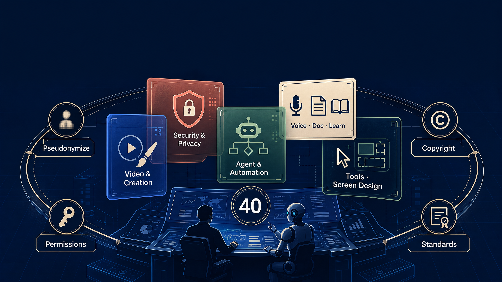

# 2026-11-21 · 도구는 연결하고, 기준은 다시 세운다 · 릴리스 40건

<section class="release-control-room-hero">
  <figure class="release-control-room-hero__figure">
    
    <figcaption>이번 40개 자료를 한 장으로 펼쳐 보면, 새 도구의 숫자보다 연결하고 확인하는 순서가 먼저 보인다.</figcaption>
  </figure>
  

    
FIELD GUIDE · 40 NOTES · 2026.11.21

    <h2>도구는 연결하고, 기준은 다시 세운다</h2>
    
영상·창작부터 에이전트·자동화, 음성·문서, 화면 설계까지 이번 자료를 실제 작업의 흐름으로 다시 묶었다. 편리함이 커질수록 권한·개인정보·저작권을 확인하는 일도 함께 따라온다.

  

  

    
<strong>01 · 연결</strong>도구를 이어 작업 흐름 만들기

    
<strong>02 · 확인</strong>권한·개인정보·조건 살피기

    
<strong>03 · 적용</strong>작은 실험으로 내 일에 붙이기

  

</section>

최근 AI 자료를 40개쯤 한꺼번에 보면 새 도구가 쏟아진다는 인상이 먼저 든다. 그런데 조금 나눠 보면 흐름은 의외로 단순하다. 에이전트는 브라우저와 컴퓨터 바깥으로 나오고 있고, 영상·음성·문서·3D를 만드는 일은 점점 한 작업 흐름으로 이어지고 있다. 그만큼 권한, 개인정보, 저작권을 확인해야 할 자리도 많아졌다.

이번 글에서는 2026년 11월 21일 Readray 미분류 목록에서 최신순으로 고른 40개를 여섯 묶음으로 다시 읽었다. 도구를 소개하는 데서 멈추지 않고 “이걸 어디에 붙여 볼까?”, “어디까지 맡겨도 될까?”라는 질문까지 함께 적어 두었다. 7번은 외부 원본 주소가 없는 업로드 PDF라서, 그 사실도 숨기지 않고 표시했다.

## 이번 목록에서 눈에 들어온 것들

1. **에이전트가 화면 밖으로 나오고 있다.** 브라우저 조작을 넘어 원격 기기와 API 연결까지 이어진다. 그래서 기능보다 먼저 권한과 중단 지점을 정해야 한다.
2. **생성보다 수정과 확인이 중요해지고 있다.** 영상·3D·문서 도구는 결과물을 한 번 뽑아 주는 데서 끝나지 않고, 사람이 다시 고치고 검수하는 흐름을 전제로 한다.
3. **음성·문서·UI는 반복 작업을 줄이는 쪽으로 모인다.** 받아쓰기, HWPX, 화면 부품, 스킬이 따로 있는 것처럼 보여도 결국 같은 일을 다시 하지 않도록 만드는 장치다.
4. **보안과 개인정보는 마지막에 붙이는 옵션이 아니다.** 자료를 넣기 전부터 무엇을 가리고, 어떤 조건을 확인할지 정해야 한다.

그럼 여섯 묶음을 차례로 살펴보자. 관심 가는 항목을 하나 골라 원본과 공개 요약을 나란히 보고, 작은 작업에 붙여 본 뒤 **입력 → 실행 → 결과 → 확인** 네 지점만 기록해도 충분하다.

## 영상과 창작 (4개)

이번 묶음에서 가장 먼저 보이는 건 영상과 3D를 만드는 일도 점점 “말로 지시하고 결과를 고치는” 작업으로 바뀐다는 점이다. 다만 결과가 그럴듯할수록 촬영물의 개인정보와 저작권, 렌더 결과를 더 꼼꼼히 확인해야 한다.

### 1. Claude Video /watch

영상 파일에서 자막과 프레임을 뽑아 Claude가 내용을 읽게 해 주는 도구다. 영상을 직접 보며 요약을 부탁하는 흐름을 코딩 에이전트 쪽으로 가져온 셈이다.

- 원본: [원본 링크](https://github.com/bradautomates/claude-video)
- 공개 요약: [Readray 공개 요약](https://readray.ai/digest/12220631/16157185?noteVersionId=15553234)

### 8. stick-scene

웹 캔버스 위에 막대인형 애니메이션을 만들 수 있게 돕는 스킬이다. 복잡한 작화보다 짧은 설명을 장면으로 바꾸는 실험에 잘 어울린다.

- 원본: [원본 링크](https://github.com/nilbuild/stick-scene)
- 공개 요약: [Readray 공개 요약](https://readray.ai/digest/12202147/16136973?noteVersionId=15531870)

### 15. OpenFilm

코딩 에이전트에게 영상 제작을 맡기고, 결과를 다시 편집할 수 있게 하는 오픈소스 도구다. 생성과 수정이 따로 놀지 않게 하려는 방향이 흥미롭다.

- 원본: [원본 링크](https://github.com/openfilm/openfilm)
- 공개 요약: [Readray 공개 요약](https://readray.ai/digest/12163237/16094032?noteVersionId=15486273)

### 21. 3D Gaussian Splatting 입문

촬영한 영상을 3D 공간으로 바꾸는 입문 자료다. 결과가 멋져 보여도 사람 얼굴·차량번호·촬영 허가부터 먼저 확인해야 한다.

- 원본: [원본 링크](https://www.youtube.com/watch?v=VNPfPrqMWpM)
- 공개 요약: [Readray 공개 요약](https://readray.ai/digest/12139948/16068950?noteVersionId=15459621)

## 보안과 개인정보 (2개)

창작 도구와 자동화 도구가 늘어날수록 자료를 어디까지 넣어도 되는지가 중요해진다. 보호 도구의 성능 주장과 개인정보 처리 기준은 소개 문장만 믿지 말고 원문과 최신 기준을 함께 봐야 한다.

### 2. BLA: AI 역공학 방어

AI가 코드를 분석하는 시대를 거꾸로 바라본 도구다. 역공학 에이전트가 읽기 어렵게 산출물을 보호하는 접근인데, 효과는 원문에 적힌 실험 조건과 함께 봐야 한다.

- 원본: [원본 링크](https://github.com/qybaihe/bla)
- 공개 요약: [Readray 공개 요약](https://readray.ai/digest/12216255/16152284?noteVersionId=15548009)

### 7. 가명정보 처리 가이드라인(2026.03.)

가명정보를 어떻게 만들고 어떤 안전조치를 붙일지 설명하는 334쪽 지침이다. 법률·정책 자료인 만큼 이 글의 요약만으로 판단하지 말고 최신 원문을 기준으로 삼아야 한다.

> **원본 상태:** 7번은 외부 원본 주소가 없는 업로드 PDF다. 공개 요약은 참고용으로 보고, 법적 판단이 필요하면 원문과 최신 기준을 직접 확인해야 한다.

- 원본: 업로드 PDF (외부 주소 없음)
- 공개 요약: [Readray 공개 요약](https://readray.ai/digest/12202230/16137062?noteVersionId=15531951)

## 에이전트와 자동화 (9개)

에이전트의 활동 범위가 브라우저 밖으로 빠르게 넓어지고 있다. 컴퓨터 화면을 읽고, 원격 기기를 조작하고, 웹사이트를 API로 바꾸는 일까지 가능해졌지만, 시작점은 여전히 작고 분명해야 한다. 어떤 권한을 줄지와 어디서 멈출지를 먼저 정하는 편이 안전하다.

### 3. Orca 봇 시작 안내

로컬에서 돌아가는 Orca 봇을 처음 설정하는 사람을 위한 안내서다. 메모리, 작업 공간, 외부 연결을 어떻게 잡는지 살펴볼 수 있다.

- 원본: [원본 링크](https://orca.dev/docs/bots)
- 공개 요약: [Readray 공개 요약](https://readray.ai/digest/12216233/16152264?noteVersionId=15547988)

### 4. agent-browser

접근성 트리를 읽어 브라우저를 조작하는 CLI 도구다. 좌표를 찍는 자동화보다 화면 구조를 기준으로 작업을 설명할 수 있다는 점이 핵심이다.

- 원본: [원본 링크](https://github.com/vercel-labs/agent-browser)
- 공개 요약: [Readray 공개 요약](https://readray.ai/digest/12205327/16140415?noteVersionId=15535520)

### 5. Anthropic Skills 저장소

문서 작성·분석처럼 반복되는 일을 AI에게 맡길 때 참고할 수 있는 스킬 모음이다. 스킬을 새로 만들 때 절차를 어떻게 쪼개는지도 볼 만하다.

- 원본: [원본 링크](https://github.com/anthropics/skills)
- 공개 요약: [Readray 공개 요약](https://readray.ai/digest/12205309/16140390?noteVersionId=15535494)

### 10. Unity Skills

Unity 프로젝트에서 재사용할 수 있는 AI 코딩 스킬 모음이다. 게임 개발에 AI를 붙일 때 매번 같은 설명을 반복하지 않도록 작업 지침을 묶어 둔 형태다.

- 원본: [원본 링크](https://github.com/Unity-Technologies/skills)
- 공개 요약: [Readray 공개 요약](https://readray.ai/digest/12200055/16134705?noteVersionId=15529456)

### 12. Handlus MCP

브라우저와 컴퓨터를 에이전트에 연결하는 MCP다. 편리함만큼이나 어떤 화면과 계정에 접근하는지 먼저 확인해야 한다.

- 원본: [원본 링크](https://handlus.com/ko)
- 공개 요약: [Readray 공개 요약](https://readray.ai/digest/12199986/16134626?noteVersionId=15529374)

### 13. HomeExit

아이폰·아이패드에서 Mac 화면과 터미널을 이어 쓰게 해 주는 원격 도구다. 이동 중에 작업을 이어 가려는 사람이라면 눈여겨볼 만하지만, 원격 접속 권한은 좁게 잡는 편이 안전하다.

- 원본: [원본 링크](https://homeexit-qvy.pages.dev/ko/)
- 공개 요약: [Readray 공개 요약](https://readray.ai/digest/12192795/16126663?noteVersionId=15521053)

### 16. Reverse API Engineer

웹사이트의 통신을 살펴 typed API client로 바꾸는 도구다. 자동화 가능성을 보여 주지만, 대상 서비스가 허용한 범위 안에서 써야 한다.

- 원본: [원본 링크](https://github.com/kalil0321/reverse-api-engineer)
- 공개 요약: [Readray 공개 요약](https://readray.ai/digest/12155797/16085903?noteVersionId=15477644)

### 19. 11월 14일 줌미팅 세미나

11월 14일 세미나 영상으로, 에이전트 운영·게임 개발·모델 비용 이야기를 한 자리에서 다룬다. 도구 소개보다 실제 사용 경험을 듣고 싶을 때 볼 만하다.

- 원본: [원본 링크](https://www.youtube.com/watch?v=3T8BMGuvAUc)
- 공개 요약: [Readray 공개 요약](https://readray.ai/digest/12148844/16078226?noteVersionId=15469476)

### 20. Pomerado

웹사이트를 에이전트가 호출할 수 있는 API나 MCP 연결로 바꾸는 접근이다. 웹을 사람이 클릭하는 화면에서 에이전트가 다루는 인터페이스로 넓혀 간다.

- 원본: [원본 링크](https://github.com/Pomerado/pomerado)
- 공개 요약: [Readray 공개 요약](https://readray.ai/digest/12140156/16069178?noteVersionId=15459869)

## 음성·문서와 학습 (4개)

이 묶음은 AI를 멋진 생성기로 보기보다, 말을 받아 적고 문서를 만들고 자료를 설명하는 보조자로 바라보게 한다. 변환이 끝난 뒤 발음·시간 정렬·문서 서식·출력 결과를 사람이 한 번 더 확인하면 활용도가 크게 올라간다.

### 6. 머딕 한국어 받아쓰기

Mac에서 돌아가는 로컬 음성 모델로 한국어 받아쓰기를 하는 도구다. 말버릇을 정리하는 기능까지 있어 회의 메모나 수업 기록을 다듬을 때 써 볼 만하다.

- 원본: [원본 링크](https://murdic.netlify.app/)
- 공개 요약: [Readray 공개 요약](https://readray.ai/digest/12205261/16140340?noteVersionId=15535443)

### 14. Gemini Notebook 대화형 사이트

자료를 넣으면 시각적 설명이나 대시보드처럼 생긴 대화형 사이트로 만들어 주는 Gemini Notebook 기능 소개다. 설명 자료를 읽는 방식 자체를 바꿔 볼 수 있다.

- 원본: [원본 링크](https://blog.google/innovation-and-ai/products/gemini-notebook/interactive-sites/)
- 공개 요약: [Readray 공개 요약](https://readray.ai/digest/12171775/16103314?noteVersionId=15496333)

### 17. hwpx-docs

HWPX 문서를 만들고 읽고 검사하는 도구다. 한글 문서가 자동으로 만들어졌다고 바로 끝내지 말고, 실제 한글 프로그램에서 열어 출력까지 확인해야 한다.

- 원본: [원본 링크](https://github.com/BlackBuddle/hwpx-docs)
- 공개 요약: [Readray 공개 요약](https://readray.ai/digest/12149709/16079162?noteVersionId=15470467)

### 18. WhisperX

음성을 글로 옮기는 데서 멈추지 않고 단어별 시간과 화자를 맞춰 주는 도구다. 자막을 만들거나 여러 사람이 말한 녹음을 정리할 때 특히 유용하다.

- 원본: [원본 링크](https://github.com/m-bain/whisperX)
- 공개 요약: [Readray 공개 요약](https://readray.ai/digest/12149615/16079060?noteVersionId=15470360)

## 도구와 화면 설계 (2개)

좋은 화면은 매번 새로 그리는 것보다 이미 검증한 부품을 다시 쓰는 편이 오래 간다. UI 카탈로그와 패치 도구를 볼 때는 예쁜 화면뿐 아니라 재사용성과 업데이트 이후의 유지 방법까지 같이 살펴볼 만하다.

### 9. doksam-ui

버튼·표·페이지 같은 UI 부품을 한데 모아 둔 카탈로그다. 화면을 만들 때 매번 처음부터 그리지 않고 검증된 패턴을 다시 꺼내 쓰려는 흐름과 잘 맞는다.

- 원본: [원본 링크](https://github.com/LeeYudok/doksam-ui)
- 공개 요약: [Readray 공개 요약](https://readray.ai/digest/12200087/16134746?noteVersionId=15529501)

### 11. Antigravity 한국어 패치

Antigravity의 한국어 UI 패치와 업데이트 뒤 재적용을 돕는 도구다. 비공식 패치인 만큼 현재 버전과 적용 범위는 설치 전에 확인해야 한다.

- 원본: [원본 링크](https://github.com/pal815/antigravity-ko)
- 공개 요약: [Readray 공개 요약](https://readray.ai/digest/12200032/16134676?noteVersionId=15529425)

## 기존 자료와 연결 (19개)

앞의 자료들이 새 도구의 사용법을 보여 준다면, 여기서는 그 도구가 실제 작업과 어떻게 만나는지 볼 수 있다. 영상 제작, 개인 비서, 로컬 모델, 화면 조작이 서로 떨어진 유행이 아니라 하나의 작업 흐름으로 이어진다는 점이 흥미롭다.

### 22. gemini-skills/skills/gemini-api-cli/SKILL.md at main · google-gemini/gemini-skills · GitHub

Gemini API를 명령줄에서 쓰는 스킬 문서다. 이미지·영상 같은 미디어와 파일을 함께 다루는 자동화 흐름을 만들 때 참고하기 좋다.

- 원본: [원본 링크](https://github.com/google-gemini/gemini-skills/blob/main/skills/gemini-api-cli/SKILL.md)
- 공개 요약: [Readray 공개 요약](https://readray.ai/digest/12133102/16061451?noteVersionId=15451689)

### 23. 영상 편집, 한 번도 안 했습니다 — 글 몇 줄로 6분 영상 만드는 법 | Claude Code 스킬 찾기·설치부터 따라 하기

영상 편집을 해 본 적 없는 사람이 Claude Code와 스킬로 6분짜리 영상을 만드는 과정을 보여 준다. 실제로 따라 할 때는 결과 영상의 사실관계와 자막을 직접 확인해야 한다.

- 원본: [원본 링크](https://www.youtube.com/watch?v=WdbUfo8YX9o)
- 공개 요약: [Readray 공개 요약](https://readray.ai/digest/12132870/16061183?noteVersionId=15451398)

### 24. Aside로 맥북에서 카톡·당근 자동화 끝냈습니다

Aside로 카톡 요약과 당근 매물 검색을 자동화한 사례다. 손이 덜 가는 만큼 메시지와 검색 기록을 어디까지 읽게 할지 먼저 정해야 한다.

- 원본: [원본 링크](https://www.youtube.com/watch?v=LyJBoEKGlxU)
- 공개 요약: [Readray 공개 요약](https://readray.ai/digest/12132787/16061088?noteVersionId=15451294)

### 25. 해외에서 난리난 phone-harness 직접 사용해봤습니다

phone-harness로 스마트폰 화면을 직접 조작해 본 실험이다. 터치 자동화의 가능성과 함께 화면 인식이 흔들리는 순간도 생각하게 한다.

- 원본: [원본 링크](https://www.youtube.com/watch?v=-7akHqSkpzE)
- 공개 요약: [Readray 공개 요약](https://readray.ai/digest/12113789/16040570?noteVersionId=15429521)

### 26. GitHub - storytold/craft-anything: Craft Anything: understand how any software works, and craft your

소프트웨어가 어떻게 움직이는지 분석한 뒤 비슷한 프로그램을 새로 만들어 보는 도구다. 화면을 보고 따라 만드는 방식과 코드를 읽고 재구성하는 방식의 차이를 살펴볼 수 있다.

- 원본: [원본 링크](https://github.com/storytold/craft-anything)
- 공개 요약: [Readray 공개 요약](https://readray.ai/digest/12090435/16014677?noteVersionId=15401859)

### 27. GitHub - vercel-labs/agent-desktop: Computer use CLI for AI agents · GitHub

접근성 트리로 컴퓨터 화면을 읽고 조작하는 CLI다. 화면 좌표에 의존하지 않는 컴퓨터 사용 에이전트가 어떤 모습인지 보여 준다.

- 원본: [원본 링크](https://github.com/vercel-labs/agent-desktop)
- 공개 요약: [Readray 공개 요약](https://readray.ai/digest/12087431/16010917?noteVersionId=15397911)

### 28. 게임 그래픽 용어 총정리 &mdash; 같은 장면, 27가지 얼굴

같은 장면을 여러 그래픽 스타일로 표현하며 게임 그래픽 용어를 정리한 자료다. 원하는 이미지를 AI에게 설명할 때 말이 막히는 사람에게 유용하다.

- 원본: [원본 링크](https://javaexpert.tistory.com/1877)
- 공개 요약: [Readray 공개 요약](https://readray.ai/digest/12079728/16002580?noteVersionId=15388950)

### 29. GitHub - 3dassets-dev/3dassets: Free CC0 GLB models and game asset packs for three.js, Blender, Godo

CC0로 공개된 GLB 모델과 게임 에셋 모음이다. 3D 작업의 시작점을 빠르게 마련할 수 있지만, 개별 에셋의 라이선스 표기는 다시 확인하는 게 좋다.

- 원본: [원본 링크](https://github.com/3dassets-dev/3dassets)
- 공개 요약: [Readray 공개 요약](https://readray.ai/digest/12078095/16000782?noteVersionId=15387032)

### 30. GitHub - microsoft/graphrag: A modular graph-based Retrieval-Augmented Generation (RAG) system · Git

문서 속 사람·조직·사건의 관계를 그래프로 뽑아 검색에 활용하는 GraphRAG 프로젝트다. 자료가 많아질수록 키워드 검색만으로 놓치는 연결을 어떻게 보완할지 보여 준다.

- 원본: [원본 링크](https://github.com/microsoft/graphrag)
- 공개 요약: [Readray 공개 요약](https://readray.ai/digest/12062902/15983072?noteVersionId=15368047)

### 31. 클로드 앱이 완전히 달라졌습니다! '2.0'이라 불리는 핵심 기능 8가지 업무 활용법

Claude 앱의 작업 분할과 결과 공유 같은 기능을 실제 업무에 어떻게 쓰는지 보여 주는 영상이다. 기능 목록보다 여러 작업을 나누어 관리하는 방식에 초점이 있다.

- 원본: [원본 링크](https://www.youtube.com/watch?v=lYCIvhvFkXg)
- 공개 요약: [Readray 공개 요약](https://readray.ai/digest/12062748/15982896?noteVersionId=15367857)

### 32. 뮤즈 뺨치는 AI 비서, 한국이 만들었다 - 김덕진 소장 (IT커뮤니케이션 연구소)

전화와 예약 같은 일을 맡기는 AI 비서 사례를 소개하는 영상이다. 대신 해 주는 범위가 넓어질수록 마지막 확인을 사람에게 남겨야 한다는 점도 함께 보게 된다.

- 원본: [원본 링크](https://www.youtube.com/watch?v=9PjDBbupocc)
- 공개 요약: [Readray 공개 요약](https://readray.ai/digest/12062724/15982872?noteVersionId=15367832)

### 33. earshot/skills/earshot/SKILL.md at main · Leonxlnx/earshot · GitHub

소리를 측정하고 분석하는 에이전트 스킬이다. 음량이나 오디오 품질을 감으로 판단하지 않고 수치로 확인하려는 작업에 연결할 수 있다.

- 원본: [원본 링크](https://github.com/Leonxlnx/earshot/blob/main/skills/earshot/SKILL.md)
- 공개 요약: [Readray 공개 요약](https://readray.ai/digest/12060020/15979771?noteVersionId=15364468)

### 34. GitHub - shinyobjectz/raea: Render Anything Engine: tell your AI what to make. Videos, motion graphi

영상·모션 그래픽·3D를 코드와 AI로 만들 수 있게 하는 렌더링 엔진이다. 만들어 내는 단계뿐 아니라 렌더 결과를 확인하는 과정까지 한 흐름으로 묶으려는 시도가 눈에 띈다.

- 원본: [원본 링크](https://github.com/shinyobjectz/raea)
- 공개 요약: [Readray 공개 요약](https://readray.ai/digest/12059646/15979339?noteVersionId=15363991)

### 35. 내 통화와 카톡, 이메일을 기억하는 AI 비서, 직접 만들어봤습니다.

통화·카톡·이메일을 기억하는 개인 비서를 직접 만든 사례다. 편리함의 대가로 어떤 개인정보를 얼마나 오래 보관할지 고민하게 만드는 자료다.

- 원본: [원본 링크](https://www.youtube.com/watch?v=C4oI-VEeFDo)
- 공개 요약: [Readray 공개 요약](https://readray.ai/digest/12059332/15978977?noteVersionId=15363603)

### 36. 11월 7일 줌미팅 세미나(코너속의 코너:pickle desktop 버전, grill-me, ego-lite vs aside, 쌤글, 김준홍님의 UX 소개, 그밖의 다양한 이야기)

11월 7일 세미나 영상으로, pickle desktop·grill-me·ego-lite·aside·쌤글·UX 이야기까지 여러 주제를 한꺼번에 다룬다. 한 가지 도구보다 당시의 관심사를 훑고 싶을 때 적합하다.

- 원본: [원본 링크](https://www.youtube.com/watch?v=6gVe2yyptWg)
- 공개 요약: [Readray 공개 요약](https://readray.ai/digest/12058695/15978295?noteVersionId=15362872)

### 37. AI 코딩하시면 써보세요. 허더가 무료 앱으로 나왔습니다 [3분 완벽 정리]

여러 코딩 에이전트를 한 화면에서 관리하는 허더 앱 소개 영상이다. 작업을 한곳에서 보고 지시하는 방식이 실제로 내 흐름에 맞는지는 직접 써 봐야 한다.

- 원본: [원본 링크](https://www.youtube.com/watch?v=zpf84UcXcXo)
- 공개 요약: [Readray 공개 요약](https://readray.ai/digest/12058688/15978286?noteVersionId=15362863)

### 38. 맥북으로 로컬에서 돌아가는 자율주행을 만들어봤습니다. 그리고 발견한 놀라운 사실

맥북에서 로컬 자율주행 모델을 돌려 본 실험이다. 모델 자체뿐 아니라 데이터를 모으고 반복해서 개선하는 과정에 시선이 간다.

- 원본: [원본 링크](https://www.youtube.com/watch?v=5R2f9UBa0_c)
- 공개 요약: [Readray 공개 요약](https://readray.ai/digest/12058589/15978181?noteVersionId=15362753)

### 39. Jev 같은 System 1 모델이 오픈 웨이트로 나왔다 — Clef·Laya 를 맥에서 직접 돌려봤습니다

Clef·Laya 같은 오픈 웨이트 모델을 Mac에서 직접 돌려 본 영상이다. 빠르게 반응하는 모델과 복잡한 추론을 맡는 모델을 나눠 쓰는 관점을 보여 준다.

- 원본: [원본 링크](https://www.youtube.com/watch?v=yuFEX-RvQUc)
- 공개 요약: [Readray 공개 요약](https://readray.ai/digest/12058580/15978172?noteVersionId=15362743)

### 40. 스타링크 반값, 사기 전에 꼭 알아야할 것들ㅣ"60일 규칙+QnA"

스타링크 할인과 추천 크레딧의 조건을 설명하는 영상이다. 60일 규칙과 가격은 바뀔 수 있으니, 실제 가입 전에는 공식 안내를 다시 확인해야 한다.

- 원본: [원본 링크](https://www.youtube.com/watch?v=Z7u8djlND9k)
- 공개 요약: [Readray 공개 요약](https://readray.ai/digest/12057970/15977458?noteVersionId=15361981)

## 읽고 나서 바로 해볼 것

- **처음부터 크게 연결하지 않는다.** 문서 한 개, 브라우저 한 개, 테스트 기기 한 대처럼 결과를 확인할 수 있는 범위에서 시작한다.
- **원본과 결과를 나란히 둔다.** 음성·문서·영상·3D 자료는 변환 과정에서 무엇이 달라졌는지 확인할 수 있어야 한다.
- **권한과 조건을 적어 둔다.** 개인정보, 저작권, API 사용 조건, 업데이트 뒤 재적용 여부를 실행 전에 확인한다.
- **중요한 순간에는 사람이 확인한다.** 자동화가 끝난 뒤에만 보는 것이 아니라, 되돌리기 어려운 분기마다 사실과 형식을 점검한다.
- **한 번 써 보고 다음 질문을 남긴다.** 완성된 결과물을 끝으로 보지 말고, 오류와 빈틈을 다음 수업·업무·창작 실험의 질문으로 바꾼다.

## 복사용 링크 표

| 카테고리 | 주제 | 제목 | 원본 링크 | 릴리스 공개 링크 |
|---|---|---|---|---|
| 영상과 창작 | Claude Video /watch | GitHub - bradautomates/claude-video: Give Claude the ability to watch any video. /watch downloads, extracts frames, transcribes, hands it all to Claude. · GitHub | [원본](https://github.com/bradautomates/claude-video) | [공개 요약](https://readray.ai/digest/12220631/16157185?noteVersionId=15553234) |
| 보안과 개인정보 | BLA: AI 역공학 방어 | GitHub - qybaihe/bla: 🛡️ BLA (bla-agents / Blind LLM Agents) — Open-source Blue Defense MCP server & CLI protecting JS/TS, Electron ASAR, WASM, Python, Native Binaries, SQLite, GGUF/Safetensors & Android DEX against AI reverse-engineering agents (REA). · GitHub | [원본](https://github.com/qybaihe/bla) | [공개 요약](https://readray.ai/digest/12216255/16152284?noteVersionId=15548009) |
| 에이전트와 자동화 | Orca 봇 시작 안내 | Bots quickstart — Orca Docs | [원본](https://orca.dev/docs/bots) | [공개 요약](https://readray.ai/digest/12216233/16152264?noteVersionId=15547988) |
| 에이전트와 자동화 | agent-browser | GitHub - vercel-labs/agent-browser: Browser automation CLI for AI agents · GitHub | [원본](https://github.com/vercel-labs/agent-browser) | [공개 요약](https://readray.ai/digest/12205327/16140415?noteVersionId=15535520) |
| 에이전트와 자동화 | Anthropic Skills 저장소 | GitHub - anthropics/skills: Public repository for Agent Skills · GitHub | [원본](https://github.com/anthropics/skills) | [공개 요약](https://readray.ai/digest/12205309/16140390?noteVersionId=15535494) |
| 음성·문서와 학습 | 머딕 한국어 받아쓰기 | 머딕 · Mac에서 쓰는 한국어 받아쓰기 | [원본](https://murdic.netlify.app/) | [공개 요약](https://readray.ai/digest/12205261/16140340?noteVersionId=15535443) |
| 보안과 개인정보 | 가명정보 처리 가이드라인(2026.03.) | 가명정보 처리 가이드라인(2026.03.) | 업로드 PDF: 외부 주소 없음 | [공개 요약](https://readray.ai/digest/12202230/16137062?noteVersionId=15531951) |
| 영상과 창작 | stick-scene | GitHub - nilbuild/stick-scene: Skill to draw stick figure animated visuals · GitHub | [원본](https://github.com/nilbuild/stick-scene) | [공개 요약](https://readray.ai/digest/12202147/16136973?noteVersionId=15531870) |
| 도구와 화면 설계 | doksam-ui | GitHub - LeeYudok/doksam-ui · GitHub | [원본](https://github.com/LeeYudok/doksam-ui) | [공개 요약](https://readray.ai/digest/12200087/16134746?noteVersionId=15529501) |
| 에이전트와 자동화 | Unity Skills | GitHub - Unity-Technologies/skills: A collection of reusable skills for AI coding agents — prompts, slash commands, and tools built for Unity workflows · GitHub | [원본](https://github.com/Unity-Technologies/skills) | [공개 요약](https://readray.ai/digest/12200055/16134705?noteVersionId=15529456) |
| 도구와 화면 설계 | Antigravity 한국어 패치 | GitHub - pal815/antigravity-ko: Natural Korean UI localization patch and update-resilient smart launcher for Antigravity 2.0 Desktop App (Windows) · GitHub | [원본](https://github.com/pal815/antigravity-ko) | [공개 요약](https://readray.ai/digest/12200032/16134676?noteVersionId=15529425) |
| 에이전트와 자동화 | Handlus MCP | Handlus MCP(핸들러스): 클로드코드·코덱스가 내 브라우저(크롬 · 엣지 · 웨일)부터 컴퓨터까지 조작합니다 | [원본](https://handlus.com/ko) | [공개 요약](https://readray.ai/digest/12199986/16134626?noteVersionId=15529374) |
| 에이전트와 자동화 | HomeExit | HomeExit: 내 Mac 작업을 손 닿는 곳에 | [원본](https://homeexit-qvy.pages.dev/ko/) | [공개 요약](https://readray.ai/digest/12192795/16126663?noteVersionId=15521053) |
| 음성·문서와 학습 | Gemini Notebook 대화형 사이트 | Turn Gemini Notebook sources into interactive sites | [원본](https://blog.google/innovation-and-ai/products/gemini-notebook/interactive-sites/) | [공개 요약](https://readray.ai/digest/12171775/16103314?noteVersionId=15496333) |
| 영상과 창작 | OpenFilm | GitHub - openfilm/openfilm: The open source AI video agent: turns any coding agent into a video agent, with editors to change anything it makes. · GitHub | [원본](https://github.com/openfilm/openfilm) | [공개 요약](https://readray.ai/digest/12163237/16094032?noteVersionId=15486273) |
| 에이전트와 자동화 | Reverse API Engineer | GitHub - kalil0321/reverse-api-engineer: Reverse engineer any website into a typed API client. Works with Claude Code, Codex, Cursor and OpenCode. · GitHub | [원본](https://github.com/kalil0321/reverse-api-engineer) | [공개 요약](https://readray.ai/digest/12155797/16085903?noteVersionId=15477644) |
| 음성·문서와 학습 | hwpx-docs | GitHub - BlackBuddle/hwpx-docs: Make, read, check and preview Hancom Office Hangul HWPX (OWPML, KS X 6101) documents - Claude Code plugin · GitHub | [원본](https://github.com/BlackBuddle/hwpx-docs) | [공개 요약](https://readray.ai/digest/12149709/16079162?noteVersionId=15470467) |
| 음성·문서와 학습 | WhisperX | GitHub - m-bain/whisperX: WhisperX: Automatic Speech Recognition with Word-level Timestamps (& Diarization) · GitHub | [원본](https://github.com/m-bain/whisperX) | [공개 요약](https://readray.ai/digest/12149615/16079060?noteVersionId=15470360) |
| 에이전트와 자동화 | 11월 14일 줌미팅 세미나 | 11월 14일 줌미팅 세미나 | [원본](https://www.youtube.com/watch?v=3T8BMGuvAUc) | [공개 요약](https://readray.ai/digest/12148844/16078226?noteVersionId=15469476) |
| 에이전트와 자동화 | Pomerado | GitHub - Pomerado/pomerado: YC F26. Turn any website into an API / MCP in minutes. Open source core integration minting harness. MIT. · GitHub | [원본](https://github.com/Pomerado/pomerado) | [공개 요약](https://readray.ai/digest/12140156/16069178?noteVersionId=15459869) |
| 영상과 창작 | 3D Gaussian Splatting 입문 | 3D Gaussian Splatting 입문 | [원본](https://www.youtube.com/watch?v=VNPfPrqMWpM) | [공개 요약](https://readray.ai/digest/12139948/16068950?noteVersionId=15459621) |
| 기존 자료와 연결 | gemini-skills/skills/gemini-api-cli/SKILL.md at main · google-gemini/gemini-skills · GitHub | gemini-skills/skills/gemini-api-cli/SKILL.md at main · google-gemini/gemini-skills · GitHub | [원본](https://github.com/google-gemini/gemini-skills/blob/main/skills/gemini-api-cli/SKILL.md) | [공개 요약](https://readray.ai/digest/12133102/16061451?noteVersionId=15451689) |
| 기존 자료와 연결 | 영상 편집, 한 번도 안 했습니다 — 글 몇 줄로 6분 영상 만드는 법 \| Claude Code 스킬 찾기·설치부터 따라 하기 | 영상 편집, 한 번도 안 했습니다 — 글 몇 줄로 6분 영상 만드는 법 \| Claude Code 스킬 찾기·설치부터 따라 하기 | [원본](https://www.youtube.com/watch?v=WdbUfo8YX9o) | [공개 요약](https://readray.ai/digest/12132870/16061183?noteVersionId=15451398) |
| 기존 자료와 연결 | Aside로 맥북에서 카톡·당근 자동화 끝냈습니다 | Aside로 맥북에서 카톡·당근 자동화 끝냈습니다 | [원본](https://www.youtube.com/watch?v=LyJBoEKGlxU) | [공개 요약](https://readray.ai/digest/12132787/16061088?noteVersionId=15451294) |
| 기존 자료와 연결 | 해외에서 난리난 phone-harness 직접 사용해봤습니다 | 해외에서 난리난 phone-harness 직접 사용해봤습니다 | [원본](https://www.youtube.com/watch?v=-7akHqSkpzE) | [공개 요약](https://readray.ai/digest/12113789/16040570?noteVersionId=15429521) |
| 기존 자료와 연결 | GitHub - storytold/craft-anything: Craft Anything: understand how any software works, and craft your | GitHub - storytold/craft-anything: Craft Anything: understand how any software works, and craft your | [원본](https://github.com/storytold/craft-anything) | [공개 요약](https://readray.ai/digest/12090435/16014677?noteVersionId=15401859) |
| 기존 자료와 연결 | GitHub - vercel-labs/agent-desktop: Computer use CLI for AI agents · GitHub | GitHub - vercel-labs/agent-desktop: Computer use CLI for AI agents · GitHub | [원본](https://github.com/vercel-labs/agent-desktop) | [공개 요약](https://readray.ai/digest/12087431/16010917?noteVersionId=15397911) |
| 기존 자료와 연결 | 게임 그래픽 용어 총정리 &mdash; 같은 장면, 27가지 얼굴 | 게임 그래픽 용어 총정리 &mdash; 같은 장면, 27가지 얼굴 | [원본](https://javaexpert.tistory.com/1877) | [공개 요약](https://readray.ai/digest/12079728/16002580?noteVersionId=15388950) |
| 기존 자료와 연결 | GitHub - 3dassets-dev/3dassets: Free CC0 GLB models and game asset packs for three.js, Blender, Godo | GitHub - 3dassets-dev/3dassets: Free CC0 GLB models and game asset packs for three.js, Blender, Godo | [원본](https://github.com/3dassets-dev/3dassets) | [공개 요약](https://readray.ai/digest/12078095/16000782?noteVersionId=15387032) |
| 기존 자료와 연결 | GitHub - microsoft/graphrag: A modular graph-based Retrieval-Augmented Generation (RAG) system · Git | GitHub - microsoft/graphrag: A modular graph-based Retrieval-Augmented Generation (RAG) system · Git | [원본](https://github.com/microsoft/graphrag) | [공개 요약](https://readray.ai/digest/12062902/15983072?noteVersionId=15368047) |
| 기존 자료와 연결 | 클로드 앱이 완전히 달라졌습니다! '2.0'이라 불리는 핵심 기능 8가지 업무 활용법 | 클로드 앱이 완전히 달라졌습니다! '2.0'이라 불리는 핵심 기능 8가지 업무 활용법 | [원본](https://www.youtube.com/watch?v=lYCIvhvFkXg) | [공개 요약](https://readray.ai/digest/12062748/15982896?noteVersionId=15367857) |
| 기존 자료와 연결 | 뮤즈 뺨치는 AI 비서, 한국이 만들었다 - 김덕진 소장 (IT커뮤니케이션 연구소) | 뮤즈 뺨치는 AI 비서, 한국이 만들었다 - 김덕진 소장 (IT커뮤니케이션 연구소) | [원본](https://www.youtube.com/watch?v=9PjDBbupocc) | [공개 요약](https://readray.ai/digest/12062724/15982872?noteVersionId=15367832) |
| 기존 자료와 연결 | earshot/skills/earshot/SKILL.md at main · Leonxlnx/earshot · GitHub | earshot/skills/earshot/SKILL.md at main · Leonxlnx/earshot · GitHub | [원본](https://github.com/Leonxlnx/earshot/blob/main/skills/earshot/SKILL.md) | [공개 요약](https://readray.ai/digest/12060020/15979771?noteVersionId=15364468) |
| 기존 자료와 연결 | GitHub - shinyobjectz/raea: Render Anything Engine: tell your AI what to make. Videos, motion graphi | GitHub - shinyobjectz/raea: Render Anything Engine: tell your AI what to make. Videos, motion graphi | [원본](https://github.com/shinyobjectz/raea) | [공개 요약](https://readray.ai/digest/12059646/15979339?noteVersionId=15363991) |
| 기존 자료와 연결 | 내 통화와 카톡, 이메일을 기억하는 AI 비서, 직접 만들어봤습니다. | 내 통화와 카톡, 이메일을 기억하는 AI 비서, 직접 만들어봤습니다. | [원본](https://www.youtube.com/watch?v=C4oI-VEeFDo) | [공개 요약](https://readray.ai/digest/12059332/15978977?noteVersionId=15363603) |
| 기존 자료와 연결 | 11월 7일 줌미팅 세미나(코너속의 코너:pickle desktop 버전, grill-me, ego-lite vs aside, 쌤글, 김준홍님의 UX 소개, 그밖의 다양한 이야기) | 11월 7일 줌미팅 세미나(코너속의 코너:pickle desktop 버전, grill-me, ego-lite vs aside, 쌤글, 김준홍님의 UX 소개, 그밖의 다양한 이야기) | [원본](https://www.youtube.com/watch?v=6gVe2yyptWg) | [공개 요약](https://readray.ai/digest/12058695/15978295?noteVersionId=15362872) |
| 기존 자료와 연결 | AI 코딩하시면 써보세요. 허더가 무료 앱으로 나왔습니다 [3분 완벽 정리] | AI 코딩하시면 써보세요. 허더가 무료 앱으로 나왔습니다 [3분 완벽 정리] | [원본](https://www.youtube.com/watch?v=zpf84UcXcXo) | [공개 요약](https://readray.ai/digest/12058688/15978286?noteVersionId=15362863) |
| 기존 자료와 연결 | 맥북으로 로컬에서 돌아가는 자율주행을 만들어봤습니다. 그리고 발견한 놀라운 사실 | 맥북으로 로컬에서 돌아가는 자율주행을 만들어봤습니다. 그리고 발견한 놀라운 사실 | [원본](https://www.youtube.com/watch?v=5R2f9UBa0_c) | [공개 요약](https://readray.ai/digest/12058589/15978181?noteVersionId=15362753) |
| 기존 자료와 연결 | Jev 같은 System 1 모델이 오픈 웨이트로 나왔다 — Clef·Laya 를 맥에서 직접 돌려봤습니다 | Jev 같은 System 1 모델이 오픈 웨이트로 나왔다 — Clef·Laya 를 맥에서 직접 돌려봤습니다 | [원본](https://www.youtube.com/watch?v=yuFEX-RvQUc) | [공개 요약](https://readray.ai/digest/12058580/15978172?noteVersionId=15362743) |
| 기존 자료와 연결 | 스타링크 반값, 사기 전에 꼭 알아야할 것들ㅣ"60일 규칙+QnA" | 스타링크 반값, 사기 전에 꼭 알아야할 것들ㅣ"60일 규칙+QnA" | [원본](https://www.youtube.com/watch?v=Z7u8djlND9k) | [공개 요약](https://readray.ai/digest/12057970/15977458?noteVersionId=15361981) |

## 용어 정리

| 용어 | 쉬운 설명과 예 |
|---|---|
| AI 에이전트 | 목표를 받아 도구를 쓰며 일을 진행하는 프로그램. 예: 웹 자료를 찾아 표로 정리하기. |
| 스킬 | 반복 작업에 필요한 절차와 자료를 묶은 지침. 예: 회의록을 같은 형식으로 정리하는 안내서. |
| MCP | AI가 다른 도구와 데이터를 연결할 때 쓰는 약속. 예: AI가 문서 검색 도구를 호출하기. |
| API | 프로그램끼리 기능이나 데이터를 주고받는 창구. 예: 앱이 날씨 정보를 요청하기. |
| 가명정보 | 추가 정보가 없으면 특정 사람을 알아보기 어렵게 처리한 정보. 예: 이름 대신 임의 번호를 사용하는 자료. |
| 3D Gaussian Splatting | 사진이나 영상의 정보를 작은 점들로 표현해 입체 장면을 만드는 방법. 예: 골목을 촬영해 3D 공간으로 보기. |
| UI 카탈로그 | 화면의 버튼과 표 등 부품을 모아 둔 목록. 예: 여러 페이지에서 같은 모양의 버튼을 쓰기. |

## 마무리

이번 40개를 관통하는 변화는 AI가 갑자기 모든 일을 대신하게 됐다는 이야기가 아니다. 자료를 읽고, 도구를 연결하고, 결과를 고치고, 마지막 판단을 사람에게 돌려주는 흐름이 조금씩 구체적인 형태를 갖추고 있다는 쪽에 가깝다.

그러니 새 도구를 하나 더 설치하기 전에 지금 하고 있는 일에서 가장 번거로운 한 구간만 골라 보자. 문서 정리인지, 영상 확인인지, 반복되는 화면 작업인지 정한 뒤 작은 범위에서 연결하고, 결과를 직접 확인하면 된다. 이번 40선은 그 첫 실험을 고르는 참고표로 보면 충분하다.
